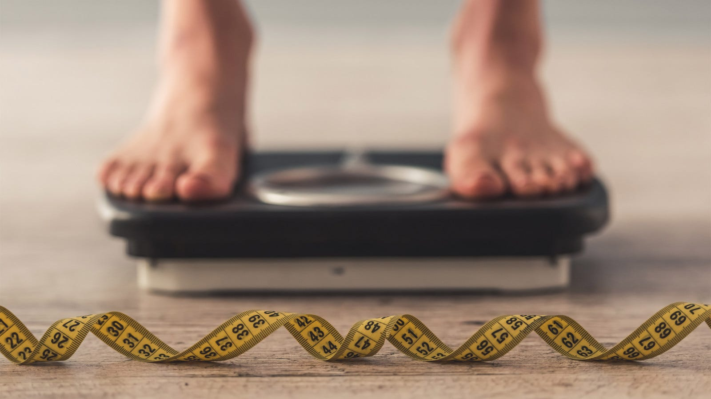
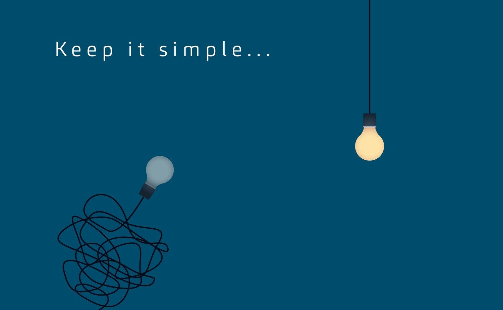
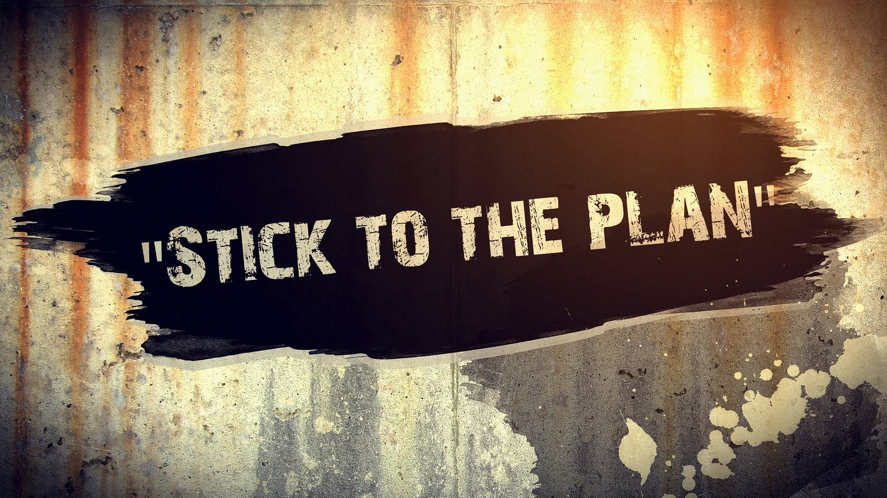
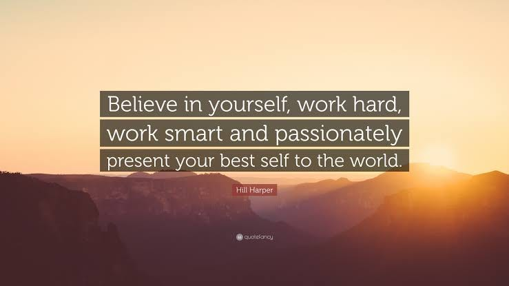
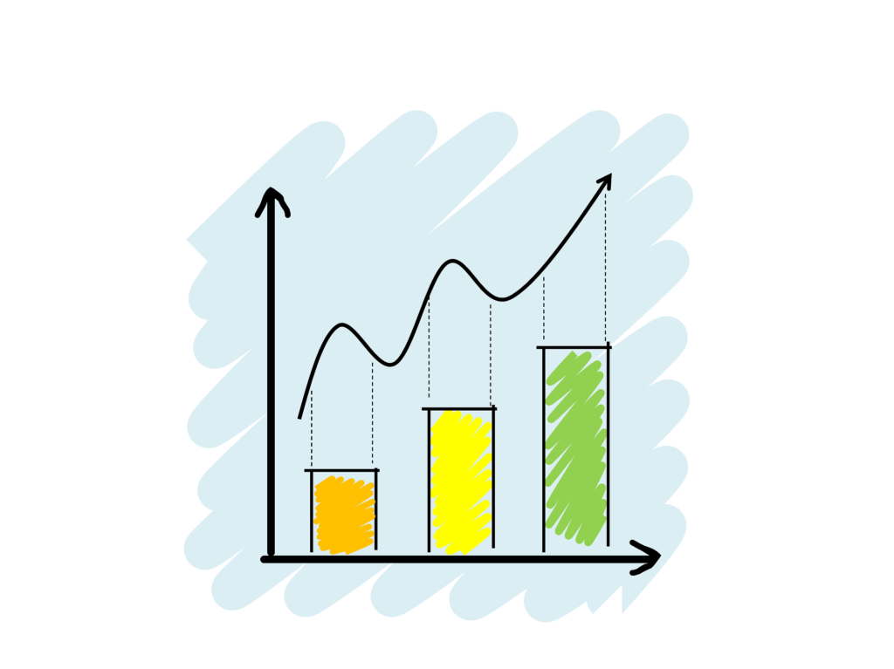
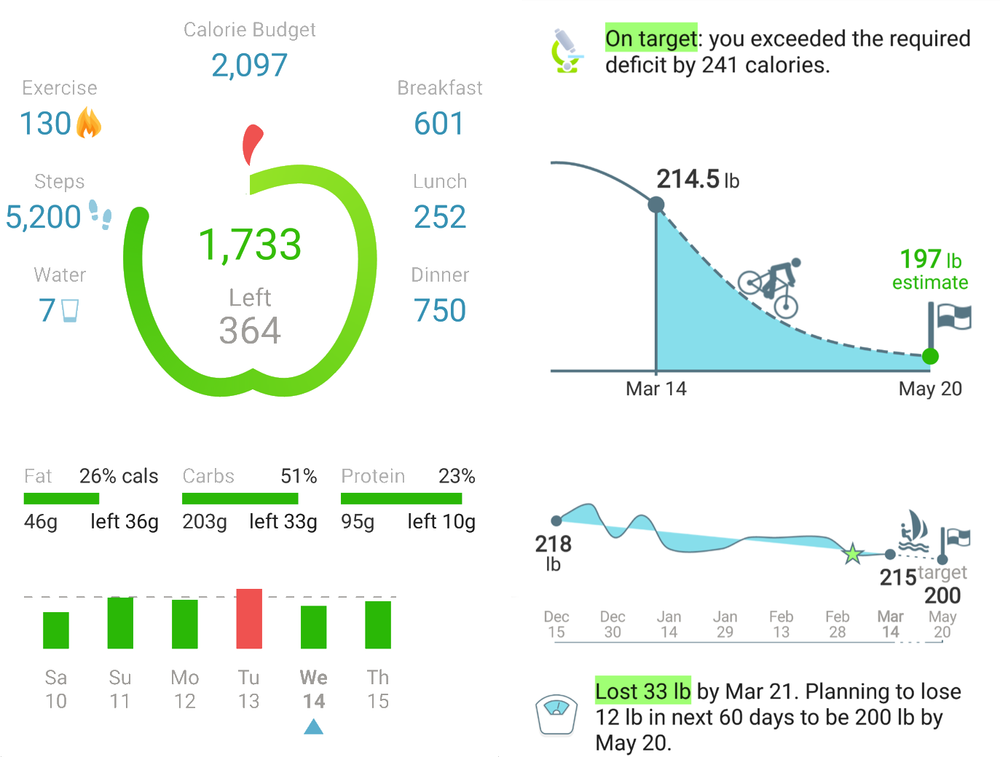
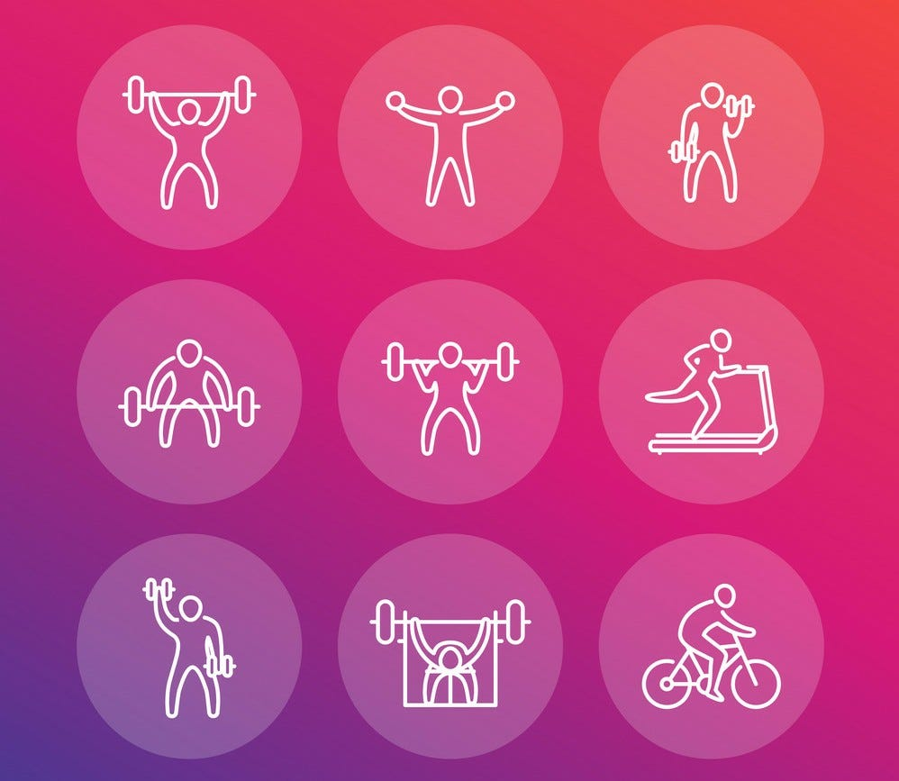
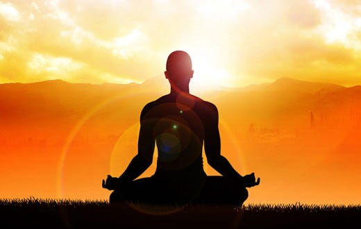
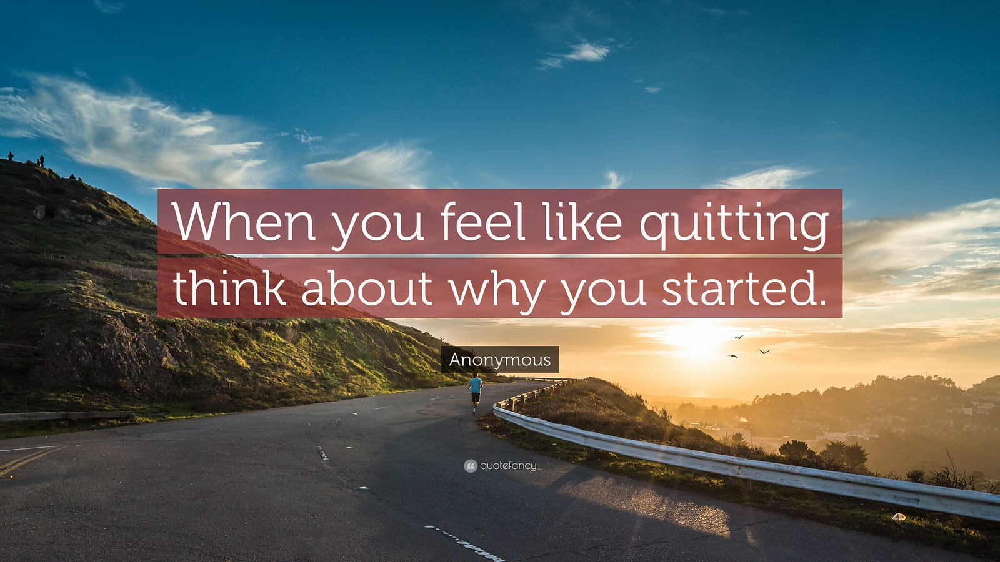

---

**Tldr — Eat less, move more, meditate**

I’m always fascinated by what the human bodies are capable of if given the right inputs. Our bodies are our lifelong partners and the way we treat them defines the wellness of our being.

We all know this as a matter of fact but somewhere in our daily lives we end up neglecting our body and it’s immense potential to heal itself remains unused.

Since I was 16 I wanted to lose that extra fat of mine and look overall fit. Fast forward a decade and I only managed to gain more. I tried working out like hell, there were times I would burn 1k calories a day for months but barely lose a kilo. I just wasn’t seeing the results. In the process I gained some decent muscle just to lose it all again. All these efforts, though, created an immense interest in working out and I became friends with people with a similar mindset. That for me had become one of my greatest asset.

So what did I do differently this time? Let’s delve right into it-

- **Uncomplicate things :** When hard work isn’t working then taking a step back helps. Although I was working out harder few years back than what I do today, that effort was mostly masked by my eating habits and inconsistency. I was just not putting efforts in the right direction, almost becoming blind to the answer right in front of me

- **Make a plan and stick to it :** Weight loss, muscle gain or overall fitness, if you want to achieve it you need to have a measurable target. And it needs to be realistic. Eg. Losing 0.5 kg fat per week, gaining 0.5kg muscle per month. You need to accept and appreciate the fact that results take time

- **Work smart and hard :** When it comes to getting fit, 70% of the effort is from your diet, rest 20% sleep and less than 10% your workout. Most of us, including me, have a bias to think it’s the other way around. The objective of workout is again not to burn fat but to avoid losing muscles while you’re burning fat due to caloric deficit. We’ll discuss this on more detail below

- **It’s all in the numbers :** First, identify your basal metabolic rate — calories your body burns at rest. This [website](https://tdeecalculator.net/) helps calculate the same. Next you need to create a caloric deficit, that is, eat less than your BMR, but how much less, that depends on your goal. If your objective is to lose 0.5 kg/day then the deficit you need is 3.5k calories a week which is approximately 500 calories a day. That’s it, so if your BMR is 1800 calories, you should eat not more than 1300 calories a day

- **Track and track :** Ican’t stress enough on how important it is to come up with a diet plan that suits your lifestyle and your weight loss goals. It’s important to eat more proteins ~2gm/kg body weight and reduce the carbs, less than 100g per day. Proteins help since they are difficult to digest hence leave you feeling full for a long time after the meal and hence you crave less for snacks, they also ensure that you don’t lose muscle. Carbs if taken in moderation help. Since they give you the energy you need during workout it’s recommended to have them an hour before hitting the gym. You can compensate the lower carb intake by adding some healthy fats like Mayonnaise, peanut butter etc. Lastly fibre, our body needs at least 30g fibre to have good motions and since we are cutting carbs we reduce fibre intake. It’s best to have fibre supplements like Psyllium Husk, Flax seeds etc. It’s also a good habit to have a heavy breakfast and lighter dinner and have 5 meals thought the day. Track every single food item you eat. It might be 2 peanuts, or one carrot, or a biscuit but however miniscular you think that item is track it in some app. There are many apps like Healthifyme, Myfitnesspal etc. that help here

- **Sleep :** Ifyou’re not getting enough sleep then all that weight loss diet is in vain, since sleep directly affects your metabolism. Lack of sleep produces hunger hormones and you end up craving for snacks. Also, good sleep helps relive body strain from all the workout you did in the day and recharges the body for the next day. You should sleep at least 7hrs/day

- **Stay hydrated and take less stress :** Every time I craved for snacks I was either thirsty or was under stress. Drinking water ends the cravings most of the times. If you’re stressed it’s said that the rational part of your brain is suppressed and you end up succumbing to your cravings. Meditation helps a lot in handling stress. We’ll discuss this in more detail below

- **Workout :** If diet and sleep alone can help in weight loss, why is workout needed? On a weight loss diet your body is basically consuming itself to obtain that extra energy for basal metabolism. This can come from burning both fat and muscle. Now, if you don’t engage your muscle enough your body will end up using them for energy and you’ll incur muscle loss. Workout is needed if you want to maintain those hard earned muscle tissues. Again, you are very likely to lose upto 5% of your muscle while reducing your fat percentage by 10% points but workout will help keep the number to minimum

- **Meditate :** It’s very easy to come up with a plan but you need to stick to it for long to see significant results. Getting fit is not that difficult. In the end it’s just a sum of small efforts repeated consistently day in and day out. Having a calm mind helps. There are a plethora of reasons that will force you to quit but if you have a slight command on your head it’ll help you restrain those thoughts. I’ll admit that I gave up multiple times but meditation helped me bounce back up. It’s very surprising that 10 mins of time a day can help you clear your mind and think straight. I’ll admit here that I haven’t been very consistent with meditation recently, but whenever I feel like I’m stressing out, I sit in a quiet place, close my eyes and have some Headspace. It’s been one of the most significant contributor in helping me stick to my routine. It teaches you how to detach yourself in any situation and bring a sense of peace to your mind
- **Online resources :** There’s a plethora of resources available online for any minor queries you have. YouTube channels like Fittuber, Calisthenicmovement, Officialthenx are just a few of them. You just need to use your common sense to filter out quality content

- **You need to find a reason :** It’s like a guardian angel for your target. It lifts you up in your darkest time. I can’t put it in words because it’s something that hugely varies person to person

I strongly believe that fitness isn’t just a simple journey-destination kind of setup but rather a way of life. It’s also about creating and sharing stories that you experience. It’s the like minded people you befriend. It’s about worshiping the great gift nature has given you — your body. It’s about being grateful for being able to push your body to it’s limits. And a body that has been pushed to it’s limits has a lot of stories to tell ☺

To begin with, all you need is a drive to be a better version of yourself, everyday!

\**Disclaimer — I’m not a qualified fitness person. The numbers above are just something that worked out for me.*
