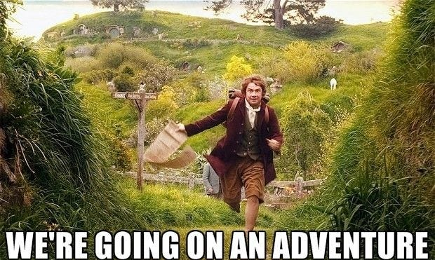
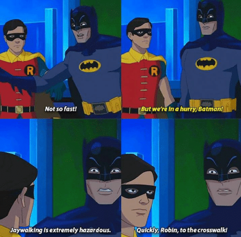
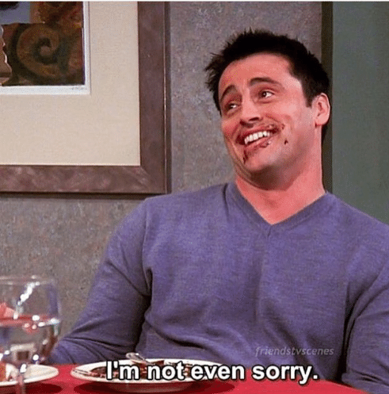
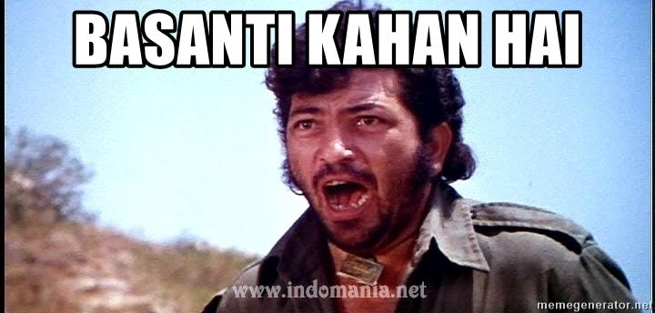
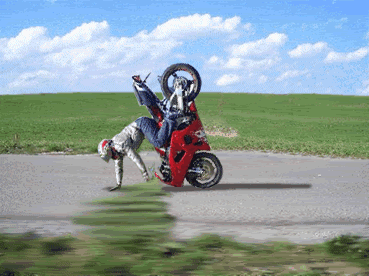
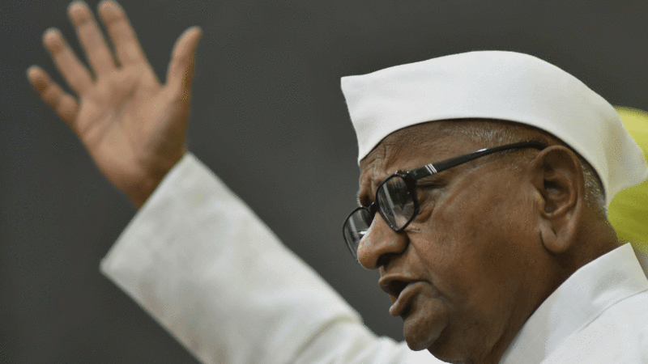
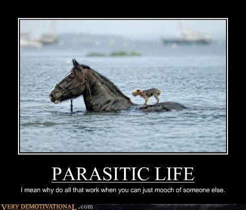
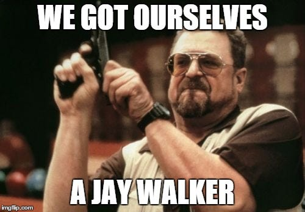
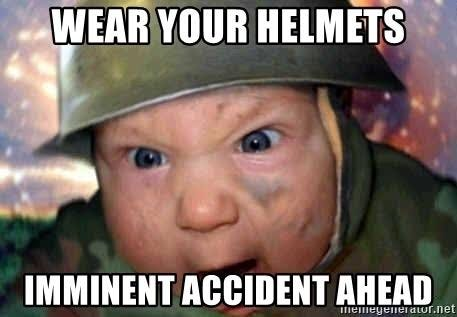

---

A wise man once said “At least once in your lifetime, do something that scares the shit out of you! Overcoming that fear will help you see life with a new angle! Blah blah”

If you’re reading this article then I guess you have a fair idea what it’s going to be about. Bangalore traffic, Jay walking, why crossing roads is a nightmare, few tips for newbies to cross roads, act of goodness while crossing roads, exchanging middle fingers and some occasional accidents.

In the following section, I’ll be attempting to list down some of my experiences while crossing road on a daily basis -

- **The judgemental jaywalker(JJ)** : Off the bat, I’d want to put forth this point that I judge everyone on road who’s acting outside standard operating procedures(sop). By sop, I don’t mean the rules laid out by government because comparing to them would be “evil”, my sop is just based on a simple logic — there’s nothing to gain by excessive hurry and unnecessary revving, at most you’ll reach few minutes earlier, just leave early from home instead? It’s pretty funny to make the JJ lens ON everyday and walk around judging the hell out of every random stranger you come across. Makes the daily commute interesting

- **Joey doesn’t share his car!** — You throw a stone randomly in Bangalore traffic and there’s 30% chance that it’ll hit a car that has only one person in it. If I were to force all these people to come together and share rides — not unreasonable considering the success of Quick ride — there’s definite goodness that may be observed in traffic congestion. I know Joey, you want to use that pretty car or it’ll catch rust, but at least once a week try public transport, maybe?

- **Is bus se tum mat utarna Basanti!** — In an ideal world, every bus waits at its dedicated bus stop and Basanti gets off with a happy face. Bangalore bikers have come up with creative ways to make sure even this sop gets tossed out. I mean while a person is getting of the bus, a biker would come from opposite end honking on the highest decibel until that person gets scared and re-enters the same bus he got off. Point 1. You’re not allowed to cross a bus from left side Point 2. If you were to do it and get injured it won’t be the responsibility of the bus driver Point 3. How difficult is it to be a little patient and allow people to get in/off the bus while it’s docked in the bus stop? My solution to this — Main utrega, tu chadha gadi mere pe! — it works most of the times

- **My bike was born with one tyre**— Outer ring road has been the training centre for many South Indian stuntmen, or at least it appears so based on the number of kids driving their scooties on a single tyre. Didn’t they add 2 tyres for a reason? But hey, where’s the fun in driving like normal people?

- **The Anna Hazare** — He’s the masiha of jaywalkers. He’s the one who stands up in the face of revving bikes and cars and makes them stand still with a single show of hand. His hand can stop a tsunami if he were to try. He’s the one who leads jaywalkers. All hail the daily Anna Hazare’s who help countless people cross the road!

- **The parasites** — We like playing safe! We bunch up and become a single organism. Then take hesitant steps towards the traffic, some random biker or car makes a brief pause. The organism grasps the chance and makes a leap of faith. Sometimes Anna Hazare comes to rescue. But legend has it that the parasite has never had any casualty while crossing. We have the highest success rate in sending people to the other side in one piece. Join us and live the rest of your life happily jaywalking. We also have occasional promotions where one of us becomes confident enough to take the reins of Anna Hazare. But we live by a simple rule — Anna tum age badho…hum tumhare saye hain!

- **The one with reverse ADHD** — ADHD people have difficulty in correlating the speed, distance and time of a projectile, as made famous by Taare Zameen Par. Opposite of this, what I’m casually calling reverse ADHD, is when people can identify even the slightest hint of crossing their bike/car in front of a horde of parasites crossing the road. They live on a simple principle — they see parasites crossing the road, they suddenly get enlightened on how important their time is, they do the speed, distance, time calculation of both their bike/car and jaywalkers, they add additional elements of instilling fear in jaywalkers by revving their vehicles and then they close their eyes and zoom past the parasites. Meanwhile the parasites look up to Anna Hazare who’s equally bewildered!

- **The false safe zone** — So you crossed the main road and entered the service road? You take a sigh of breath thinking you’re safe and can cross this service road with ease. Little you knew that service roads are two way in Bangalore! You attempt to cross and hear a horn right behind your head which is enough to scare and freeze you where you’re standing. Remember to check both sides my dear parasites!

- **Rip foot path** — Want to hear a one worded joke? Footpath! Well it’s the path that’s taken by cyclists and enlightened bikers for evading the sop followers. Whatever is left is taken up by damaged manholes and mud, if there’s anything left, people walk on it!

Again, what I’ve written above is just an exaggeration of what I come across everyday. It actually makes the start of day interesting and amusing.

But setting the fun part aside, please be patient dear Bangalore traffic. Few minutes of delay won’t make much difference in your life!

And to all my fellow jaywalkers, be like parasites!

