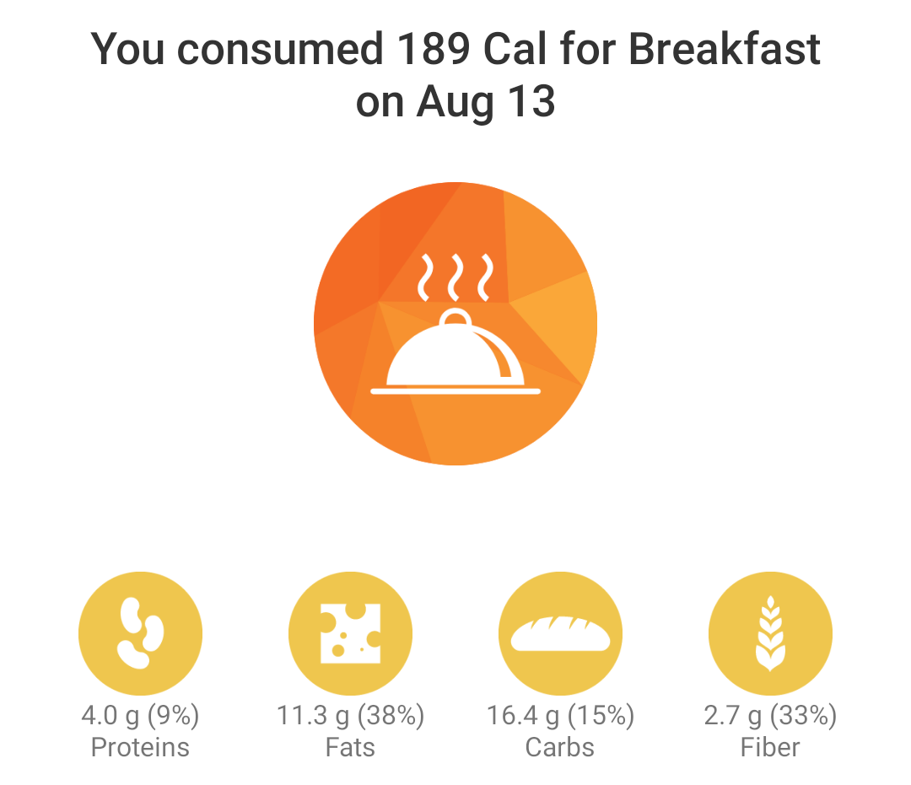
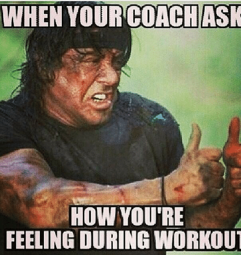
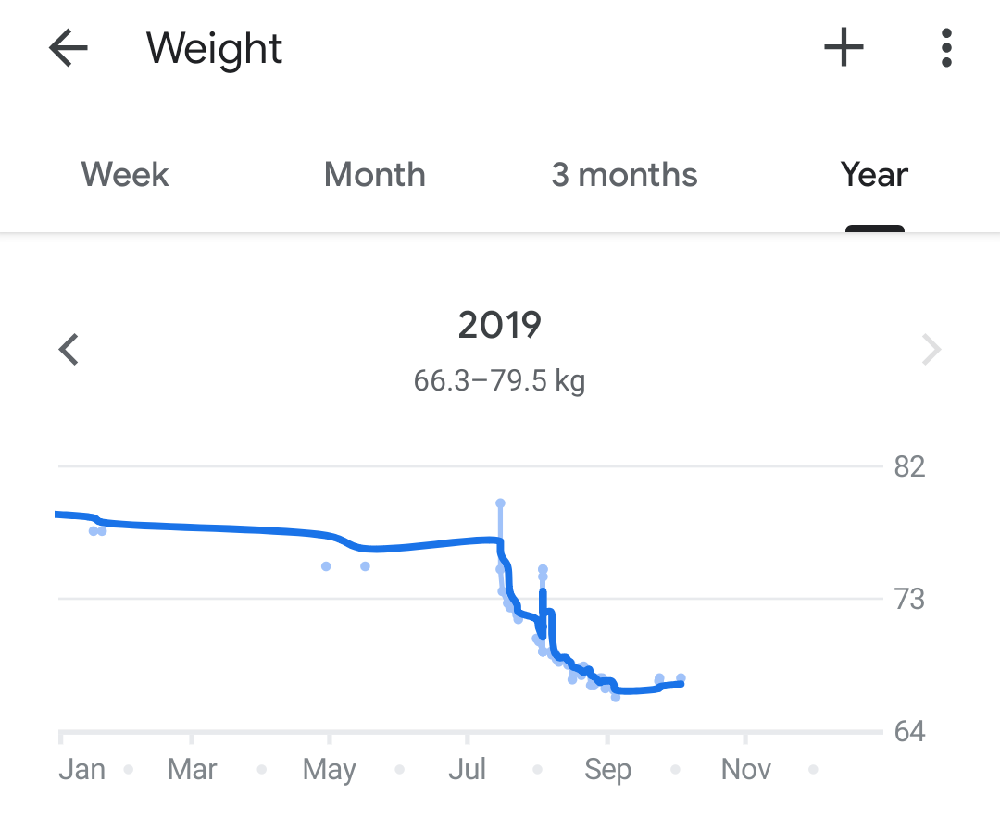
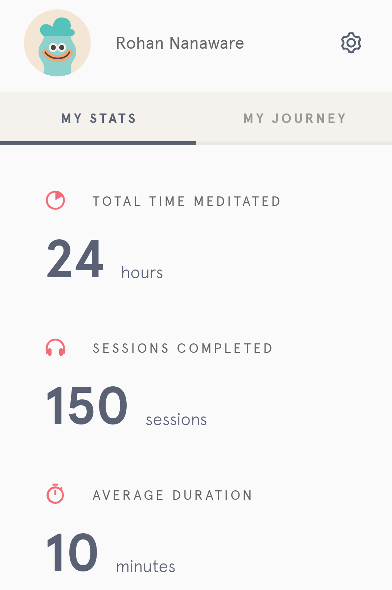
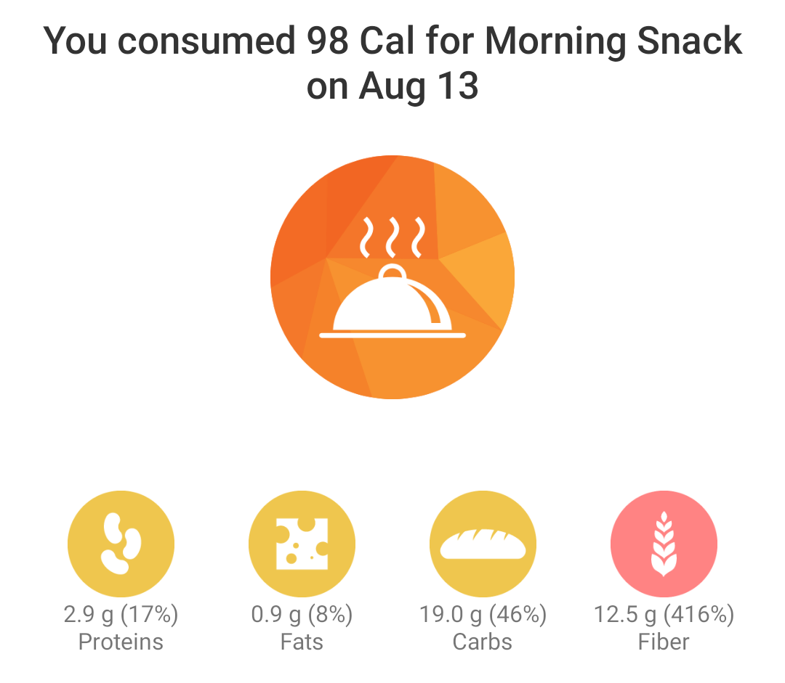
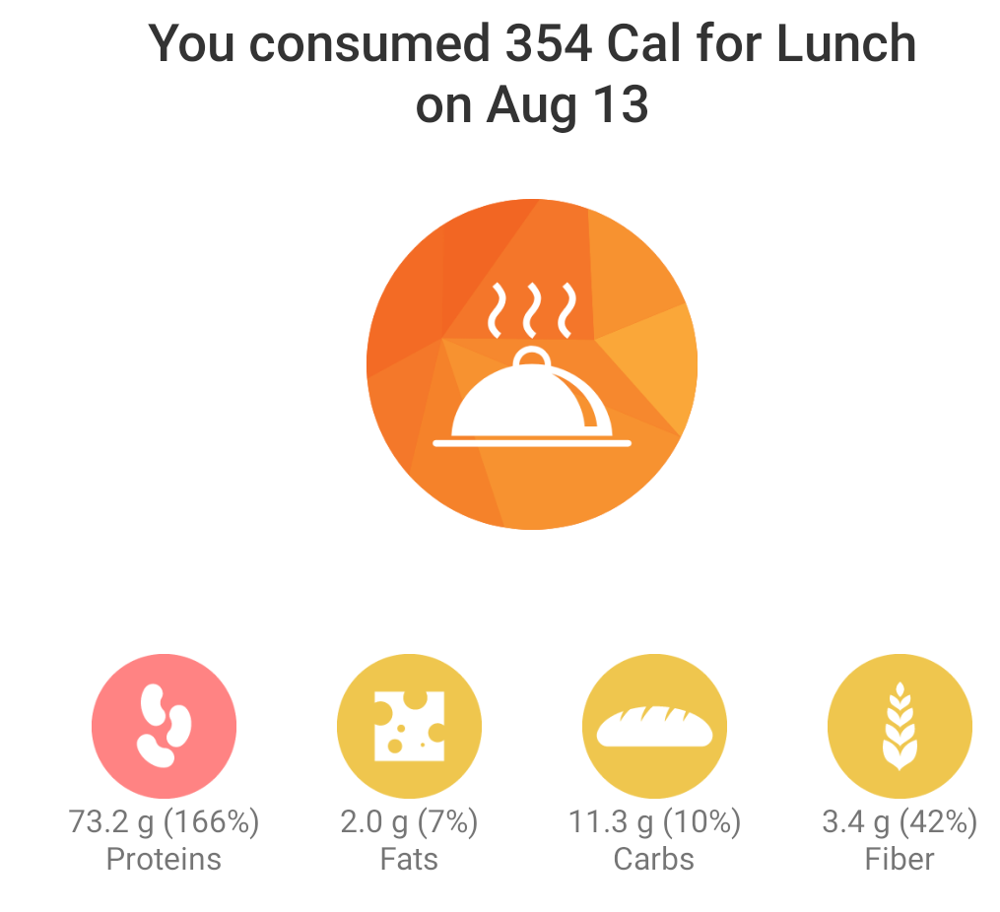
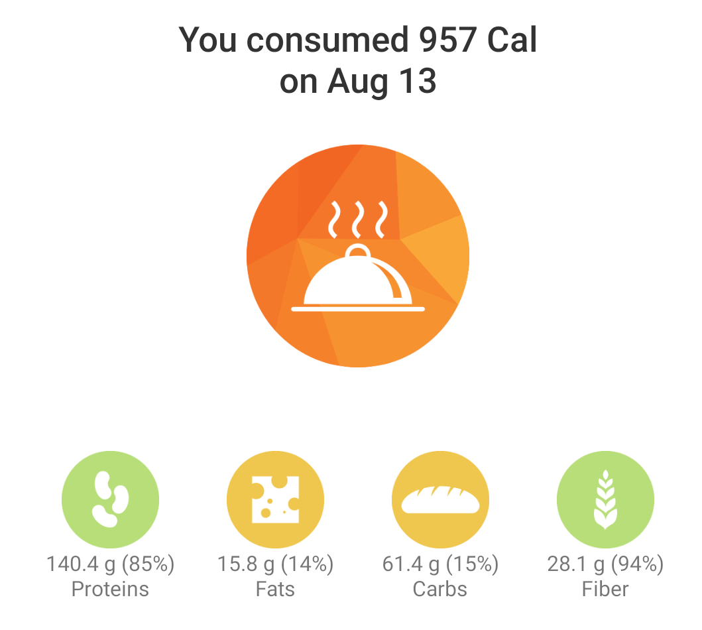
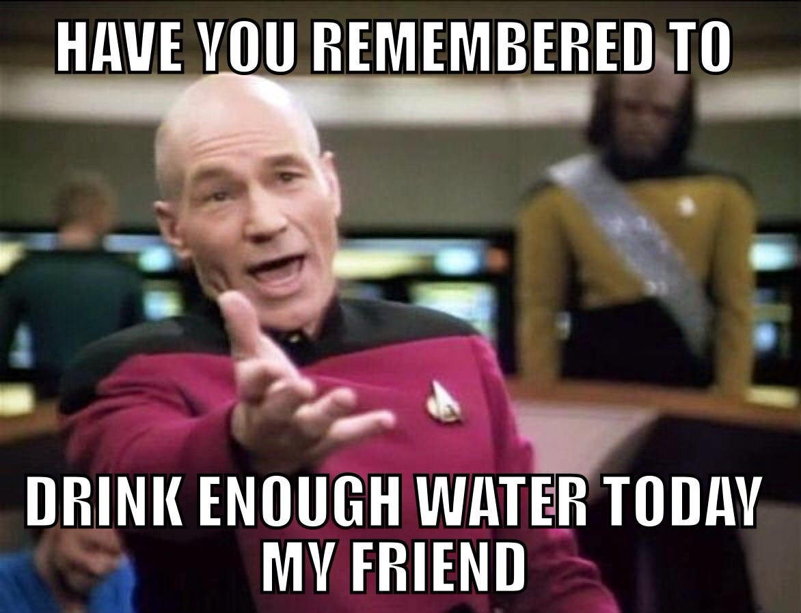
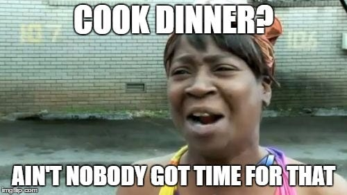

---

I recenty wrote an article about [what I learnt while losing 8 kilos in 7 weeks](https://link.medium.com/y8UxPiMOS0). The intention of that article was to demystify the theory of weight loss and make it a bit more modular for people to follow.

One feedback I received was to write about what I actually did to lose weight. This article will go into my daily regime for 7 weeks that translated into the weight loss journey.

- **Start early**— I used to start my day at 5am. Get freshened up. Do some reading

- **Pre-workout snack**— I liked having a carb rich pre-workout snack since it kept me pumped during the workout. This would include dry fruits — 2 dates, 5 cashews, 5 almonds, 5 raisins, 5 walnut halves. Coupled with Omega-3 capsule and Coffee with lemon, dalchini powder without milk. Honestly this was the best time of the day!

- **Workout** — This would involve conditioning workouts mostly. I focused on cardio vascular endurance than strength. Was also learning the correct form and posture for workout. I used to workout for about an hour burning anywhere between 300 to 500 calories. I would rest on Sundays

- **Track weight**— used to do this post workout to ensure its done at that same time of day, everyday. Losing 200–300g weight daily became normal. Anything beyond 500g and it was a red flag indicating I’m over doing it

- **Meditation** — 15 mins of Headspace post workout. Helped a lot when the craving used to get out of hand

- **Morning snack** — Sprouted pulses, 25g and Psyllium Husk 10g. Alongwith Cheese slice, pepper and salt. Due to the carb rich nature of the snack it’d mellow down food cravings

- **Lunch**— 300g of boiled chicken with an onion, tomato and some spices. I used to cook it myself in the evening once I return from office
- **Evening snack and dinner** — Exactly the same as morning snack and lunch respectively

- **Diet summary stats**—Overall it used to be about a 1000 calorie diet translating into a calorie deficit if 500 per day coupled with 300–500 calories spent during workout. This translated to a weight loss of about 1.1 kgs per week. The diet was heavy on proteins, light on carbs and balanced on fibre

- **Water** — Kept me hydrated and helped tackle cravings. Used to drink at least 3 litres of water a day. Whenever I’d get cravings they’d mostly be silenced by taking a sip or two of water

- **Dinner recipe** — It’s pretty difficult to find time to cook chicken every evening considering you are tired from work, low carb diet and just want to crash into the bed. I devised a very simple recipe. Make thick slices of Onion, tomatoes, wash the chicken, put everything in a cooker, add turmeric, mirchi, masala and salt, mix, add water close the lid of cooker and put it on high flame — one whistle and low flame — 3 whistles. Takes less than 15 mins

- **Make your weekends eventful** — Weekends can make or break your regime since you have more than usual free time on your hand and mind. I used to either go cycling, boxing, long walks, volunteering in Gurudwara or trekking. Reading used to help as well. Do anything but don’t sit idle

It was fun and humbling doing this short experiment on my body. Just shows the power our body has to cure itself if given a chance. To summarise the 7 weeks, it was all about eating less, moving more and meditation.
