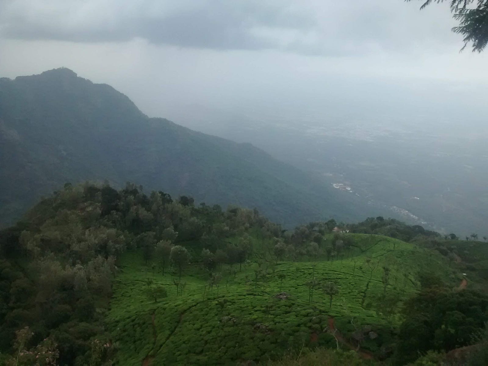

---

“As you travel solo, being totally responsible for yourself, it’s inevitable that you will discover just how capable you are!”

It was July, 2016, Friday. I had just returned from office and clock read 12:30am. Lots of things had happened in office over past few months which had culminated into a highly volatile state of mind. Also my team had changed, “Dude enjoy this weekend to the fullest. It’s going to be the last one you’ll get to enjoy”, said my new teammate and I somehow knew he wasn’t kidding. Coincidentally it was also a long weekend.

I changed up but could’t fall asleep. His words kept ringing. My anxiety levels shot up enough to give me an existential crisis. Something had to be done, I wanted to unbecome the person I was in that time and space.

Opened up my laptop, searched [Tiruchirapalli](https://maps.app.goo.gl/h54WmcdCTNbTdeAX9). Why this particular place? My older self liked to explore the art in ancient temples and Tiruchirapalli has [Sri Ranganatha Swamy temple](https://maps.app.goo.gl/eTzsN9dsakqBYfDC8) which is one of it’s kind to have Vishnu idol in sleeping position. Next, checked the earliest bus to Trichy from Bangalore, found one at 6am leaving from Silk board, packed my bags, borrowed about 1500 cash from my flatmates, slept for a bit, woke up, freshened up and left for Silk board. This decision later translated into many emotions, eye-openers, injuries, discoveries and freedom across different phases of the journey

### **Phase 1 : The long forgotten self**

Halfway to Silk board, some of my senses kicked in questioning the sanity of what was happening. Almost made me turn back. Then I heard a voice that hadn’t spoken to me since quite some time — ”Do this and you’ll remember the journey for your entire life. Let me loose just this once”. That was enough to keep me going.

### Phase 2 : The sane friend

One of my friend hails from Trichy. I called her and told about this. Either her knowing that I’d barely slept for an average of 5 hrs per day for last few weeks or me unable to give her a concrete itenary, I got the privilege of hearing swears from her for the first time. But then she told about a few more spots to visit and that helped me plan itenary for next 3 days. Thanks 🙂

### Phase 3 : Things won’t go as per plan

I’m glad I realised this early on in the journey. There were many buses that directly connected Silk board to Trichy and I hopelessly missed each of them. Ended up hopping Hosur, Krishnagiri, Dharmapuri, Salem, Namakkal, Musiri etc. until I finally reached Trichy only to have my backpack torn apart while getting off the bus. Luckily I found a cobbler who took pity on my state and not only got my bag fixed but also told me the fastest route to Sri Ranganatha temple. Thank you 🙂

### Phase 4 : Sometimes, a lot of times, less is more

I left Bangalore at around 7am, it was 4pm when I set foot in Trichy. While traveling I listed 2–3 more temples that had caught my attention and I did have enough time to explore each of them. At least that’s what I thought. I decided to visit Ranganatha temple first. The temple is huge and by the time it was 7, I hadn’t finished exploring half of it. I decided to rather stay in this temple and explore every corner of it than exploring the remaining ones. Later this helped out since I got to be part of their evening Aarti. It’s best to focus on enjoying single activity to fullest that making a stockpile of multiple activities

### Phase 5 : Communicate your itenary and whereabouts to someone

This helps from a safety standpoint. I’m not taking about sharing an update every 15 mins to someone. Just giving information about the high level itenary and any major changes in plans helps reduce their anxiety and ensures your safety in extreme scenarios. Here, “they” could refer to your family, flatmates or friends

### Phase 6 : Who needs a bed to sleep?

It was already 10 pm by the time I came out of the temple. I’d already planned which place to go next. But I also needed to find a warm place to sleep since it was freezing outside. I asked around and the charges for one nights stay were beyond my reasoning. Little did I know that 300 per night is the norm. I left the places and decided to sleep on the bus stand. But where was the bus stand. I tried asking around, but who knew Hindi/English, no one walking on the streets of Trichy middle of the night. I hopped on to a bus service, which was surprisingly active, that dropped me to the bus station. This is where I was going to get the bus to reach Coonoor. And the same bus would serve as my bed for the night

### Phase 7 : Rest, since you must

I’ve already talked about things not going as per plan. At around 3am, in the middle of nowhere, the conductor woke me up saying the bus had broken down. They’re were 4 more people besides me in the bus, each of them equally confused. He asked us to get off the bus and then he started looking in the far direction we’d come from to check if there’s any bus following which we could hop on. To be honest, I was sleepy. Tired from the journey and lack of sleep for last few weeks. The side road looked like the most comfortable bed to me and I thought, to hell with it, I’m going to sleep. I asked a fellow passenger to wake me up when the bus arrives. He was too tired to judge me and just nodded in compliance. Thank you for waking me up random stranger🙂

### Phase 8 : If there are tea plantations besides the route to your destination, it’s best to walk than to take a lift

In Coonoor, I was planning to visit Dolphins Nose, Lambs Rock and SIMS park. While on the way to Dolphins nose I saw tea plantations for the first time and couldn’t believe how something so beautiful exists. That mixed with the misty climate was adding to the overall beauty. My actual trek had finally started. I ended up walking through the plantations not noticing how far I’d traveled until I reached the entry point of Dolphins nose. The view of tea plants have that effect of making you forget how much you’ve walked.

### Phase 9 : Capture beauty with your eyes not your camera

The entrance of this place was like any other commercialised tourist spot but when I looked more carefully my breath for taken away. One spot in Dolphins nose, which I was lucky enough to be standing at, had an almost 270 view of the entire valley. It reminded me of Sahyadri ranges visible from from my hometown. I peeked into the valley below and a mild blast of rain hit my face. It was raining mildly and windy enough to hurl the raindrops, falling down into the valley, upward right on my face. Surreal! Everywhere I saw, it was lush green, with occasional mist and fog covering the corner of my eye. A lonely waterfall added to the background lullaby. I stood there, unable to move, not wanting to move, hypnotized by the sheer beauty of the nature I was witnessing, something I’d never imagined could exist in such scale. I felt grateful to be there. In that moment, I felt alive.

Two hours standing in the same position and I’d mentally photographed the entire view to the best of my capacity. All this time, I didn’t feel like opening the camera, felt that’ll disturb the serenity of the moment

### Phase 10 : Letting go is the first step of new discovery

It was time. I had to move to next place. I didn’t want to though, I wanted to enjoy the view more. “Stay here in heaven or try exploring the unknown”, there it was, that voice again. “Exploring the unknown it is”, I almost cried out loud. But I need some tea first!

### Phase 10 : First rule in making new friends — be a good listener

SIMS park. Famous for it’s collection of Bonsai, garden in shape of continents, flowers and vast bird species. It’s a haven for bird watchers. I was lucky enough to be shown around by a group of bird watchers. They did their best to explain me the features of each bird, sound, looks, etc. while telling me it’s name which I forgot slow enough to not sound rude but fast enough to make a mental note of them.

### Phase 11 : There are two sides to every coin

The bonsai collection here was one of the oldest. It was the first time I was seeing a Bonsai and I couldn’t help but feel bad for the trees that weren’t allowed their fundamental right to grow. But then, they had the privilege of having most likely exceeded their natural life span.

### Phase 12 : What’s love? Ask a plant being tended by a humming gardner

This one area that was left unexplored was a incubation centre. An area where new plants took birth under the careful watch of SIMS park’s gardener. There was a different kind of serenity, like the way a gush of air makes the rice field dance, the saplings seemed to absorb the rythm of whatever the gardner was humming. I also got a chance to visit a small greenhouse which was giving shelter to the foreign plants who were making their residence in this alien park. And that concluded SIMS park visit.

### Phase 13 : Overcoming fear

Next up was Lambs back. A place similar to Dolphins nose but with a gloomy trail covered with hanging Banyan tree roots. It might have felt gloomy mostly because it was pretty late by the time I reached there and hence was starting to get dark. Also, there’s was no living soul in sight throught the trail. I won’t deny, I was scared and fatigued. This time though, I didn’t need the voice to keep going, it happened involuntarily. The Banyan tree roots unfolded into rays of sunlight and soon the peak was in sight. Now the peak in itself didn’t have much standing space in comparison to Dolphins nose but it gave a 360 view of surrounding. Also, the sightly higher elevation increased the range of how far I could look and absorb the view of. I ended up staying here till it got dark

### Phase 14 : It’s okay to trust strangers

I was yet to plan whether I’d spend the night in Connor or take a late night bus. But before that, I had to get closer to a residential area. There was no transport in sight. I ended up asking local farmers for lift, they were carrying tea leaves to the market and didn’t hesitate a second before giving me seat besides a bundle of tea leaves. Note that I’ve struggled trusting people but I was too tired to think straight. Guess the farmers empathized with my state and decided to help me out. They dropped me as close as possible to the main road and showed me the directions to take further. Thank you 🙂

I kept waking for about 20 mins until another car stopped in front of me. “You need a lift dear?”, “Yes, that’d be helpful, thanks!”

### Phase 15 : Everyone has a unique story and each story has a audience

“Hop in, we’re going in the city, will drop you there”, said the women in the back seat. She, her husband and her brother were locals in Coorg. “We don’t usually see people waking by themselves in this part” she asked, “I’m on a solo trek, got held up and hence running late”, that answer gave rise to more conversations and I told them about my journey so far. It wasn’t much but I saw a spark in their eyes while they were hearing my story.

Until then, I always thought people are too busy with their own problems to care about others but these guys, they not only were visibly intrigued by my story but were asking questions about how I managed to do things. All 3 of them had a childish energy around then. For some reason, I felt warm, someone was actually genuinely interested in what I was saying. Not because it had any monetary value add but because they wanted to see things I’d seen through my words. I was deeply humbled by their gesture. Instead of dropping me to the corner of the city, they dropped me right next to the bus stop and even suggested the timings of buses per my itenary. Thanks 🙂

### Phase 16 : Arriving in Ooty

I was tired and the buses were crowded. I was lucky enough to board a bus to Ooty. I looked like an odd man in the bus with my huge backpack and warm outfit. I got a seat besides a family traveling to Ooty and after some icebreaker I started conversing with the kids about their trip and they enquired about mine. It was a fun exchange of stories that lasted through the travel. I arrived in Ooty pretty late and right after stepping foot there, I knew that I won’t be able to sleep either on bus stand or in the bus. It was freaking cold outside. I checked the nearest lodgings and found one at 300 per night. I took it without second thought, asked them what time I can get some hot water to bathe and then headed to sleep.

### Phase 17 : Your body knows when to take a break, listen!

I set an alarm for 6:30am, that’s the same time I was going to receive hot bath water. I woke up, tried removing my sheets, freezed off from head to toe, went back into the sheets! It was cold, really cold, like waking up in a freezer. Either because I was hungry, tired from the travel and the extremely low temperature of Ooty, my body was not abiding by my command to get up and get ready. I decided to rest more and it actually helped me gather most of my energy back, enough to tackle another day of trek. I took a bath, checked out and was off to next place

### Phase 18 : Enjoy the journey and not the destination

Ooty is famous for its rose gardens, cold climate and lakes. I decided to visit the lakes. There were two of them — Avalanche and Emerald. Both of them are pretty close to each other. I decided to take a bus to the point as close as possible to each of these lakes.

I walked in the morning cold towards the bus stop, had some snacks there and waited for the bus. There were few other people near the stand — a father and his son, a man in his 50s, a group of ladies. The smell of hot tea in nearby shop was in the air. It was early even for the locals and today they had a random guy standing clueless on the bus stand.

Luckily, the bus didn’t take too long and was totally vacant when I got in. The bus didn’t go towards the lake but I did get a ticket for a stop that’ll take me super close to it.

Throughout the bus journey, I was continuously subjected to the breath taking view on the hairpin bends the bus was taking. The mountains were wearing clouds as their crown. The tea leaves were dancing in the rain and one could hear the sound of waterfall nearby

### Phase 19 : Walking is the best mean of transport

There wasn’t any direct drop to Emerald Lake. I had to walk the remaining distance. Throughout the trip I’d walked enough to get blisters on my toes. But walking alone gives you lot of time to think and introspect. Coupled with the lush green of trees, the clear silver of water and the silence of the surrounding it helped me unwind lots of entangled threads. My priorities in life were getting updated.

Also, thinking is a great time killer. In about an hour or two I reached the Emerald Lake, but I barely noticed having walked 10+km. The lake in itself was quite serene. Rainy season wasn’t at its peak so the water level was lower than usual. This was clear from the banks of the lake where water level had visibility receded and the ground was visible.

Coupled with the clouds in the distance, the blue mountains ranges reminding of Nilgiris, the neighborhood peaks, the lake in front of me and cool breezes of wind…I was at ease. All that traveling, making and updating plans, confusion, fear, self doubt had culminated to this exact moment I was living in. If I were to summarise in a single word what my state of mind was; I felt grateful.

### Phase 20 — When you travel, make sure you learn a word or two of the local language

Next up I planned on trekking Chembra peak. But I was faced with one major challenge. Language!

All I wanted to know was which way is the closest bus stop. But after using all my creativity in conveying the message I decided I was better off searching on my own. I was lost for the first time, not in the wilderness but in the concrete jungle. Then I heard the sound of a bell, one that signalled that a school was nearby. I waited at the school gate where kids were leaving the school. They spoke a common language and were kind enough to help a lost soul. Thanks 🙂

### Phase 21 : Respect time

I picked the bus but didn’t know the route to Chembra and I was almost out of time. The conductor understood my sorry excuse for sign language. He wrote the map, the buses to take, the stops to get off on my ticket. But both him and another local friend told me I was running late. I won’t make it in time.

I decided to call it a day and leave for Bangalore. Chembra will have to wait. 1 year later I’ll make a failed attempt to trek it again. Since then, it hasn’t left my bucket list. Someday!

### Phase 22 : It’s good to be home

It was past midnight when I reached Bangalore. There was that usual Sunday midnight traffic buzzing the roads, I hopped a few autos and buses to reach back to my room in Whitefield. My flatmates were awake. They were visibly worried, I left them a single note before leaving and they knew my state of mind when I left.

I told them the whole story and they were patient enough to hear it although half asleep. Thanks 🙂

### End notes

There’s a belief that you should solo trek at least once in your life. In an aeroplane mode fashion. It’s the most conducive environment for introspection.

Did the journey lead to transformation? I won’t say so, but it was worth it. I was bitten by the Wanderlust bug and it won’t leave me for the years to come. I knew now what travelling outdoors meant for me — It was connecting with the nature and yourself, it was creating and sharing stories, it was finding and solving your deepest fears, it was about talking to your true self. It was blissful.

For the next few days I’d give a download of the trek to every person whom I came across and they would be equally interested and enthusiastic in listening to it. The story was finding a voice and audience through me and I couldn’t have been more grateful.

The voice was right, I’d remember this trek for the rest of my life. I’d let the voice loose during the trek and since then it’s been talking to me. I’d finally befriended it and so had it myself.
