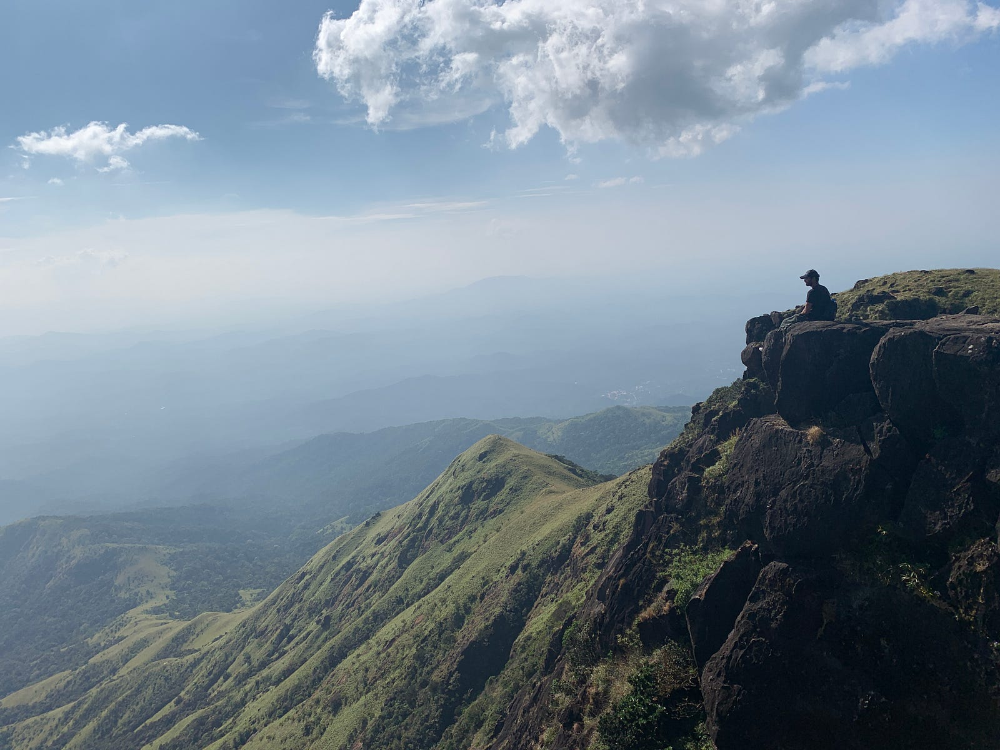
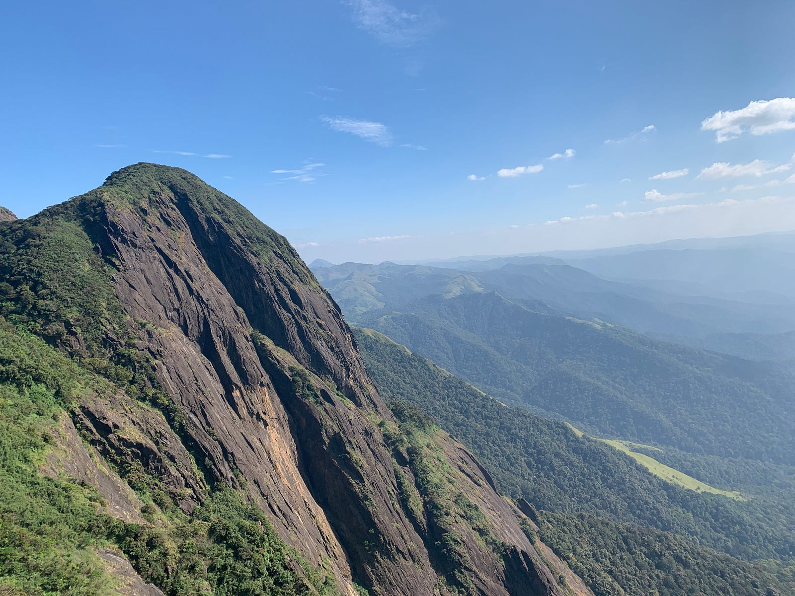
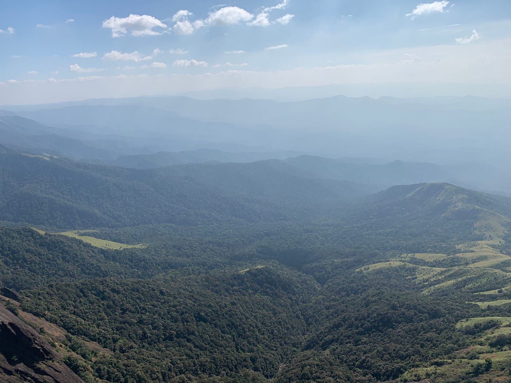
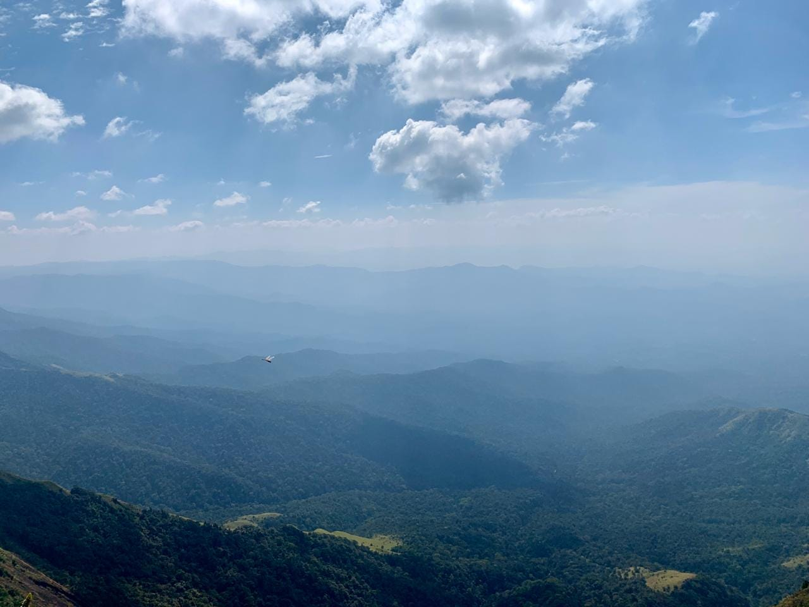

---

You’re halfway through the trek, your knees are hurting, your thighs are burning, the sun won’t get any easier, you’re almost out of water, the climb is getting steeper, there’s sweat dripping through your back…you’re halfway through the trek and you know you can’t turn back

You’ve made it this far, you’ve shattered your own beliefs, you’re setting new limits and hence rediscovering a new you…

You feel like giving up but there’s something motivating you to keep going, for some reason you can’t keep your finger on it but it’s there, a flame silently burning, igniting your entirety and keeping you on track. You’re out of fuel, running on will power only. You keep moving, instinctively, inch by inch

What’s the reward? I asked myself.

Look around you, a voice answered. I abided and was spellbound, maybe it was the fatigue. The green of grass, the softness in the wind, the chill of nearby water stream, the chirp of an unknown bird, for how long had I been ignorant of these stimulus?

What’s the reward? — the answer hadn’t been more clear

My legs kept moving, I knew something more precious was waiting. The Summit!

Summits have an ability to make you forget yourself and live in the moment. There’s too much to absorb there and while doing that you feel thankful.

Thankful for being alive ☺

