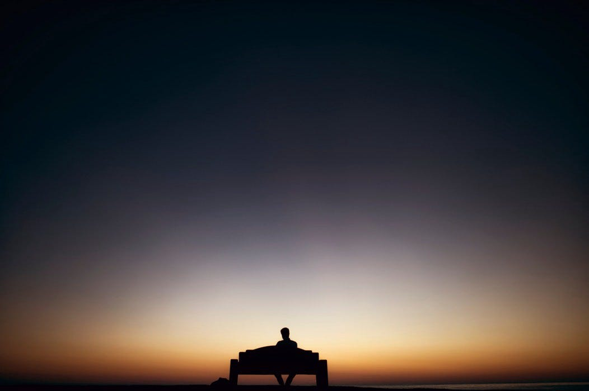

---

This article is an attempt to document my learning from investing piece of my mind in myself, people, art, mountains and nature.

*Disclaimer : It’s a work of fiction and written only to be a mean of entertainment.*

> Recently, I’ve been asking myself way too many questions to remember and the only way to put a structure to them is to write them out, so here they go —

What does it mean to connect with someone? To find a soul mate? To realize that you are just another piece of puzzle waiting to be fit in the larger picture of life?

Is it already written? Where? Why and by Whom?

Are your actions driving you towards it unconsciously? When do you know it’s the right time, the right person, the right place the right you? Is it dependent on your past experiences, or your current state of mind? Or does the nature have a larger plan and you are just a medium for it to execute the same?

Let’s try to answer these questions, one at a time

### When it all started

This is a memory from when I was about 2 years old. Little black ants around my home, such beautiful creatures, they used to fascinate me. What was the point of running all around in seemingly random directions. I had the power to put an end to their motion, one smack of hand and puff. But hey, what’s this feeling and what’s this red thing flowing out of my hand? It hurts! Why are there tears in my eyes and why is everyone trying to open my fist? Is this what they call pain? Why does pain exist?

### The kid who knew

रोहन — “now try writing it again”, my mother said and I abided. It was a black slate and the words were all over the place. But the words were “me”, it was “my” name. It felt great just writing them over in the sunlight entering through the small window while my mother sat besides me, the words curved at the right places, and it was fun saying out loud each syllable as I wrote them. I did it over and over again because it filled me with joy, because it made my mother happy in ways I was yet to understand, I didn’t know that’s what writing meant, for me it was more like drawing something that identified me. It felt natural and fulfilling

### My first story

The slate became my soul mate, we would go on great imaginary journeys together, from sun coming out of mountains to rivers flowing through the village. I didn’t have many friends, I was yet to learn the concept of friendship but with the slate I had infinite possibilities with me. I did have an elder sister and she did have a lot of friends. She always used to hang out with my cousin sister and my mother would have to go pick her up every time. How I remember this? Because that’s the first story I drew on my slate and for some reason my mother, father and sister liked it so much that they made me redraw it all the time — breakfast, lunch, dinner, I even got extra money to buy new chalk sticks for drawing those stories, it was fun drawing and telling the story, although I was still learning how to form sentences then.

> Fast forward

### The troubled teen

This was the period when I was the closest to my inner self, so much that it lead to creating multiple versions of consciousness within me. When it became too hard to treat them all as myself I ended up assigning each of them a separate identity. There was Kiba — the one whose advice I would take without any questions asked, Roya — the one who was kind hearted, Master — who knew everything but rarely spoke, Black — who always used to be on lookout for taking control of my body, etc, and then me. We would debate on multiple topics in life and they would always be up for discussion, they helped me create a perspective of life which, at that time, I didn’t know was very fragile. But I played around and survived with it, completely ignorant to the fact that I was moving away from the definition of being called a normal person.

But it was okay, I had myself as a company. The thoughts never used to stop so I would always have someone to talk to. I remember wishing to stay the same for years to come. At 16, I was starting to realise that my understanding of the surrounding was just a mirage and it was time that I had to accept the truth, that everything until now were stories that I wove and had nothing to do with reality. I gave it a strong thought on whether I would be able to retain this state of mind ten years down the line and I saw it falling apart. I panicked. I was losing the mind castle that I had built in last few years. It was time to face the truth, but what was truth?

### The broken leg

It was the end of college and we 4 friends wanted to say our thanks to one of our teachers. While on the way, I met with an accident which left me with a ligament tear. It was bad, I was going to be bed ridden for next couple of months but my priorities had heavily changed in all these years. The first question I asked the doctor was — When can I resume working out? That had become my identity, the sheer joy and confidence I received by investing my attention back into positive self development than mental comfort was so addictive and rewarding that I could not imaging letting it go, yet it had to happen.

Are things taken away from you when you need them most? Or was this another test? What’s the most logical course from here?

Every single day, I practiced all my workouts, not physically but mentally, every day I would wake up and do each rep of each set in my head and I kept at it until they removed my plaster. It kept me sane, it kept me myself, I didn’t want to let go of it because I had found something to latch on to.

That’s when I realized that I had huge amount of emotional inertia. Was it a good thing or a bad thing? It was a completely new attribute that I’d discovered, I decided it was better to let time answer this question

### The impostor

It feels nice to be looked at as someone who is perfect, far from it I actually was. But it was easy to be an impostor perfectionist. All you needed was to be better at a topic than the person in front of you. A little more calculated reading, research and there you are. But it also translated into me being rude, arrogant, self obsessed jerk. Because that’s what was expected of a perfect person I thought. Little did I know I was hurting others and in doing that hurting myself. I was getting disconnected with myself.

I carried this false personality around people, some got interested in it and went a bit too far. When they got to know about what I really was, it was too late for both sides. They were disgusted and I was shaken. Disgusted because I was so hollow and shaken because I knew the truth but didn’t have any earlier experience to prove it.

The shell that I had created to gel into the society was starting to crumble. All those years of living with my own set of assumptions of how things work were finally showing up, naked to people around me. The society alienated me and I felt helpless in processing any of it.

### The cry for help

Nothing was adding up, I decided to introspect again, this time it would be stimulus driven than by the multiple faces that lived inside me.

I went off grid, for about 4 days, in South India, wherever the roads took me. I didn’t have a plan, I didn’t know why I was doing it, what was driving me? Maybe the inability to process life in the current state? Maybe the search for answers?

> “You’ll remember the journey for rest of your life, give me control just this once” — Voice in my head — July, 2016

It was the first time I heard the Voice. It was different from the other personalities I had in my earlier years, it was calm, composed, concise and had a air of authority against it. I abided.

For 4 days I turned off all the chatter that had been running through my head since I got my senses. I wanted to know if there is anything more than that to me. What am I without the chatter in my head? That’s when I saw the green mountains, felt the cold breeze carrying the raindrops from the mild rain which sent shivers down my spine. I felt one with nature, it felt so forgiving, almost saying out loud —

> It’s okay, you’re okay, believe in yourself, be grateful, be kind, be honest, be vulnerable, be trustworthy, it will all work out just fine

I stood there at the summit, taking in what I had just heard, the message kept echoing, it was so soothing that I felt being forgiven for the immeasurable sins I had committed against myself and against people who cared about me.

I got bit by the wanderlust bug on this journey but it was going to take a few years for me to realize that.

### Looking at the positive

All those years of trying to be perfect made me extremely competitive and skeptical of others. Why is he/she helping me? What do they have to gain from it? If it’s something I don’t understand then the motive is definitely negatively ulterior. I need to be cautious, maybe increasing the distance from these people would help me, why do they still keep coming back? Do they really want to damage me that bad? Finally! pushed them away! Now I can be at peace.

Never once could I accept that the person in front of me truly cared and wanted to help. Everyone tried their best to connect with me but I, looking at the negative side of things, made it that much harder for them. This in turn costed me good friends, people who actually cared. All that time, I thought I was defending myself from further mental damage, rather, it was me denying the treatment that people were offering me, with absolutely no expectation in return.

I learnt I had to look at the positive side. To take a leap of faith. To trust that the person in front of me only has positive thoughts because in most cases that’s what the truth is.

I was late to realize it, but I am grateful that I did.

### Finding the one

Keep doing things that you love and the love of your life will find you. All these years had given me a realization that I was far from being a perfect human. I still had all the traits of my older years whether I wanted to accept it or not. They all had hugely influenced the current me. But I did want to improve as a person, be more empathetic, more compassionate, more optimistic and true to myself.

She was like light, but in her eyes I saw darkness. I knew, she was broken too. She had a perspective on life that complemented mine. She understood my demons and was non judgmental — because hers were far scarier. She was like the image of moon that would keep going farther as you tried getting closer. Although it didn’t work out, it was okay, I was learning my lessons. That made me think, was this wishful thinking? What would a life partner mean for a person like me?

> The answer was simple — she made me want to be a better person.

My introspection was more pinpointed, the answers were more clear and actionable and all this was based on a simple lesson — look at the positive side of everyone — of yourself of others.

### A note to the future me

I can’t guarantee you anything. You are the wisest version of myself. Just remember whatever you are, I will keep believing in you. You have been through things unimaginable and you have endured them with a smile on your face. But what makes you “you” is less of what you have done and more of the bias to action you have. You have a good heart and you know it, no one can take that away from you. You have the ability to be true to yourself and the courage to digest the darkest sins.

It’s okay, you’re okay, keep believing in yourself. You need not be perfect, famous, renowned, rich; just remember to lead a fulfilling life, be happy, look at the positive side of yourself and people, everything will work out just fine, when things get awry just be grateful for what you have and remember that no matter what the situation is, you will always have two choices. Make the one that gives you more fulfillment and them more happiness.

Stay kind, that’s what makes you beautiful.
