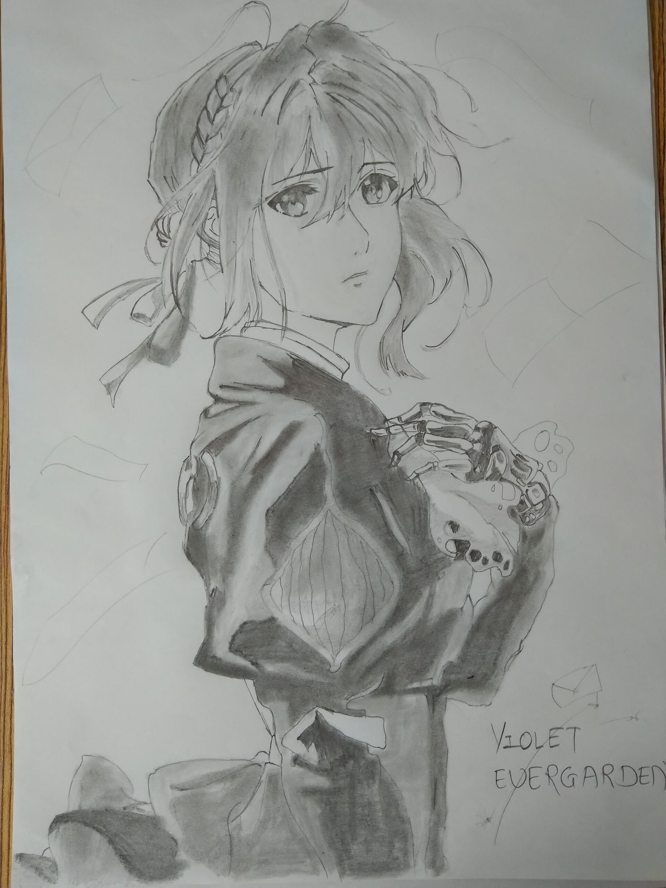

---

*The final drawing based on a picture I found online*

> Every piece of work, be it art or something else, has a soul in it. Discarding it midway would mean abandoning that nascent soul that you worked so hard to bring to life.

This article talks about the realization I received when I was halfway through drawing Violet and about to erase the incomplete drawing off and forget about it. It talks about why I continued drawing it despite making mistakes and repeating them. It’s about understanding that every creation has an underlying bond with it’s creator which demands to be nurtured and not abandoned mid-way.

### Violet Evergarden’s story

A weapon manufactured to be an expendable asset during the world war. Emotionless, without a personality or a hint of flinch while slicing through her enemies and their territory, Violet was perfect in every manner desired by her manufacturers.

But what does a killing machine do when the war ends and her master is nowhere to be found.

Violet Evergarden is a story of a young girl learning the definition of life — one word at a time. The illustrations in this anime are beyond beautiful. Through her journey you experience what introspection feels, what learning new feelings feels, as she questions the fundamental feelings that you and I understand intuitively. You question your own understanding of emotions and start giving them a deeper thought. This one’s both on my favorite anime and favorite characters list.

Here’s a trailer from Kyoto Animation’s official YouTube channel

### The struggle with the drawing

Drawing Violet was always on my list because of the sheer beauty in the depth of her story and her animation. I rewatched first few episodes of the series just to get back into that state of mind.

But the problem was, I had not drawn anything since a while and was slowly losing confidence. Before even starting, I was scared of messing the drawing up. Had I not been able to finish the drawing, it would have left a gaping hole in me. I decided to trust myself and started drawing the picture.

As always the content was high and I got stuck while drawing her face. It just didn’t look like Violet. It didn’t have that innocent yet deadly look. I redrew multiple times until the paper started becoming weak due to the continuous erasing. I decided it was better to give up than damage the drawing more. My fears were being realized.

### The nascent soul

Was it her backstory, or my admiration of the character or the look in her eyes at that point…or maybe all of them, but I didn’t feel like giving up.

That’s when I felt that everything that you create, it may be a drawing, a painting, a musical note, a story, a deliverable in office, be it your own creation or replication of someone else’s, has a soul it. Where did it get the soul from? You gave it yourself. You poured your heart while creating it and your emotions gave rise to not only the object but to a unique bond only known to you and it. This meant you had a responsibility against it. You brought it into this world, now it’s your task to nurture it and not let it disappear midway.

I feel this is applicable in every walk of life. You have an obligation to see to completion anything that you undertake. Abandoning it midway is as good as severing the bond you created when you started working on it eventually killing the nascent soul you worked so hard to bring to life.

This realization kept me going. Whichever way the drawing was going to come together, I decided I would give it my best shot.

Although it did not entirely look like the Violet from the picture I found online, I was glad I saw it to completion :)
