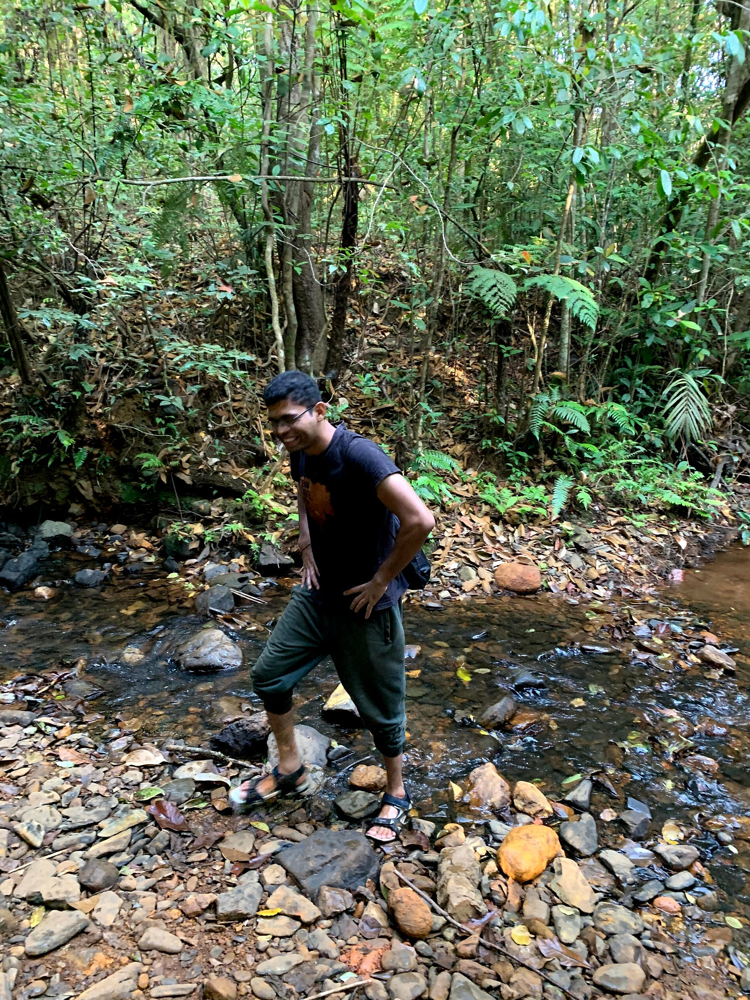
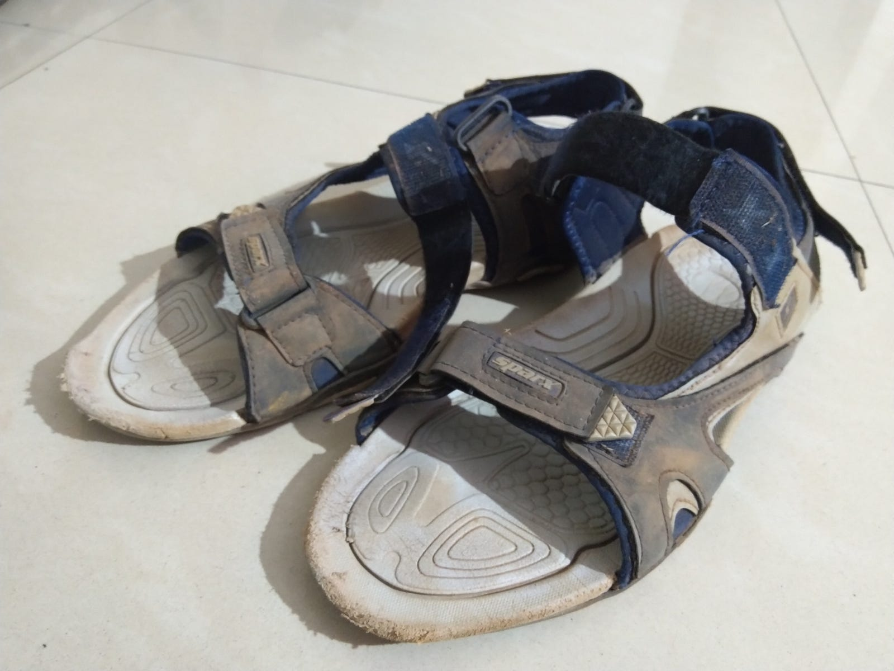
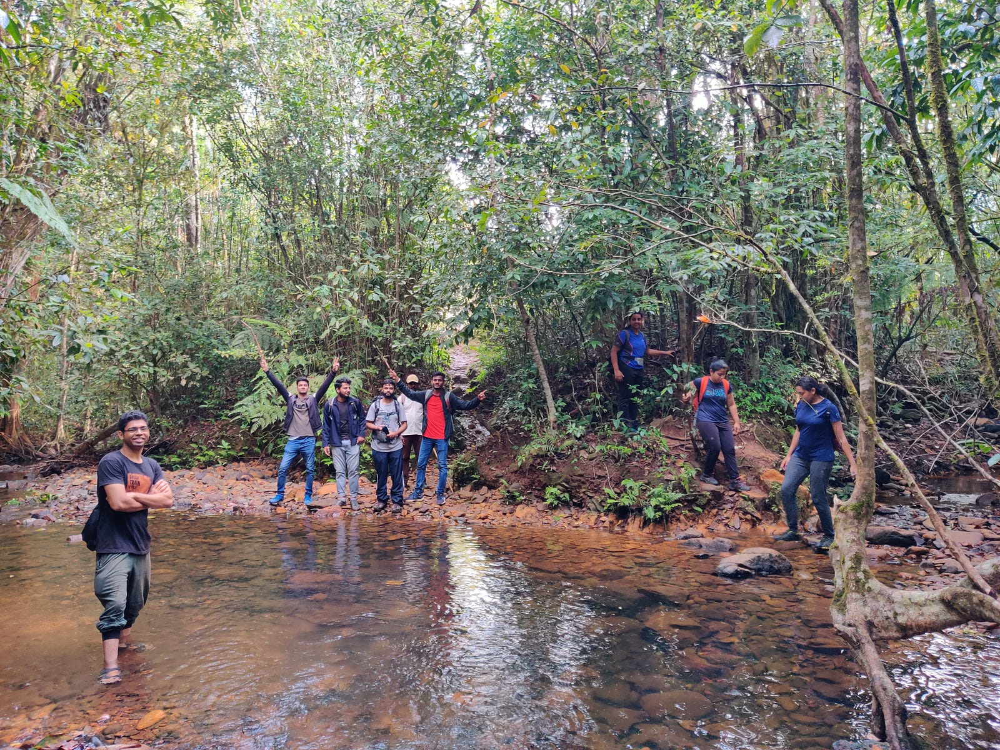
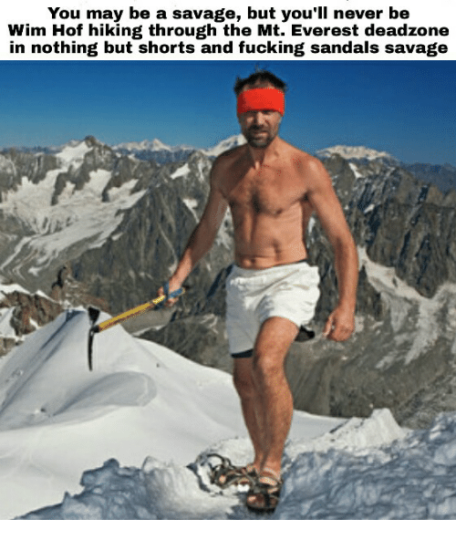

---

Tl;dr I’m a stupid person

In every trek, participants are visibly confused when I ask them to have ship shap shoes with properly tied shoe laces and long socks while I’m wearing a pair of sandals. The other Outdoor Leaders are always like — bro you’re setting bad example!

This article contains the reply I give the participants and some more details. Let’s dive into it

### These ain’t no ordinary sandals

They’ve withstood the test of time and more than 10 treks without losing tad bit of their grip. That in itself commands appreciation.

The light weight and the soft sole helps you feel the ground more accurately. It’s like you’re not wearing any footwear minus all the stones and pebbles that may hurt while trekking.

Also, they’re cheap and good quality. Purchased for about ₹600 during Flipkart’s BBD’19 sale, these are one of the most fast moving products with highest number of positive ratings and reviews.

I wear them to office, gym, walks and treks, so they’ve sort of become a part of my body already

### Bouldering or trekking rocky terrains

In case of bouldering you need to have a feel of the ground which I get better in sandals than shoes.

Rocky terrains like Madhugiri, Skandagiri require you to have good grip which again these sandals are better in providing

### Forest covers and river crossing

As an Outdoor Leader you need to ensure the trek is executed per schedule. Throughout forest covers you come across water streams — almost 15 of them on Kudremukh in monsoon — and I can’t help but get into them.

Wearing shoes would require me to remove and wear them everytime I get near a stream and that’ll cause definite delay, especially when participants copy what you do

### Leeches

Back when I started trekking leeches used to be a pain since I always had to wait and remove my shoes to get the leeches off. Then came a point where I stopped giving f’s and would just remove them at the end of trek…only to find big fat ones in my shoes with a ton of blood lost.

Wearing sandals helped since I could spot them easily and remove them on the go. Also the number of leeche bites considerably reduced post using sandals. Tough luck sucking that blood you leeches!

### Disadvantages

Knowing the trail always helps if you’re trekking in sandals as many complications arise while doing so

**Snake bites** — have been lucky enough to evade in more than one situation. Knowing where you are not likely to find them helps but that’s something not always possible on new terrains

**Twigs and thorns**— I accept it, they’re the most irritating things once they get inside your sandals. Easy to remove though. Thorns are another equations in itself

**Ankle support** — Comes into play when the terrain is filled with loose rocks. And it hurts having ankle sprained when using a shoe could have easily avoided it

**Leeche bites**— similar to snakes but not lethal

**Frostbite** — Himalayas with sandals are not a pleasent combination

Having said all that, I’m not really sure if I’ll entirely switch to sandals for everything. There are definite cases when your can’t wear them like long runs, loose rocky trails, snake infested areas etc. But yeah, they’ll always be part of my trekking gear.

Also, you do get sandals that are specifically designed for trekking…it might just be a marketing gig to put a higher price…but yeah, you’re not completely crazy if like me you also choose to trek in sandals. Welcome the club!
