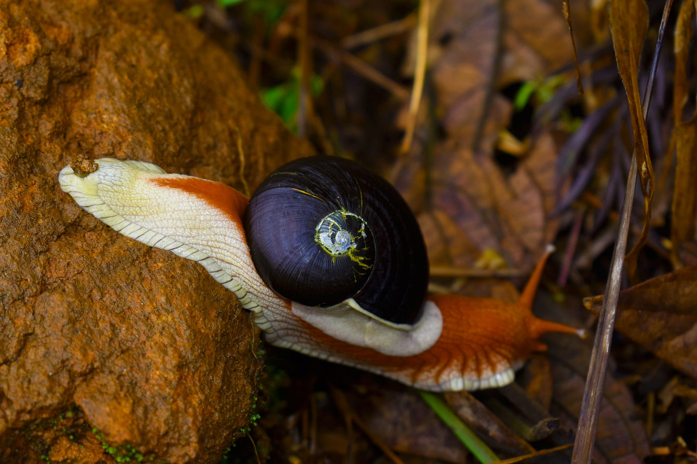
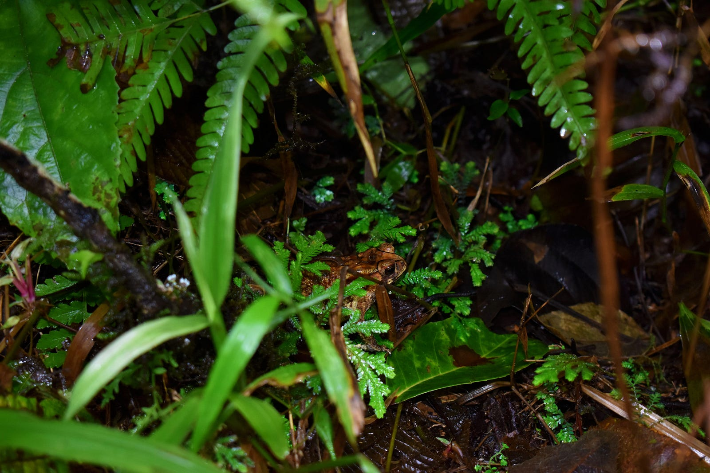
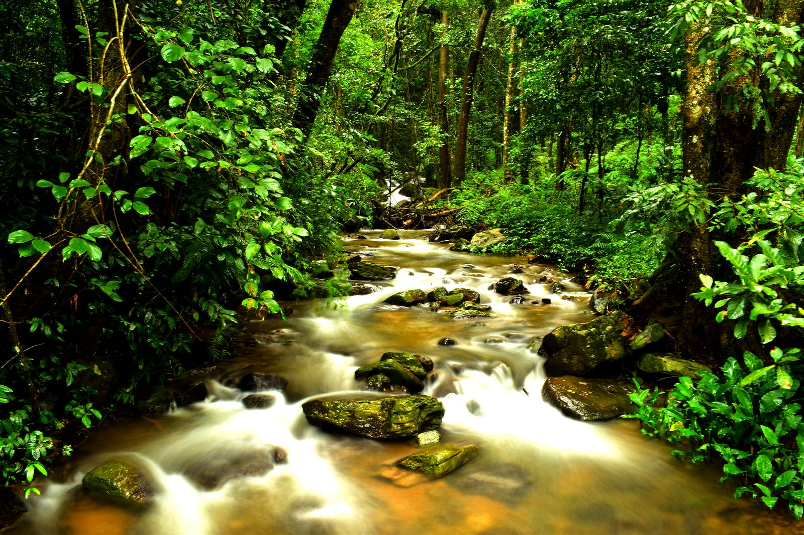
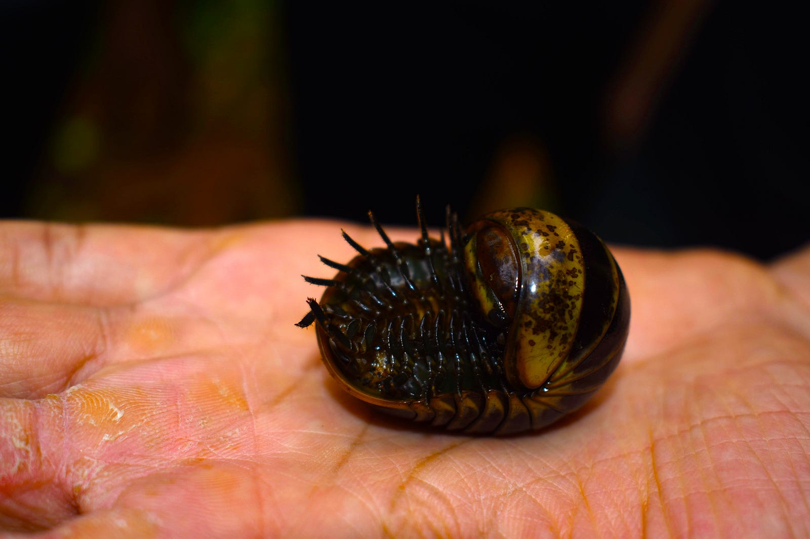
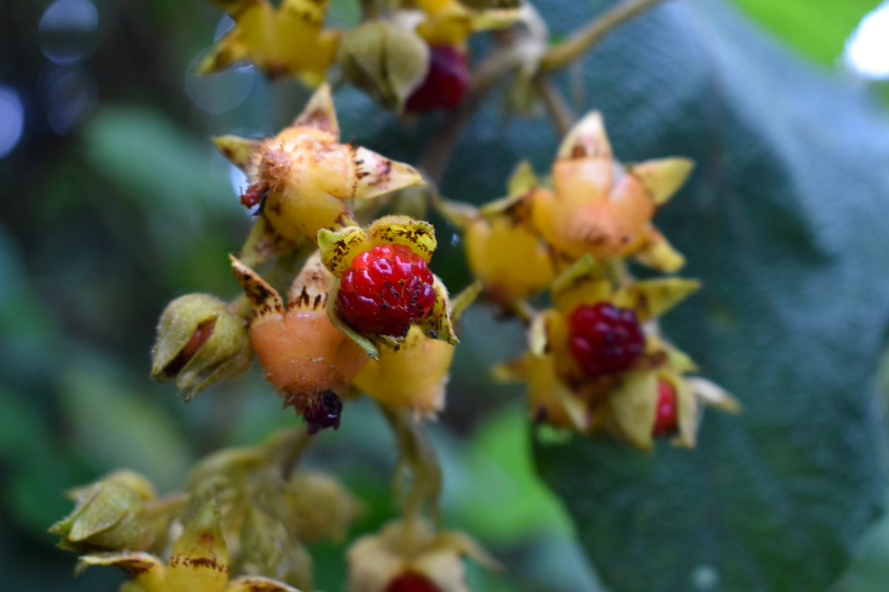
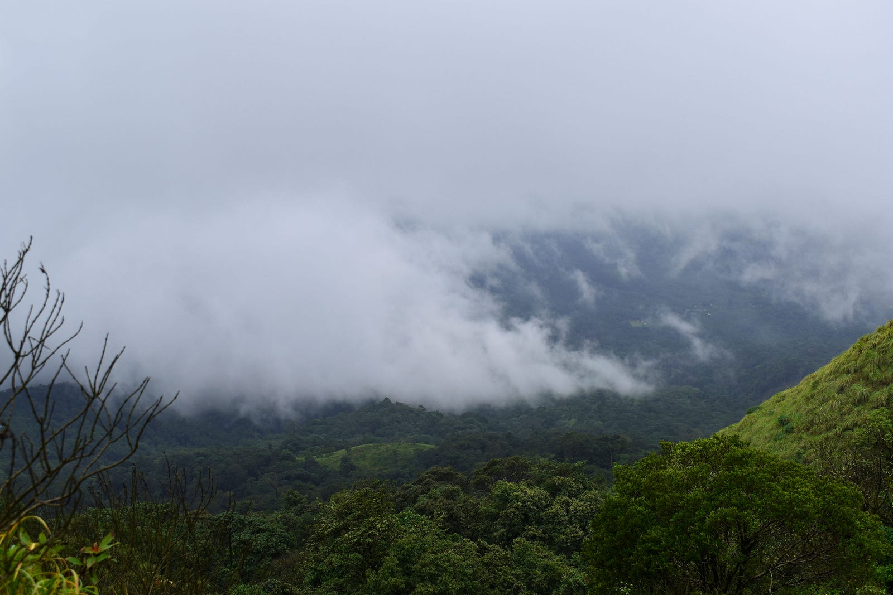

---

*A glimpse of the wildlife in Galibeedu*

> The beauty of a moment is that it’s fleeing. By it’s very nature, it slips through one’s fingers, making it that much more precious — Ted Mosby(HIMYM)

If you are someone who’s into photography, you will relate with Ted’s quote. Every click of our camera is to preserve and store the fleeing beauty in each moment because it’s something that will never reappear; once lost, it’s lost forever and as someone who locks time with camera we are duty bound to capture it :)

*A frog chilling in the rain*

[Galibeedu(Coorg, Karnataka)](https://www.google.com/maps/place/Galibeedu,+Karnataka+571201/@12.4551698,75.6851536,14z/data=!3m1!4b1!4m5!3m4!1s0x3ba4fef3000d2031:0xb656c7552398bd56!8m2!3d12.4551706!4d75.7026632) was the 2nd trek I did with [Get Beyond Limits](https://www.getbeyondlimits.com/) after [Kudremukh](https://www.google.com/maps/place/Kudremukha+Top+View+Point/@13.1261674,75.271858,17z/data=!4m12!1m6!3m5!1s0x3bbb4b37789bd275:0xfec569106a58ee25!2sKudremukh+Peak+Top!8m2!3d13.1261674!4d75.2740467!3m4!1s0x0:0xee8e68a8b1fdad9e!8m2!3d13.1267074!4d75.2740087). [Kudremukh’s](https://www.google.com/maps/place/Kudremukha+Top+View+Point/@13.1261674,75.271858,17z/data=!4m12!1m6!3m5!1s0x3bbb4b37789bd275:0xfec569106a58ee25!2sKudremukh+Peak+Top!8m2!3d13.1261674!4d75.2740467!3m4!1s0x0:0xee8e68a8b1fdad9e!8m2!3d13.1267074!4d75.2740087) beauty had left me spellbound and I never thought there would be a place which would quench my thirst for wanderlust at similar scale. I was gladly proved wrong by Galibeedu.

*One of the two water streams on Galibeedu peak’s trail*

The place is beaming with wildlife. In addition to insects, snakes, elephants you have coffee, tea plantations, medicinal plants and much more throughout the trail.

*This shy insect curls into a ball when touched*

*Glimpse of the flora*

The rich flora and fauna is perfectly complemented by the view from summit of this 14km trek. That coupled with the cold of the breeze and the softness of the air only adds to the feeling of sheer peace.

*Not the summit but close enough!*

Disclaimer — All pics in this article have been taken by [Kiran Kumar](https://www.instagram.com/adventurenest_/)(my co-trek lead). Please check his profile for many more pics like these :)
