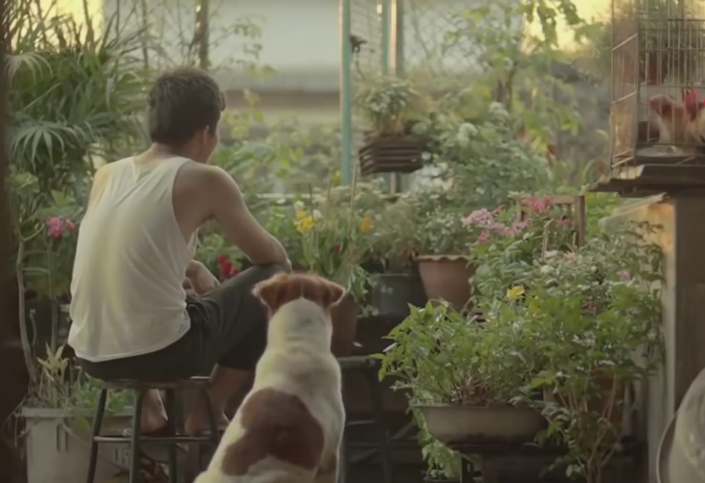

---

*What matters is knowing where to draw the line*

> Life has a way of showing that you are not in control of the larger equation and it’s perfectly fine to be so…

As social beings, to lead a peaceful life, our needs have evolved beyond food, water and shelter. Our mental health is dictated by multitude of factors; healthy social interactions and relationship being one of them. I always wonder what makes a relationship healthy. One of the factors that pops up is the freedom you give and receive to the other person and the respect of personal space.

## The argument

Everyone person should have a right to be free in interacting with the society in an individually fulfilling and socially constructive way and the people accompanying him/her should be unjudgingly accepting of it.

Every individual has a life and a way of living it and unless the way is actually causing harm to the person or the society no one should ever have a command or say in it.

Because doing so is like breaching the fundamental right of that individual. It leads to manipulative and control seeking behaviour. Both of which I’ve seen leading to highly toxic and biased relationships.   
Every individual desires and deserves to be around people they like to be around and that’s not something anyone should have a say in. Never.

## The proposal

Choosing when and when not to be a spectator in life and what do to next when you make either choice is what things boil down to.

Everyone has a right and duty to live life the way they find progressive and fruitful and everyone has an obligation to let others do the same.

> Accepting what comes and goes takes practice. But doing so can help us be less judgemental not just of us but also of others. So we become more at ease with the world around us — Headspace app

Always treat others the way you would want to be treated.

Focus on acceptance than control. Don’t seek control, rather promote emotional growth on a mutually beneficial front. Respect the individual freedom and space.

## So what do you have to gain

You’d notice that being indifferent and supportive of social growth of people around you would lead to your growth as well. You’ll live with less worries and be more honest to yourselves on what you really seek. More than anything, just watching the people around you growing positively in their own way is rewarding enough 🙂
