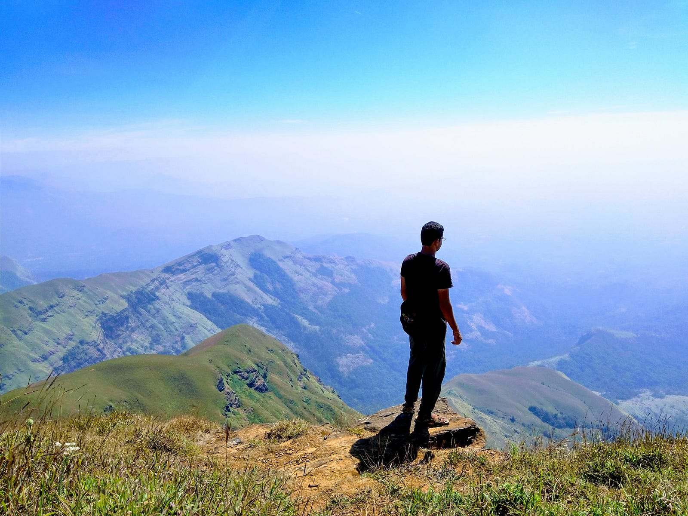
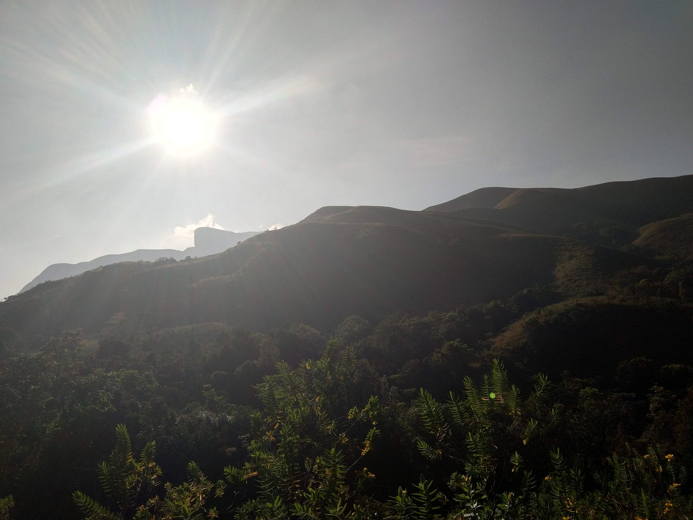

---

> When a mountain becomes your second home, the homesickness gets you❤

## Home

Home is where your family is — this is what I’ve always believed in and I still do. There’s no place to call home if there aren’t people who are eagerly waiting for your return. Similarly home is a place where you yearn to be, to experience the warmth, affection, love and the feeling of safety.

## The origin

I grew up in a small village called Jite in Raigad district of Maharashtra. My parents are my home here. They’ve also build a very pretty house for me and my sister to grow up in. The house is surrounded on three sides by mountains. My village has it’s own river originating in one of these mountains which feeds many of the farms throughout our village. Most of the farming is done in monsoon hence we usually rely on direct rain water for rice and pulses farming.

## The test

It’s not easy to reach my village, you have to cross the toughest and longest ghat section in Maharashtra — the Bhor ghat. Many vehicles have breath their last here. And even now, after many years of reforming the roads, people think twice before coming through. But those who do are blessed with the most beautiful view they can ask for.

## The reward

Waghjai devi welcomes those who are brave enough to take this route and people marvel on the ancestors who built such beautiful temple in the middle of nowhere. Right in front of the temple you get to see the most beautiful valley in entire Sahyadris. It’s so beautiful that in monsoon, when it’s lush green, if you stare at it too long then you’re bound to get hypnotised by it and lose your bearing. People avoid standing too close to the edge of the valley in this season for the exact same reason.

## Homesickness

Why am I talking all this? I never thought of writing about my hometown let alone in such foggy detail.

I’m homesick, not just of my first home but my second too — Kudremukh ❤️

The thing is, whenever I felt homesick, I’d wander in the mountains because that’d remind me of home. But in doing so less did I realise that my bond with all the mountains I was visiting was becoming equally unique.

I have been fortunate enough to visit Kudremukh more than one and each time she had new lessons for me. The dense forest cover, the marshy soil, the sweet scent of meadows, the cold yet soothing water flowing in streams and hitting your legs, the welcoming climb, the lonely tree, the view that sneaked through valleys near the lonely tree, the twists and turns of the path, the streams that flowed in the valley, the fog that kissed through your skin, the fallen trees on your trail, the portion where the trail goes missing, the humble trail that offered water streams whenever a wanderer felt thirsty, the humble Sun that sneaked through the clouds, the heavenly view on the last climb, the church and horse stable who have gotten camouflaged through the flora, the summit, the view from the summit, the second home 🙂

Kudremukh was the one place which made me feel at home, it reminded me of my hometown and each time I’d go there my homesickness would reduce just a little bit but enough.

But what does one do when he feels home sick of his second home? Where does he go? Are the photos enough? Are the lively memories enough? Is the photographic memory of summit enough? If not, then what’s missing? Why do I feel so safe, so at home, so at peace when I’m in this place?

## The remedy

Homesickness indicates you long for the love and affection at home due to the seperation. It indicates the feelings are mutual. Seperation and distance strengthen the bond of affection and love. That’s when we appreciate our bonds more. It’s ok to feel homesick. Rather it’s a feeling that deserves to be cherished 🙂

Home is where family is. The answer has never been more clear 🙂❤️

