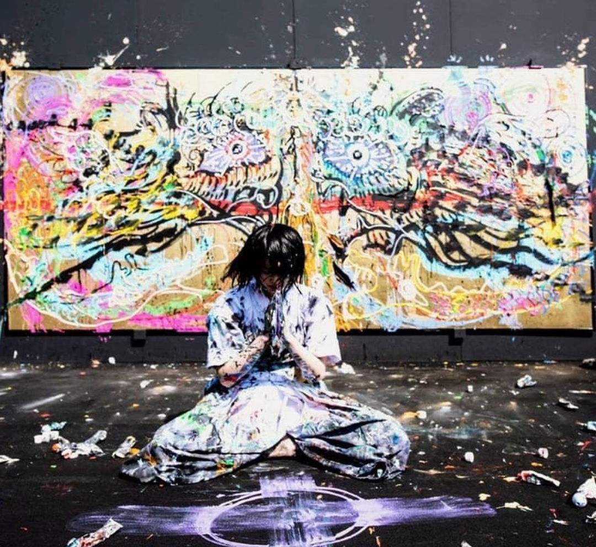

---

You don’t think, you don’t see, you just let it flow, you’re but a slave to the hand driving you.

Give in to it and let it express itself.

You’re but a medium for the inner self, it knows the language of expression, a language you’re yet to fathom, a language you don’t need to fathom.

Because that language doesn’t have a traditional vocabulary, it’s abstract, it’s obscure, it demands to be not understood, it demands to be unconditionally trusted.

You realise you’re nurturing an angel or a demon or both. One that’s formless, one who when given chance can bring out your biggest fears or soothe you with your smallest wins. All that, in a language you don’t understand.

So let it flow out, it’s not in your place to stop it. It demands freedom, it demands recognition. Not by anyone else, but by you.

Be one with it, you’re the angel, you’re the demon, accept it, cherish it, nurture it, let it grow, let it consume you, give in to it, and let it out in the material world. It’ll consume the material world too.

And in that moment, a new being will be born, one that’s indifferent to his surroundings, one that’s free of stimulus, one that’s driven by nothing external and everything internal, one that’s you inside out.

One who’s one with the art it creates. Go ahead and be the One.
