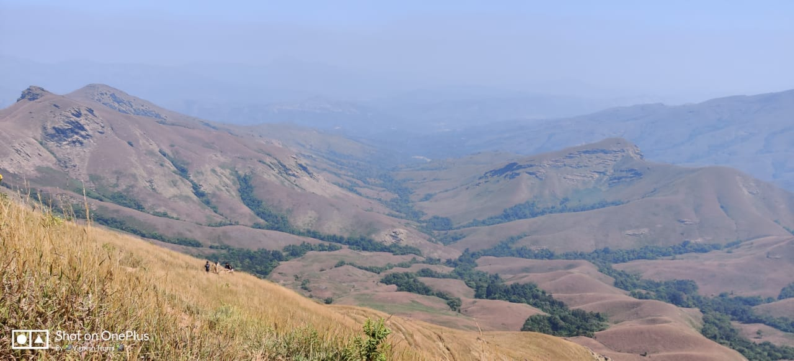

---

Only a few months ago, milky streams of water gushed through me,   
some on the surface many beneath.  
Only few months ago, the clouds became one with me,  
showering me with infinite diamonds, soon disappearing under my skin.  
Only a few months ago, my brown skin became lush green,  
with the plethora of meadows fighting for the water within.  
Only a few months ago, the humble old trees congratulated me,  
for the time had arrived when together we celebrate the dawn of new rigour in life.  
Only a few months ago, the fauna who'd so long been hidden in shades,  
started roaming freely, gushing through the meadows, jumping though the river streams, all with a hint of happiness and gratitude for the change happening in me.

Only a few months ago, you blessed me with the monsoon and I couldn't have asked for more. You set a new song reverberating through my entirity.

And my dear children, oh my dear children, they didn’t leave any stone unturned. All they would ask for would be a small patch of my skin and they’d turn it into a budding ground for life in infinite number of ways.  
Wherever the chilly water flowed, life was quick to follow, and it didn’t stop with me, water droplets joined into small streams, small streams into rivers and rivers into the promise of new life in places I have never seen...

Change is the only constant they say, but why is necessary change so painful?

Today, the water doesn't flow with its original ferocity, the meadows have all but lost their reason to live, the fauna hides in shade, new life is hesitating to blossom and the humble old trees seem to be preparing for an upcoming season of strife. It seems like the song you'd set in motion is being mellowed down by your own light. What set the events in motion is setting them off as well.

I'm not new to this, but everytime this happens I'm filled with deep despair for all the hope, beliefs and life that began on me.

**It's the season of forest fires and this year I'm again in the eons old dilemma.**

Life is like the mystical Phoenix bird, it's reborn from it's own ashes, it needs it's ashes to be reborn. In that sense if I set myself on fire I'm following the rules of nature. But what about the millions of life forms I'm harbouring now? They may not be in their happiest stage of life right now but would they agree to burn themselves for paving a way to the next generation? How do I as a parent allow that to happen?

The heat is rising as we speak, the water is drying up, my skin is getting laiden with the dried and dead remains of the once happy and grateful flora and fauna.

And I'm preparing myself for the next inevitable cycle, with dread, despair for my existing progenies and hope, gratitude for the life yet to come.

Pain demands to be felt and Life demands sacrifice. Why does it have to be this way? Why is a positive change preceded by pain? Why should there be a change at all? Why am I all but a spectator here?

There may be multiple answers to it, but would I ever find a satisfactory one? I guess the story is better that way.

And so I prepared myself for the dawn of the new cycle. One of strife, despair, gratitude and hope.
