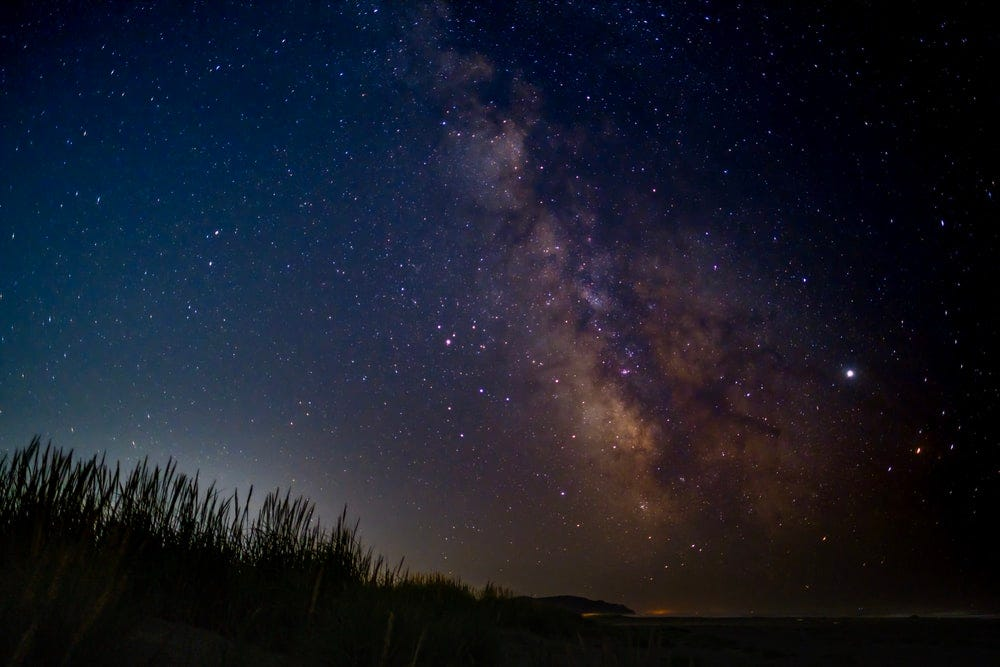
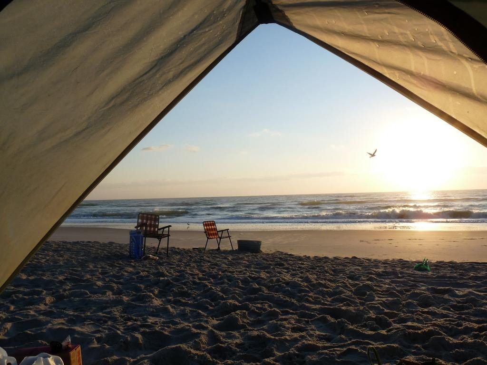
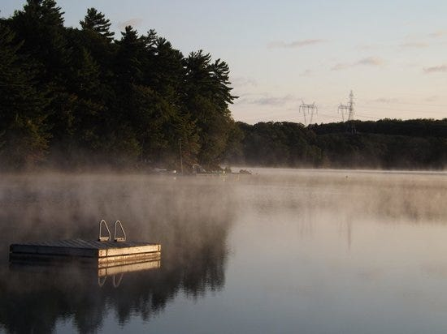
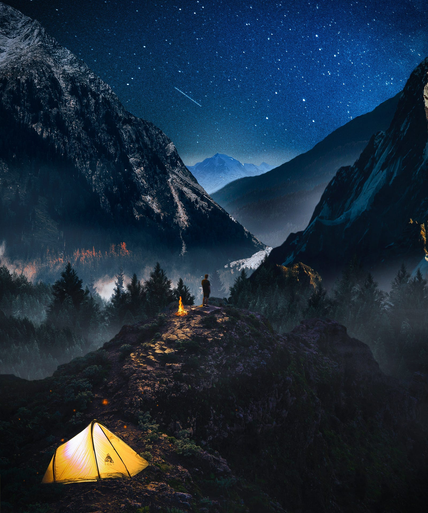
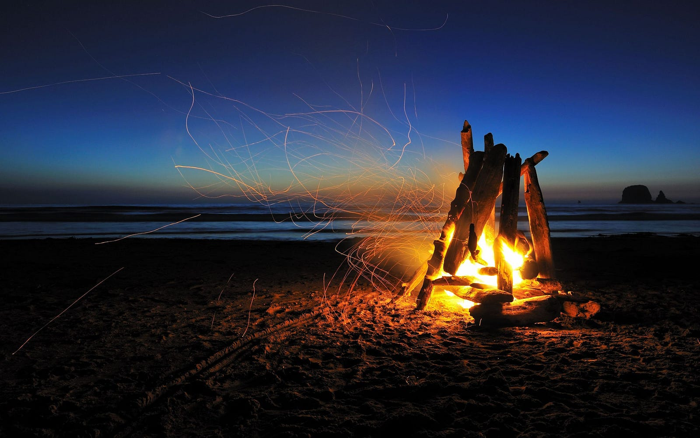
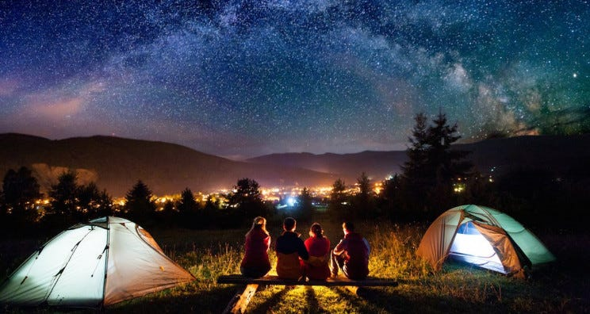

---

*Well this image answers for itself but let’s ponder on it together shall we?*

Camping by definition is spending time in tents over a holiday. But let’s be real the the definition has evolved lot more based on how creative people can get. Humans, intuitively want to live under covers deep inside forests, because that’s how we’ve evolved and those genes contain the secrets for our longing to similar situations.

To disconnect from the status quo and reconnect with your primal instincts is what camping boils down to in my opinion. The cold breeze, the starry sky, the chill of the lake, the scent of coffee, the hide and seek of moon and clouds, the rattle of a nearby stream all but different ways of teasing those primal instincts back in action. It’s makes us feel more at peace, makes us be more human.

Now that I’ve successfully bored you with my overthinking, let’s talk facts. The base of camping has remained unchanged but based on when, where and how you camp, there are some interesting possibilities that have started popping up —

**Camping on a beach**

*Ah, the sunset!*

What’s more soothing than feeling a cold breeze flowing over the sea while listening to the rhythm of waves splashing over nearby rocks. Beach camping has been a favorite since eternity.

Beach camping has an added advantage of water sports and activities in and around the sea. One moment you are racing across the beach line, the other you are kayaking or playing volleyball only to finish it off with a boat ride with dolphins around you. Not forgetting the sunset and sunrise views.

**Camping near lakes**

*Where does all this mist go?*

Sea is not constant, it’s consistent variance due to moons gravity gives it a beauty of it’s own. On the other hand, lakes are a different ecosystem in itself. If you camp near a lake you are likely to be overwhelmed by the cold mist rising from the lake water when you wake up. It’s a great experience watching the first rays of sunlight crossing through the rising mist.

Lakes are almost always surrounded by a dense flora and fauna which leads to you having the chirp of birds as your alarm and the mist of lake as your snooze.

**Camping on hills**

*Captionless and photoshopped!*

The best view is after the hardest climb. Well, wait for the night to fall and the story would be more interesting. Camping on hill tops is every trekkers dream. Because then you get to spend more time with the moment you longed for throughout the arduous climb.

And nothing beats the night sky from the summit. With no lights to pollute or disturb the dark night, the only light source you have is the moon and the twinkling starts. If you’re lucky enough and at the right place, maybe you can catch a glimpse of the milky way!

**Campfires**

*Fire is the best morale booster! Campfire the breeding ground for ghost stories!*

They are the soul of camping, the place where people open up, the place where ghost stories are cooked, the place where warmth is shared, the place where new friends are made. If you were to add up the number of stories told over campfires then it may need a library of it’s own.

Campfires have an inherent ability to make people more expressive and bring them closer to themselves and each other.

**End notes**

This is not the end of it, there’s more to write. The best part of camping is the learning you take home with yourself. How to set up a tent, put a fire, leave no waste and over all respect nature are all great life lessons to cherish. All of which are power packed together in each camping event!

May the camping be with you!

*Another random image I flicked from internet!*
