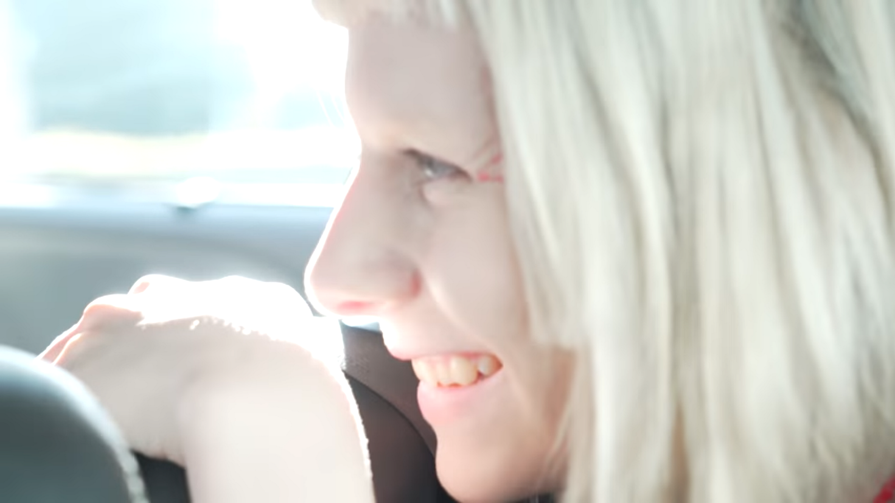
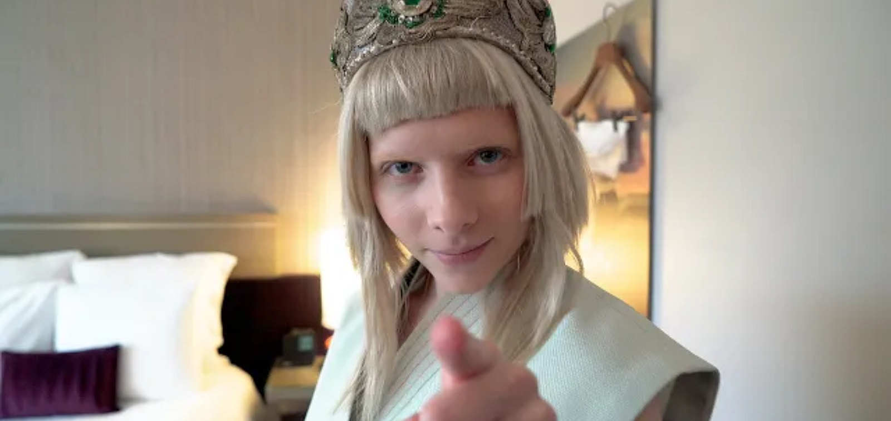

---

What would I write, when I run out of words, when the song goes silent, when pen goes blunt.

What would I write, when the thoughts won’t flow, when my dreams become colourless, when the mind stagnates low.

What would I write, when the noise of endless chatter, rings through my entirity and mellows my mind’s laughter.

What would I write, when my heart and my mind, the friendship they cherished, is hard for me to find.

What would I write when the dreams of dark content, make me lose my sanity only to make me repent.

What would I write, when the fear of judgement, inhibits me to connect myself with the self in torment.

What would I write, when I value external feedback, more than what my future self would want me to have it’s back.

What would I write, when the ideas that once fluttered, are idle as if a flower that has withered.

Live before you write, says Aurora, the more you live for yourself, the more you’ll have to write.

Enjoy the moment, cherish the present, experience the pleasure, in living, breathing, seeing, hearing and thinking.

For each moment has it’s own fleeing beauty and each moment has it’s own lessons to learn. Be always awake to the stimuli and be always aware to absorb the lessons.

And if you live so then there won’t be a day when you would run out of words to write. Make your life an open book for yourself and marvel at the infinite possibilities that lay in front of your sight 🙂

