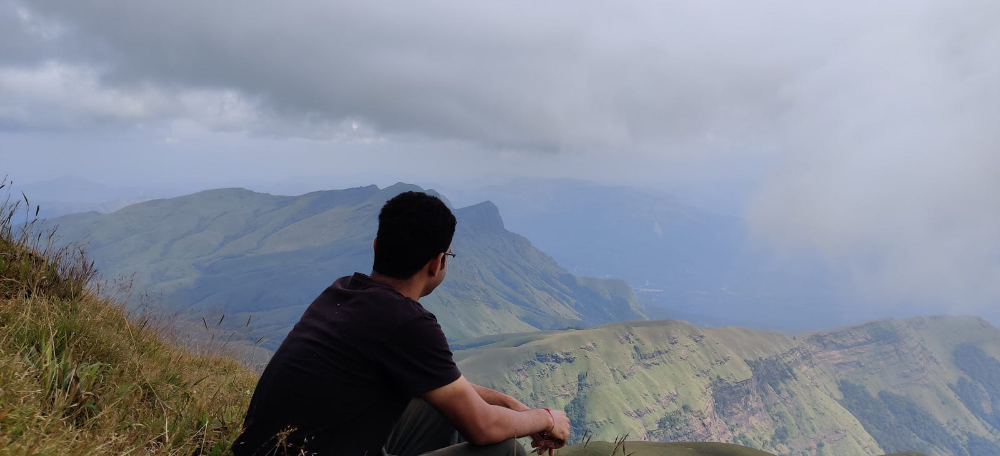
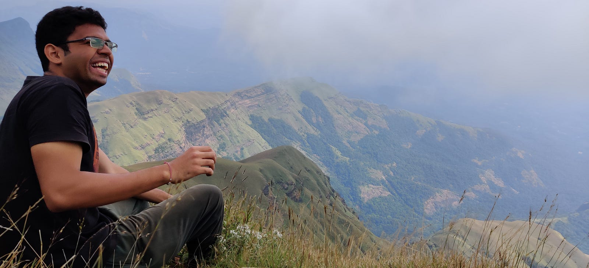

---

आकाशातील तऱ्यांमध्ये कोरताना आकृत्या, किरणे त्यांची कोमल साठवून डोळ्यात, मारत फेऱ्या बोचऱ्या थंडीत काय शोधतोस रे मना.

क्षणात भंग होणाऱ्या, उल्केच्या अस्तित्वात, प्रकट होऊन अस्त होणाऱ्या यादृच्छिकतेत, काय शोधतोस रे मना.

टीमटीमनाऱ्या ताऱ्यांच्या प्रकशात, आपले प्रखर अस्तित्व सादर करणाऱ्या, नम्र अश्या चंद्राच्या उपस्थितीत, काय शोधतोस रे मना.

---

समुद्रातील शीतल जलात, लाटांच्या खडकांवर होणाऱ्या मारात, त्यातून निर्माण होणाऱ्या मंजुळ संगीतात, काय शोधतोस रे मना.

सूर्यास्ताची लाल गुलाबी चादर, पक्ष्यांची घरी परतायची खळबळ, शुक्र ताऱ्याला तिन्हीसांजा काबीज करता पाहता, काय शोधतोस रे मना.

सूर्याची लाल किरणे, सोडून जातात पृथ्वीस एक ध्यास, की प्रकट होऊ आम्ही परत आणि वाटा देऊ नव्या प्राणास.

गाणे त्यांचे पृथ्वीशी आणि निरोप पृथ्वीचा सूर्याशी, अबोल त्यांचा संवाद ऐकताना, काय शोधतोस रे मना.

---

डोंगर रांगांच्या एका मागे एक थरी, प्रत्येक थरासोबत चढणारा निळा रंग, निळ्या धुक्यात लपंडाव करणाऱ्या डोंगर रांगात, काय शोधतोस रे मना.

डोंगरातून वाहणारे पाणी, जणू दुधाचा सागर, सागराच्या आक्रमक प्रवाहात, काय शोधतोस रे मना.

डोंगराच्या कुशीत वसनाऱ्या जंगलात, जंगलातील मोजक्या वृंडीच्या पायवाटेत, झुडपांमध्ये होणाऱ्या वाटेच्या लपंडवतात, काय शोधतोय रे मना.

डोंगराच्या दरीतून बाहेर पडता, सामोरे येणाऱ्या भव्य शिखरात, शिखरावर पोहोचण्यासाठी आरोहण करताना, काय शोधतोय रे मना.

शिखरावर पोहोचण्याच्या मार्गामध्ये, निर्मळ सावली एकांत वृक्षाची, वृक्षाच्या सावलीत आश्रय घेताना, भारावून जातोस तू सभोवतालच्या सौंदर्याने, समोर दिसणाऱ्या डोंगर रांगणा पाहताना, काय शोधतोस रे मना.

डोळ्यात दृष्या साठवून, पाण्याचे घोट पिऊन, चिक्कीचा तुकडा खाऊन, मित्रांना प्रोत्साहन आणि शाबाशी देऊन, पुन्हा सुरू करता खडतर आरोहण, काय शोधतोस रे मना.

कुद्रेमुखाच्या शिखरावर पोहोचतोस तू जेव्हा, पाहून शिखरावरील दृश्य, अश्रू रोकतोस तू जेव्हा, शिखरावर भाताचा घास लागतो जेव्हा अमृतहूनी गोड, थकले, भागले सवांगड्यांचे चेहरे न बोलूनही बोलके होतात जेव्हा, उन्हाने तापलेल्या शरीरावर वाहतो वायू देव प्रसन्न होऊन, निळ्या अंबरच्या कुशीत, काय शोधतोस रे मना.

---

लॅपटॉप मधील अक्षारामध्ये, हरवून तू विचारात, कामाच्या तंद्रीत, अंतिम मुदतीच्या मागे पळत असताना, काय शोधतोस रे मना.

बस मध्ये प्रवास करताना, पाहतोस तू बस कंडक्टरांची धावपळ, त्यांना प्रवाशांना सुट्टे पैसे देता पाहता, काय शोधतोस रे मना.

देस्कवरील लहानसे रोप, लहान पाने, लहान मुळ, रोपाला चिमूटभर पाणी देताना, काय शोधतोस रे मना.

घरून ऑफिसच्या वाटेवर, चालत रोज असताना, पाहतोस तू तेच झाड, तेच चेहरे, तोच रस्ता, तीच दुकाने, तीच सोसायटी, शेजारी कुठेतरी होत असते नवे बांधकाम, बांधकामाला हातभार लावणारा कर्मचारी, सांभाळत असे त्याच्या पोराला, आपल्यातच खेळत असलेल्या त्या लहान पोराला पाहून, काय शोधतोस रे मना.

---

प्रश्न उपस्थित होतात, उद्भवतात सरसर्त्या पवसासारखे, वाहतात दुढल्या नदिसरखे, नदीचा तो प्रवाह निर्बंध, त्याला नाही सुरुवात नाही अंत, प्रवाहाला कागदावर उतरवताना, काय शोधतोस रे मना!

---

