---

In Feb 2019 a friend of mine told me about a part time job as an Outdoor Trek Lead and I remember saying “yes” to it faster than I’ve ever done for anything before. After the interview and selection process, once the reality had settled in, I questioned what about the role attracted me so much. I thought I knew the answer, something superficial like travelling to your favorite places and getting paid for it!

I couldn’t have been more positively wrong! This article is an effort to document the things I’m learning in this role — be it on an intrinsic or extrinsic front.

### Who are outdoor leaders and what do they do?

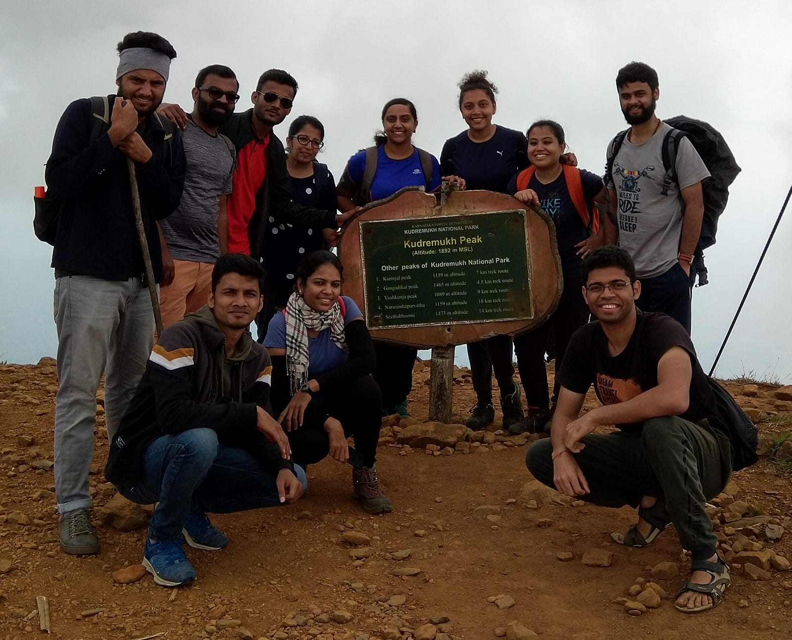

*To be one with the team, is what sums up an outdoor leader :)*

Well, we basically lead people on outdoor activities(duh!) — be it a trek through tropical forests, mountains towering the clouds, roaring waterfalls or any recreational activity. All we ensure is that you, as a participant of the trek have a good experience and the trek itinerary is executed per plan…well…most of the times.

*We need to handle the nitty-gritty like home stay and headquarter communications, permissions from forest officers, driver uncles’ temper, home stay uncles temper, local guides’ temper, participant’s temper, weather’s temper, medical kits, terrain checks, rain checks, participant checks, etc. all in background…shh! shh! But its too early in the article to get there. Let’s start with the basics!*

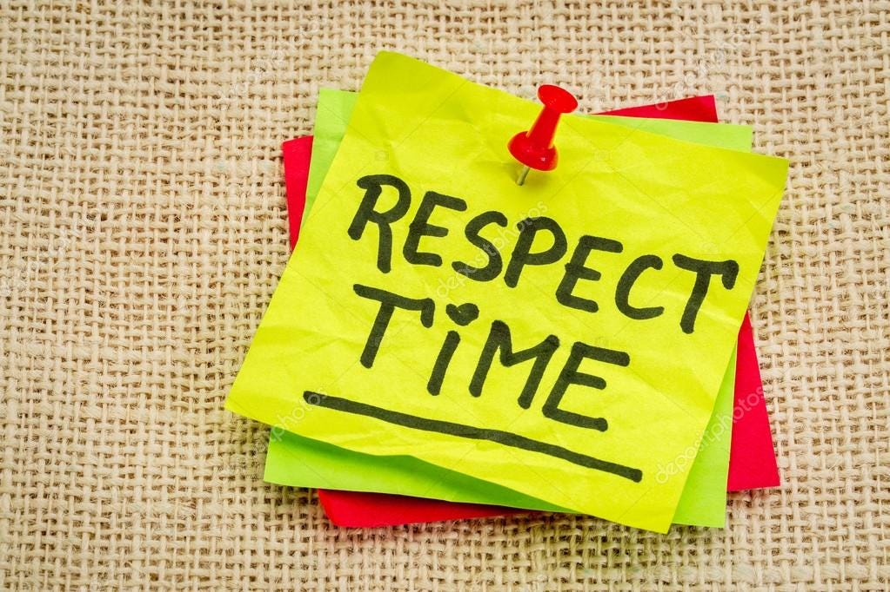

*Inarguably the single most important element of being outdoors(or anywhere else)*

**Being on time :** While being earlier than schedule is always respected, being a few minutes behind the schedule can literally shatter your itinerary. This happens in situations where the traffic in your starting location is an exponential function of time(yeah! Bangalore!) or if you need permissions from forest officers but you reach few minutes late and the slots for the day are already booked by someone else. Also, no one likes waiting, so he/she ought to make efforts to not make anyone else wait. No excuses here, live by the watch!

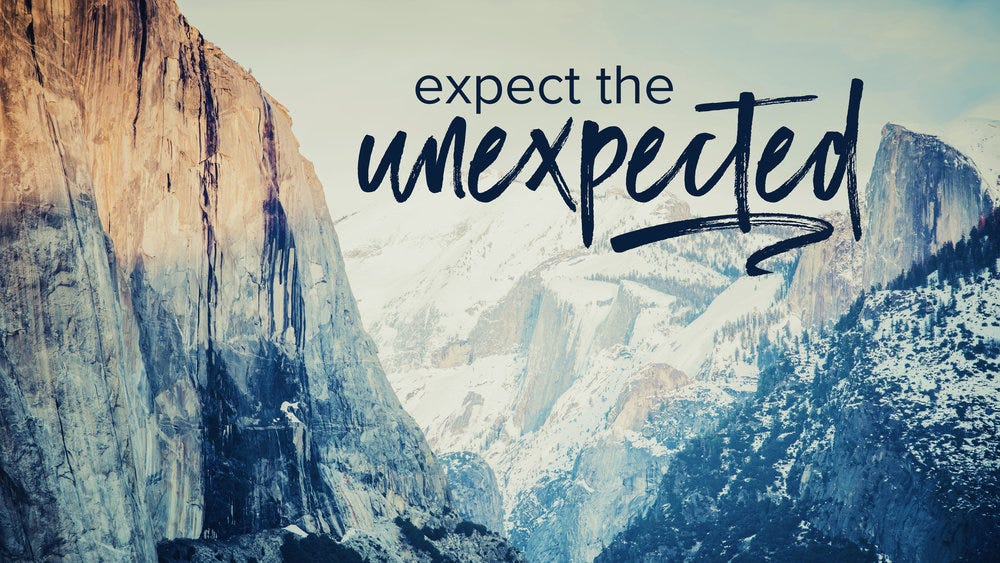

**Contingency planning**: Outdoors are unpredictable and that’s what makes it amusing. There are multiple elements at play like traffic, mood of people, permissions, rain, accidents etc. On the fly response to such situations is a skill which takes lot of experience to build, hence having a Plan B beforehand makes a difference. Eg. you did not get permission for the main trekking place? No worries — we can trek 2 neighboring peaks with equally beautiful view and a waterfall as a cherry on cake!

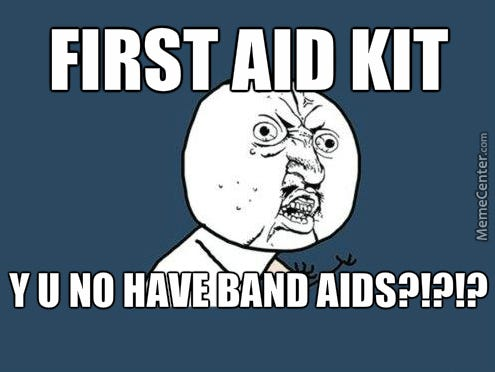

*This happens…more often than it should*

**Prepare for others :** You packed your bag with clothes, snacks, raincoat, toiletries, personal med kit etc. only to notice that in the 30 people group you are supposed to lead, more than 50% aren’t carrying any med kit of their own! This happens pretty frequently and it’s mostly because things like medicine are seldom thought by casual trekkers. Solution — think like them and imagine what you’d miss to carry — then carry them with you or make arrangements for them. Frequently missed items — med kit, lighters, turmeric, sanitizer, body wash, energy bars, raincoats, power banks, trekking sticks(you can make sticks out of nearby tree branches for this) etc.

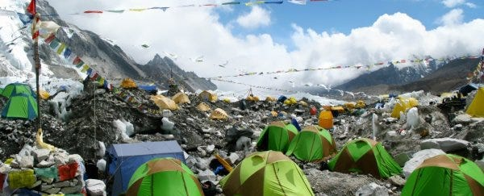

*A still from Mt. Everest camp*

**Respect the nature :** It’s heartbreaking to see what introduction of new trekking trail has done to many areas like Mt. Everest, or even places in South India like Coorg, Ooty etc. We can’t change behavior of the larger audience but it’s more than enough if you responsibly clean your trash. Since people look up to you during a trek they are likely to follow your actions.

Also, always remember that you are an alien to the ecosystem you are visiting hence it’s best to leave a minimum footprint. Try not to disturb the flora and fauna. Respect the nature for what it is than teasing and tampering it. If you have a feeling of respect towards it, that will only add more beauty to the trekking experience.

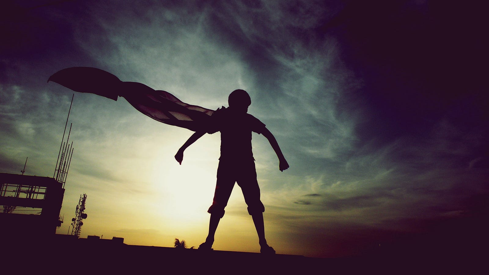

*People look up to you for the most infinitesimal of things*

**Be in control** : Things won’t always go your way, your bus will get delayed, participants may not arrive on time, you won’t get permissions for the trek, someone may get hurt. All these incidents are sure to create a concern in the team. The best way forward is to showcase that things are in your control. Because the participants will look up to you for what to do in such situation and if you are not showcasing confidence then that is likely to increase their anxiety and concern, making them panic.

To showcase control, the first step is contingency planning and the second step is communication. Communicate that there will be delay because the bus broke down and there’s no need for concern since you have already informed the concerned authorities ahead of time. Give an ETA for resolution and add buffers. Most of the time when you are transparent with the participants they will immediately empathize and consider you more approachable.

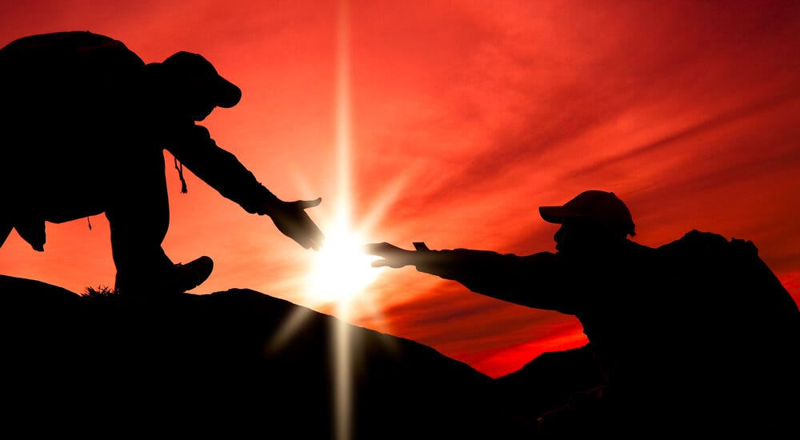

*Humility is not thinking less of yourself, it’s thinking of yourself less*

**Be humble** : As a trek lead you will find people who have varying trekking experiences. There could be veterans in your team as well as people who are just starting up. In either situation, whatever you say has an impact on their state of mind. A few harsh words and they would get hurt and trust me when I say this, those words may not seem harsh to you while saying them but could be perceived completely differently by the other person.

What’s important is being humble and appreciate that every person is unique and is here, away from their home, to enjoy the quiet of nature and connect with themselves. Your task here is to make sure they get such environment and to do that you need to echo with their experience, state of minds, outlook towards outdoors, stories they have to tell while not being judgmental.

Also, be humble with your surroundings, respect the beauty of nature around you, pray to it for protection and blessings, for it has the potential to give you strength unimaginable as well as take it all away in an instant. Be grateful for it’s humility as well, after all the mountains support life on earth and we can’t be thankful enough towards them for doing so :)

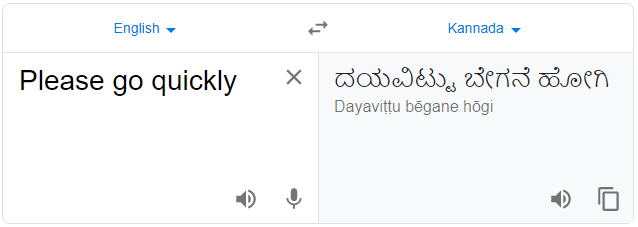

*This one phrase has helped me ignite fires(metaphorically) in the team!*

**Learn few phrases from the local language** : Nothing else commands more respect from people than a non-native person speaking a native language. People immediately lighten up, become more helpful, are more likely to agree and the overall mood of any tense situation can ease up by speaking a few words in the local language.

Also, it’s a matter of being respectful to know the local language when you visit a place. Few handy phrases — “My name is”, “What’s your name?”, “How far is this place?”, “Where can I get water/food?”, “Can you please help me here”, “Thank you”, “How is your day going?”

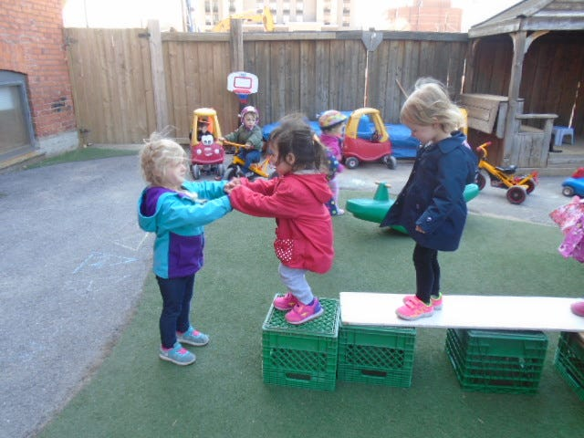

*All you need to do is ask!*

**You’re not alone — don’t hesitate to ask for help** : You can never be fully prepared for the worst situation, Murphy’s law hits in the most unexpected of times. But you need not worry about it. When outdoors, everyone around you is always ready to help, all you need to do is ask.

It’s important to ask for help when needed, both for you and the participants, considering you have a responsibility of not just yours but their safety as well. No one thinks less of you because you requested for help, rather they would do that if you didn’t!

Assess every situation and ask for help if you have the slightest of doubt that compromises yours or participant’s safety.

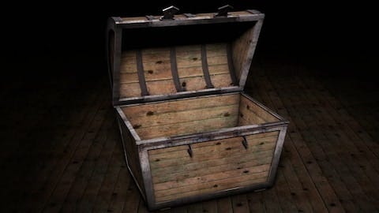

*It’s common for people to open up to you.*

**Respect people opening up to you**: On strenuous treks when people have exhausted themselves it happens quite a few times that people contemplate why they are doing the trek in the first place. We all question the mistakes and issues in our lives when we have no gas left in ourselves and you motivating them while in that state gives them a reason to speak about their life.

I am not saying this happens often, it’s rare, but it has happened. People have told me about the things they’re going through and I can’t help but imagine how a person would be handling such stuff. In that moment, talking to seeming stranger lightens them up and they keep walking.

It’s your task to keep what they say buried in the mountains, no one needs to know. And when they say whatever they say, their eyes have an unspoken promise in them. Respect it.

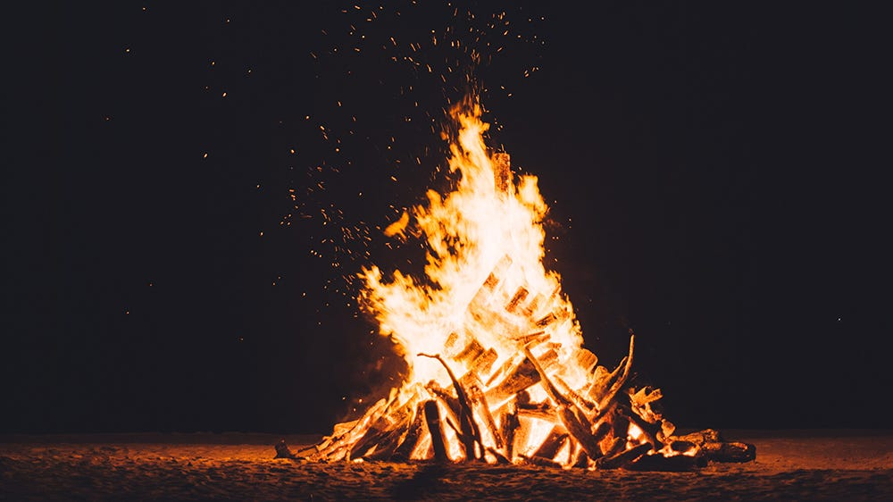

*Fire is the door to inner self, not just the eyes!*

**Campfires bring out the inner selves, engage them with stories**: By the time a trek is over, people end up striking a good friendship. And if the trek is followed by a campfire then they are likely to tell the stories of their lives.

I’ve had people talk about their experiences trekking Himalayas, forgotten ruins, hidden waterfalls, dense jungles, their relationships, stories from their school, college days, ghost stories(there’s no campfire without a ghost story!). The more people open up, the warmer the campfire feels. For people to speak up you need to be a good listener and take interest in what they are saying, cross question them on an interesting point and ask for details. People appreciate being heard and would be more than happy to tell a story or two more.

What also helps is having stories of your own(ghost stories? bring it on!). You could tell them about you adventures, what you liked, what you were scared of and also take advice in situations, what would they have done in “x-y-z” situation.

You can always start or end with how the trek experience was, what they liked the most about it, which part they felt was tough, where they thought they almost gave up and still continued moving. People always appreciate being asked for speaking up on their experience.

**Choose what you say wisely** : As an outdoor leader people look up to you. Because you are the only known object they have in this unknown place they are about to tread.

A few words of motivation can go a long way for the participants. During breaks, tell them they did a great job finishing the first part of the trek, congratulate them, clap for them and they will clap back! While walking tell them that their pace is great and we will reach the peak in no time with that pace. By doing that, they will be very open in increasing their pace if you ask them so wherever necessary.

Feeling good when someone praises our effort, is human nature, and seeing someone do that boosts the confidence of participants. Be humble, be respectful and be mindful of your words because they can go a long way in affecting a persons state of mind :)

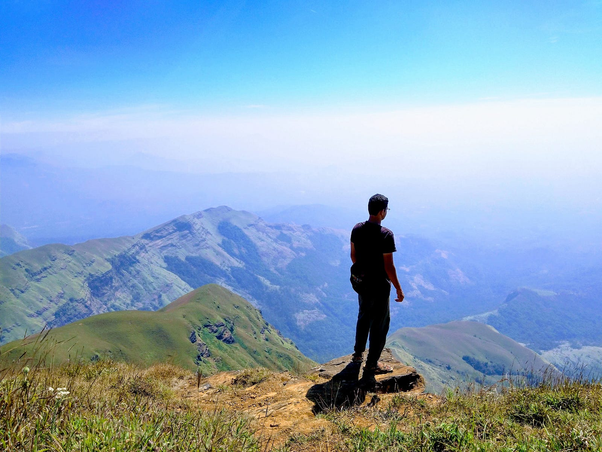

*Kudremukh summit — my 2nd home :)*

**Make sure you enjoy yourself** : The reason why I took this role dawned to me on my first trek. I knew I liked being in the mountains because it’s where I grew up. But never before had I received such a strong validation of my beliefs. While nearing the summit of Kudremukh, I saw one of the most beautiful view of my life, and I immediately fell in love with it.

In that instant I knew my reason to take up the role. This is what I’d written in my application….

> For me outdoors means “to connect” — to connect with yourself, the people around you and the beauty of nature. There is always something we can learn, some way we can appreciate nature’s beauty and even try to enhance it. Life may be filled with a lot of stress but when you truly connect with it, you know you can solve it — one problem at a time — just like trekking outdoors!

….and I felt that these lines had more meanings which I was yet to uncover! Every time I go on a hike I discover a new meaning hidden in these lines. It’s just way too difficult to word it out :)

Keep trekking! Stay connected!

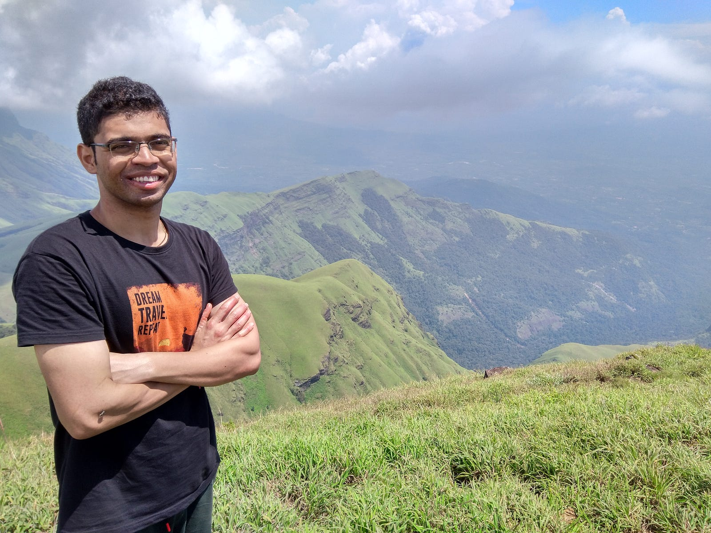

*Just another neighborhood outdoor leader :)*
