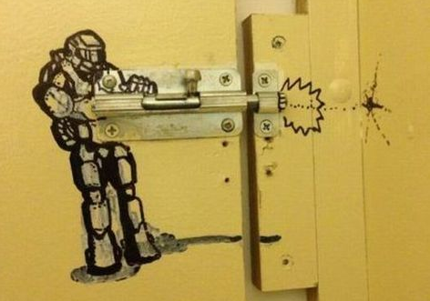
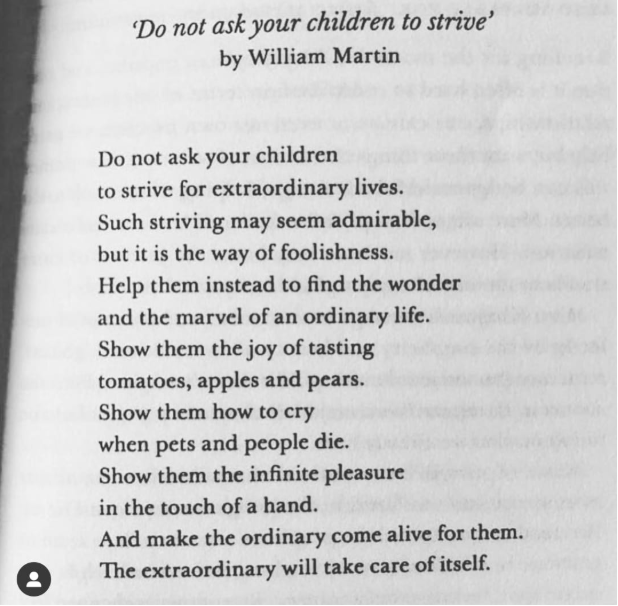
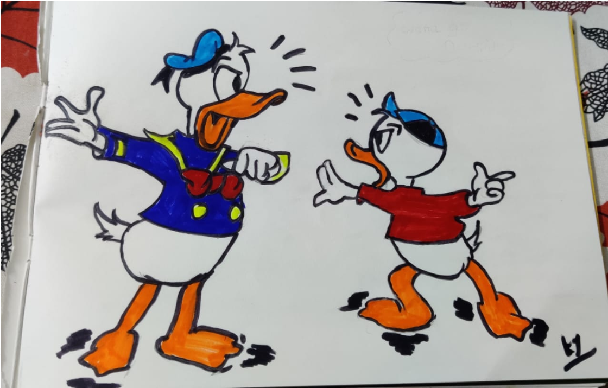

---

*Things you do when you’re sitting idle*

I know, it’s tough, 21 days is a long time I mean if you keep an egg under a hen for that long it’ll produce a healthy hatchling given the egg is fertile. Imagine the amount of transformations happening there, surely you could use this time for something — maybe making omelettes

We introverts have it easy, we’ve been training for this all our life. Although, occasional activities do help. This article is an effort to list down all the activities you can do at home to keep yourself engaged for the next few days of lock down.

1. **Write about the places you have traveled to :** Write one blog(per day or 2 days or 2 per day🤷) I know you are going through those photos, those selfies, that sunrise pic through the leaves. You’re trying to recollect those memories, but don’t be selfish, we want to see those pics too [😝](https://emojipedia.org/squinting-face-with-tongue/).   
   Writing helps you relive your memories in a much richer way. Besides you help the community by documenting the itinerary, and you get the additional pride that someone in future might follow your footsteps looking at your blog — so get started!
2. **Tell your family things that you like about them :** It’s not so frequent that you will get to spend so much time with your family (sincere apologies to people stuck away from their families — but there’s Skype so stay connected).   
   Tell them what you have been grateful about, share what you like about them, what they do that inspires you. You can use this time to have those hard conversations you have been keeping pent up since so long. Everyone has something to say, you won’t get a better chance
3. **Give a life lesson to your younger ones :** Your kids are looking at you though this crisis, the things you say, the way you react, the way you handle things is having a direct impact on the mindset of your kids/younger siblings etc. What do you want them to remember? My personal favorite lesson — teach them the importance of finding joy in small things

4. **Learn a new skill:** Having an extra skill helps, like sewing, that trouser you’re not wearing because it’s torn in the wrong place could use a hand. Learn how to play a guitar, harmonium, flute, piano. Try your hand at drawing/painting. You can always surprise people by the things you can do. For example, my sister is the most gansta person I know of, she’ll give most people a run for money on her deadlift PR. She can break people’s nose with a single punch. But then she can also break the stereotype by creating drawings like these —

*I know, she has a thing for fights!*

Break the stereotype, learn a new skill, but more importantly you will have something new to add to your portfolio. Trying to learn a new skill adds a new lens to your outlook in life. Do give it a try!

5. **Have a candle/moon/flash light dinner date with your partner**: It takes a lot of effort to get the setting right, I’ve had 2nd hand experiences to prepare settings for my friends(I know…things you do for your friends), such a drag. BAU days won’t give you enough time to make it happen, use the extra time you have now. And you could start with using their help in preparing the dinner. I know, both parties are doing the dishes right now, why not prepare the food too! An added bonus — use your kids as waiters!  
For those staying away from their partners, there’s always Skype. All things stay the same, use flashlights instead of candles, Maggi instead of some gourmet food.   
And if you have no one to Skype, you can always Skype me [🙈](https://emojipedia.org/see-no-evil-monkey/)

6. **Practice gratitude**: Gratitude is a very strong emotion. It’s the answer to pursuit of happiness. Through the day for 5–10 minutes focus on the things that you are grateful to have in life. Make a mental list of them. Most of the times in life we focus too much on the gap of where we are currently vs. where we want to be. Rather, focus on the things you have gained, things you learnt, experiences you had, opportunities that came your way.   
If you are reading this article then you have access to some of the most enriching content on the planet with occasional random crazy stuff that is published by me!

7. **Read :** Too cliche? I know. But there’s lot of stuff you can read on the internet which we thankfully have access to(see how I practiced gratitude there — smooth!) Some great pages on medium — [better-marketing](https://medium.com/better-marketing), [inc. magazine](https://medium.com/@incmagazine), [Forge](https://forge.medium.com/) and many more. I created a page where I’ve collated all articles I’ve found interesting, you can find it here(refer the ones I’ve ‘#bookmark’ed — pretty good ones).

[**5 for the weekend**  
*This thread is an effort to track some of the interesting reads that I may come across over the course of the week…*medium.com](https://medium.com/@rohan.nanaware19/5-for-the-weekend-e99f3db67a1a "https://medium.com/@rohan.nanaware19/5-for-the-weekend-e99f3db67a1a")

Also, you can read my articles on random content!

8. **Call that one friend you haven’t spoken with in a while**: You have given many excuses to not speak with that person, that person who used to be your “bff” once. All your excuses stand void now if that excuse was time! Go ahead, I know you have that number saved somewhere, ring it up and have a chat, there’s lot to catchup on.

9. **Learn to create contour maps**: For the people who are part of the trekking community, Everest base camp has become a party house than a place to test your limits, same with Chadar, soon the other places will get consumed in a similar fashion.   
What’s wrong here, maybe people are visiting places more because they are famous and vice versa, it’s a vicious cycle.  
Solution? Find new places to trek! But then the question is how do you figure out the trail? That’s where Peter Sir comes in. He’s made a great tutorial on creating contour maps and trails of places unexplored. How to draw a trail and map it in your mobile phone before even visiting that place? You have the answer now —

[**Navigation Bootcamp (10) - Trail planning in Western Ghats**  
*In this module you will learn how to explore or create a trail through a new mountain range using terrain features of…*ultrajourneys.org](http://ultrajourneys.org/ "http://ultrajourneys.org/")

Also, he has mapped most of the trails he has visited over the years. All you need to do is to download the trail maps and load them in your phone and vola! You’re off to explore new trails!   
Jokes aside, make sure you go through the entire itinerary and the precautionary measures that Peter has mentioned on the website, he can only do so much, the outdoors are a high entropy place and any amount of preparation is never enough. Use your discretion for contingency planning and ping Peter or me, we’re always up for a good chat!

10. **Don’t miss the sunrise/sunsets** : Sunrise and sunsets have a great story in them. Experiencing these two blissful events have awakened the writers and poets in infinitely many people. They are the doors to your inner selves.  
You need not see the actual Sun rise or set, rather the different shades that the Sun has to offer during these times is an experience in itself, enjoy your “Me time” of 15–20 mins when the sun shows the myriad of shades of red it has to offer!

11. **Exercise!**: Ha, ha, ha! That first Monday of the month, that first Monday of the new week, that not having time because I need to travel too much, where’s that excuse now eh?  
Now, there’s new excuse of not having enough equipment. Well then there’s Calisthenics — follow these channels on youtube.

[**Calisthenicmovement**  
*Sports Company - Fitness/Nutrition/Health Get Your Workout Program : ►► https://calimove.com ◄◄*www.youtube.com](https://www.youtube.com/user/Calisthenicmovement "https://www.youtube.com/user/Calisthenicmovement")

[**OFFICIALTHENX**  
*THENX Iphone App: https://goo.gl/Qk235s ANDROID App: https://goo.gl/kcRBpL IGNITE PREWORKOUT: https://thenx.com/shop…*www.youtube.com](https://www.youtube.com/user/TheMiamiTrainer "https://www.youtube.com/user/TheMiamiTrainer")

Or just search for Calisthenics on YouTube, [here I did it for you!](https://www.youtube.com/results?search_query=Calisthenics)   
Or there’s Rohanesthenics — bunch of newbie workouts done by me when I’m bored — 3 sets each of back push ups, chest push ups, diamond push ups, shoulder push ups, squats, lunges, mountain climbers, plank

12. **Meditate**: Can’t stress this enough. Would help you stay human for next few days and in a state that is still socially acceptable when you come out of the slumber to see the light of the day!  
Jokes aside, meditation would help you remain calm, think straight and maintain silence in your house while you respond to stress. I recommend using the Heaspace app.

13. **Play the good old games**: There’s UNO, Xs and Os, Snakes and Ladder, Chess, Carrom(all these can be played on your phone).  
I’m currently playing “Chidia Udd” with the 10 year olds in my wing’s balcony. They’re pretty good at it. Need to up my game!

14. **Sort that cupboard of yours** : It’s been that disorganized since time immemorial. During the ages when dragons flew and earth was considered flat. Maybe it’s time to get it sorted. You’ll be surprised by the amount of extra space your cupboard has. If you’re lucky you might end up finding that old favorite t-shirt of yours!

15. **Cultivate a new habit** : They say it takes 21 days to cultivate a new habit. Coincidence? I don’t know. But opportunity — Yes! Maybe you wanted to create a habit of waking up early or not touching your phone an hour prior to bed time, or calling your siblings on a daily basis, or combing your hair, you know better!

16. **Create your own mind palace** : A mind palace is exactly what it sounds, a palace or place existing in your head. It’s cool to have one, it’s a place of seclusion, peace, beauty that’s always there. You can use all of your creative self on building it, the only limitation here is how much depth you wish to add. More on this sometime later maybe

17. **Talk to yourself** : I mean all of us talk to ourselves, but usually it’s about trivial topics and quick and temporary decisions. Quite a few times, we do speak about a few important life decisions. Like having chicken tandoor or chicken gravy for lunch/dinner. Use this time to increase both the depth and breadth of the conversations you have with yourselves, more than you know, you might actually end up liking it!

18. **Revisit your passion/hobbies/retirement plans** : If I were to tell you that the world will end in a month (after the Coronavirus pandemic clears up) what would you want to be doing in that month? The answer to that is your passion. What’s stopping you from doing it now? Again, what’s really stopping you from doing it now?

Hobbies are a state of mind, there’s always something more that you can explore within and outside them.

When, why, how do you want to retire? What do you want to do when you do retire, what’s stopping you from doing it now?

Just a food for thought!

19. **Have a social media distancing day :** Thank me later!

20. **Do an “Ask me anything — I will answer honestly!”** : People tend to open up over text chats, mostly because they are able to articulate themselves more accurately than a f2f interaction. Allow them to have a QnA, it always benefits both parties!

21. **Ask people for anonymous feedback**: Everyone has something to say, some of it would be just simple appreciation, other could be a harsh yet constructive feedback, or just a simple Hi! When given the chance to provide an anonymous feedback people are more comfortable to give a honest answer. Also, an honest feedback will help you grow in a constructive manner as well. I searched around and found Google forms to be one good way of getting this done. I’ll add a template for you guys below.

You guys can give me feedback [here](https://forms.gle/gcF6bG4nQWY4SrGg9).

You can make edits to the form or create a new one.

Alright then! Have a great 21 day journey! Stay safe, stay healthy, don’t venture out of the house for no reason, wash your hands, pray and respect for the healthcare officials risking their lives, working day and night so you stay safe and pray that this pandemic gets cleared as soon as possible :)
