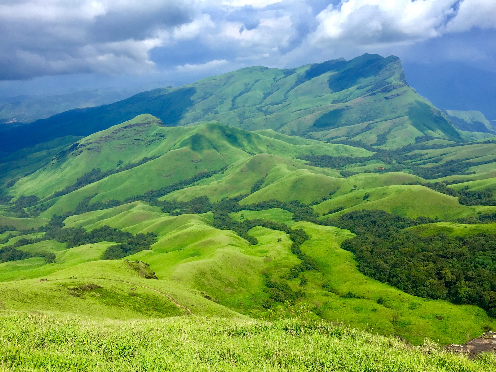

---

I know, I’m grateful that I’m in a position where I can write this, many people don’t have this privilege either and continue on with life without questioning. I’m sorry for the image used, it deserves better than this, I can’t be a judge of that. Sorry.

---

What’s the point of it all, waking up and crunching numbers, so you can fill those slides, so the KPIs move, so the investors get their return on equity, so you retain your job and pay for those bills.

What’s the point of it all, of buying those groceries, of getting those medicines, of treating those ailments, only to reduce the pain of the mistakes you’ve been doing, while you heal your body, what happens of your mind.

What’s the point of it all, of staying in apartments, built where there used to be a forest or a farmland, only to be sold so that the next generation won’t have to toil away in the jungles, of drinking water, syphoned in from rivers afar, making it bleed, while the fishes are dying by the organic waste dumped in the river.

What’s the point in pushing your body to the limits undefined, where does it lead you than the answer to the limits of human body, how does that help the planet?

What’s the point of it all, of switching on the fan when you need breeze of air to cool down, fuelled by the electricity created by burning those fuels in turn warming the air you feel on your skin. Are you not the one responsible, what are going to do about it?

What’s the point of it all, when you live under that roof, built by people who don’t have footwear to walk while they migrate to their hometown, who are beaten up so that they stay where they are and don’t spread the virus, while the affluent crib about the speed of internet.

What’s the point in experimenting with dishes and wasting the product because you burnt it while people die of hunger, the same people who toiled in the field to produce the veggies you so dumped away.

What’s the point in staying in the lockdown when all your life has lead to this, the need for stronger vaccines, the evolution of viruses and bacteria to counter it, the hunger for non traditional food, the hunger for money, power, pride, survival. Survival is a privilege humans boast about, but do they deserve it at all?

What’s the point of survival, when all our actions have lead to extinction of many known and unknown species. Despite knowing it there’s nothing we do against it. People scramble for years protecting the unprivileged only for their effort getting tossed by an overnight mining activity.

What’s the point of the hope that mankind will get any better, when years of pandemics and world wars and loss of lives have not been able to overweigh our selfish hunger for money, power and pride. Has our need to prove ourselves as a higher species turned us into an epidemic to our planet itself.

Tell me one action you’re doing now, which will help anyone, that tomorrow the planet will be a better place, not for your survival but for every creature that exists, will any of your actions in future give this assurance? Do you even have that confidence in yourself or the human race? Then what’s the point? The Earth’s better off

We need to be sorry because with every breath, we add an additional overhead to the planet, to clean our dump and still survive and support the creatures who call her home. All the atrocities, the forests burning, the animals going extinct, the poaching, so people can have shinier shoes, the aimless rant of writers, the hope that humans will improve, shattered every time they are given a second chance, the wrath has been boiling inside the Earth and it’ll produce more such cures.

Cures to annihilate the virus named humanity. Coronavirus isn’t the first and it won’t be the last. It won’t stop coming because human race won’t act on what they learn. Because we are too comfortable with our advanced lifestyles. Because we take pride in breaking the rules of nature.

If coronavirus isn’t a sickness but a cure and we are the infection to Earth, then what’s the point in doing anything, when our Mother Earth doesn’t want us as a race to exist. And is forced to create a being like the Novel Coronavirus.

A race abandoned by it’s Mother, orphans, illiterate, sociopaths, illogical, unchanging, useless, making zero value add. What face do we have left, to face the Sunrise.

I don’t have an answer. What’s the point in having one anyways?

---

“Change starts with us”, the voice kept repeating.
