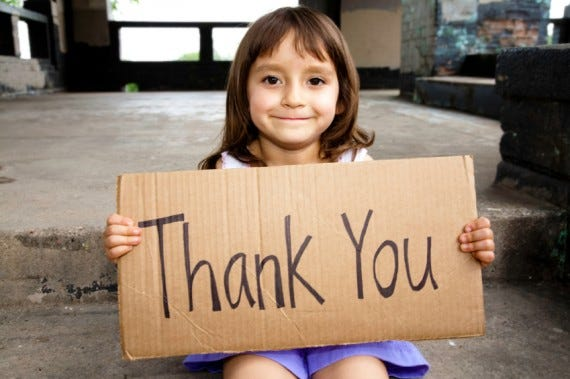

---

This article could have gone in wrong direction, had a last minute stimuli not pitched in. So I dedicate this article to that stimuli.

I’ve heard that Gratitude is a strong emotion. Everyday I wake up and I’m grateful I did. As the day progresses, for every thing that would pull me down I can always find something to latch on to.

It wasn’t like this always. I’ve lived submerged in an ocean of anxiety all my life. Imagine living on a planet with gravity many times higher than Earth. What would it feel like? Moving an inch of your body would be difficult.

That’s what anxiety feels like, everything is tough to do, right from opening your eyes to thinking whether or not to keep them open.

Many people go through it and in our country it’s considered a stigma to talk about it, but it’s there, it lurks around, waiting for its chance to pounce and eat you up.

Through these years, I’ve used a few means to deal with them, good, bad, ugly. Many of them didn’t work but some of them did. So, here I am, writing them down, hoping they’ll help someone going through anxiety, including my future self, stay strong 😄

### Breathe

Things get overwhelming at times. Information surge happens at a faster pace than you can process it. Thoughts fly around and you can’t understand which one to address first. Don’t address any of them. It’s a slippery slope.

Take the [deepest breath](https://www.google.com/search?q=breathing+exercise) you can through your nose and exhale through your mouth. Try this 2–3 times. Close your eyes if you can. Try it now!

Now, where were we? Chances are the thoughts are cleared partially. Pick one of them and either take it to finish by solving it or shrug it off and move to next one 🤷🏻‍♂️

### Meditate

Meditation makes it a little easier to control the raging surge of thoughts through your head. Think of anxiety as clouds and clear head as blue sky. Meditating frequently gives you the power of wind to blow away the clouds so you can just sit and enjoy the blue sky clearly.

That’s actually how it feels 😄 [Headspace](https://play.google.com/store/apps/details?id=com.getsomeheadspace.android) is a good app to get started with meditation.

### Exercise

The more you put your head in things that give you a sense of fulfillment and achievement, the less likely you are to fall into anxiety.

Exercise is a good start. And even if you’re just starting or have been doing it for a while, you don’t need to be too hard on yourself. There’s always the trainer you can consult and I advice doing that.

Running is one exercise that’s the easiest to begin with but takes a lifetime to master. All you need is a pair of good shoes, you can do away with them later though 😉 Focus on [warm up](https://youtu.be/E3bioKpFgFA) , [cool downs](https://youtu.be/o_pxwij2UA4) , [posture](https://youtu.be/fQ7ewHFw_I8) and of course the most important part — having fun and a big bright smile on your face while you tread through the streets. Don’t target for pace or distance always target for having fun 😄

### Be closer to Nature

Remember Avatar and the scene where they are all connected to the Mother tree? Yeah, we many have lost our way somewhere.

You don’t need to do what the people in Avatar did. Watch Sunrise or Sunsets, spare 10 mins of the day and you’ll be gifted with the most magical view of your life. Always. Pollution is a pain though, but you’ll always be able to find a view from the top floor of your office or maybe the neighbouring one 😉

Plant a tree! I’m seriously in for cancelling children and making dogs/cats the new children while trees become the new pets. What say 👻?

Go on hikes, solo ones of you’re experienced, but hike in general nonetheless. There’s something in the view from summit of mountains. It clears the biggest worries, makes you feel you are just a spec of dust in the larger universe. That brings me to watching the night sky. You can’t have enough of it. Just sit there and let the stars take you on a journey that’s bigger than yourself.

### Listen to songs, or create them 😉

Music, good one, has proven to heal anxiety. I’ll link an article [here](https://www.inc.com/melanie-curtin/neuroscience-says-listening-to-this-one-song-reduces-anxiety-by-up-to-65-percent.html). The songs here help heal anxiety. For me [this one](https://youtu.be/4ZR6I-4egTk) works.

Learn to play music, guitar, harmonica or even that office desk. Sky is the limit 😄

Sing, if you do it office people would treat you an oddball, it’s okay, but I’d suggest try it on treks, they’ll still treat you as an oddball but in a warm way 🙈

### Create a support system

It’s a lonely battle, anxiety. Having someone to share your thoughts can make the biggest difference. Trust me on this.

All these years, I tried many ways, majority of them not written here but nothing helped as much as someone listening patiently to what I had to say and not leaving my side despite the pain I gave them. I’m lucky to have someone like them and I know they’re reading this article too. You know how grateful I am towards you, words fall short 🙂♥️ I’m sorry for being such a pain.

Once you find a support system, it’s more important to maintain it, nurture it. You see anxiety will try it’s best to get rid of this system. It’ll make you think that you’re all but a burden to the people around you and put you through guilt making you increase your distance from your support. How do you circumvent this foul play of anxiety? There’s no straight answer, but remeber when I say this, your friends are here for you, they look beyond your imperfection, your weirdness, maybe they even like that part about you. Don’t make decisions for them. They chose you because they’re here to stay. And they can leave when they feel like it, don’t shrug them off, don’t test them. Please.

To the people who are friends with people with anxiety, we are a weird bunch and anxiety forces us to get rid of everything good in our life. Please be patient with us, we’re trying to learn 🙂

### Live in the present

It’s a simple statement, living in the present, but it has a much deeper messege.

Why worry about the mistakes your did 10–20 years ago? Why worry about the future? How’s it gonna help?

Rather, you are thinking, breathing, seeing, hearing, feeling and perceiving things right now. Focus on them rather. Get back to work, there’s lot of things pending 👻

### Practice Gratitude

Gratitude is a strong emotion. It’ll teach you to accept the fact that you’re enough the way you are right now. People like you for who you are. You have everything at your disposal to achieve your goals. If you’re reading this article then you have access to the most beautiful resources via the internet.

It’s ok to make mistakes, be grateful for having an opportunity to learn and having people who stay by your side while you’re learning.

Everytime I go on a run, I’m grateful I have the legs to do so. Had my ligament torn in the wrong direction, I’d never have been able to. Everytime I open my laptop I’m grateful my parents went against innumerable odds to ensure I finished my education. I’m grateful to the company who let me retain the job in a time of Covid-19 outbreak. Everytime I have food I’m grateful to the farmer’s who are working day and night nurturing the plants through their life cycle and to my Mother who makes awesome delicacies from them😍♥️ I’m grateful I have warm friends I can speak openly with, Mountains that allow me to climb them, the Sun that spreads it’s beautiful shades everytime it says Hello or Goodbye and the list is endless.

Believe in the fact that you’re enough the way you are right now, for yourself, for your family, for your friends, for the society and for Planet Earth.

Have positive thoughts and live in the present. And if you ever want to talk and can’t find someone, ping me and I’ll always be there to listen 😄
