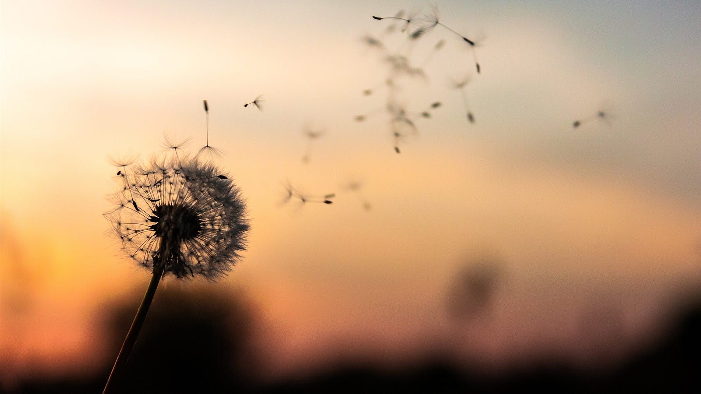

---

"I feel cold Papa, can’t sleep", said my daughter, "tell me another of your lullaby, would you please?"

"Have you heard the Song of Life dear?", "No",

"Then we have a perfect setting here and now, allow me to take you through the most beautiful journey in the universe will ya!"

---

Long ago when the Earth was barren,

the sky rained fire,

lava flowed through the rivers,

When things were grim and no soothing music nearby,

---

Something unique started happening,

---

Our Earth decided to become more beautiful

and recite this song

A song of hope and faith,

beauty and pain,

---

The Song of Life

---

The sky roared in rage,

the winds blew in fury,

the air beat in a newfound pulse,

rhyming in the rhythm of thunder’s dance

---

And behold we witnessed magic,

diamonds fell from the sky,

diamonds more beautiful

than anything man has ever made,

---

They raged towards the Earth,

each bringing with them a promise of contact,

hope of sacrifice and

faith in transformation

---

Each diamond had a story of its own,

some were big, some small

but their hearts beat the same rhythm

and they all longed for the same Earth.

---

Like mad lovers they dived in,

while the sunlight paved their way,

as a tribute to their love for Earth,

the Sun drew a rainbow along their way

---

Charmed by the gesture from the Sun,

the speeding diamonds reached their terminal velocity,

as if the air around was asking,

to be gentle when they meet the Earth they were longing

---

And so the drops fell

for and on the Earth to make her complete,

For the months of drought, she faced under the Sun

were soon going to be obsolete

---

And the Earth couldn't be more grateful,

for she started humming with joy,

And the sweet scent of their union

filled the entirety nearby

---

And long behold the seeds that

lied dormant in the womb of Earth,

were about to be united with Earth, Water, Sky, Wind

and Fire in the Sun

---

Soon the water met the seeds

and knocked on their forehead,

"You've been waiting for me long enough,

here I am, my dear kid"

---

Alas! the seeds germinated,

And reached out from their mother's womb,

For they longed for the Sun, Sky and Wind,

whose beauty they were yet to fathom

---

They breathed the first of the fresh Air,

They bathed in the first light of the Sun,

And as the Song of Life played,

They became it’s living rhythm.

---

And all the five elements,

Welcomed the arrival of their being,

Charmed by their call, they started the journey

to reach above and beyond them.

---

And soon these seeds transformed,

into the meadows and trees of today,

the Lions and Zebras of tomorrow,

and the Hope and Faith of eternity.

---

And so the seed that germinated first,

Asked himself on what the end of the song was,

It soon realized that it was just a note

Of the eternal song for whom no start or end ever was.

---

The seed pledged to the five elements,

that it had experienced all it wished,

that it knew the song needed to continue,

and knew it was incomplete without the sacrifice.

---

"Sacrifice was not the end", it said,

It was the destination, not a reason for sorrow

For the song is incomplete,

Without giving back what you have only borrowed.

---

And so the seed fell,

Back to the Earth's womb,

And became one with the five elements,

Who helped the seed become.

---

And so the Song of Life continued,

Ringing through the entirety of the seed,

And many others who lived together,

With the five elements within...

---

"So did the seed die?" asked my daughter, "No dear, there’s no life or death here, you just give back what you have borrowed from the five elements.”

"But then what about the seed? I mean he must have some hobbies. He would not want to be forgotten. He won't get to play with his friends, or get the gifts, or kisses from his Papa and Mama", valid questions, I thought to myself.

"The seed knew that something more important was waiting dear, it knew that staying the way it was, may not be as beneficial to the Song of Life as letting go. It knew that as long as his family and friends remembered him, he was still alive.”

"But why can't the seed be selfish Papa? Are the five elements so strict as to allow the seed to not be selfish?"

"The five elements don’t expect anything of the seed dear, they only wish you live the way you wish, to your fullest, with Gratitude for what you possess and doing things you love to do. It’s up to the seed to make the final choice..." I bit my lip as I lied to her.

"Ok Papa, when I wake up, and all these wires are removed, I want to give you and Mama the tightest hug ever"

---

And she fell asleep, just like that,

her pulse kept beating,

like the Song of Life,

dimming with every second of the clock.

"Why do some have to leave before their wishes are complete?" I thought

---

Mama and I gave her the tightest hug,

just like the one she would have wanted,

"I feel warm", were here final words

before her pulse became flat

and so continued Song of Life...
