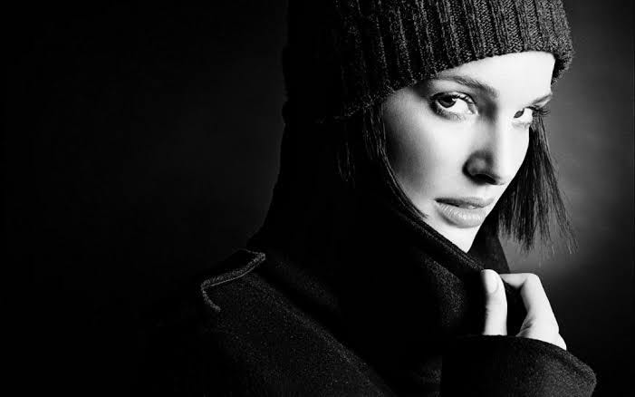

---

The clock read 01:30am  
"Time for the stroll in the park", I thought, before shutting in my laptop, pulling out the earphones, connecting them to my phone running some Two steps from hell tracks and leaving the apartment.  
"It's cooler than usual", "Yeah, winters coming!", I had the customary exchange with security uncle. We called him Anna, too cliche, but he liked to stick with that title. Guy was in his 80s but always had his face full with light. Only made more bright by the yellow street lamps.  
"Another day, another stroll!",   
"Yeah",   
"I give you 45 mins, beat your last week's time else jump the fence, I'm not holding the door for you!"   
"Enough of those Game of throne references!" I muttered. But got excited by the thought of beating the week old time limit, the cold will only add to the fun.

Warm up | Run @ 5.8m/km | Cool down | Back Strengthening

It had become my schedule since the doc said my legs have made me unfit to run. But I'd grown past it. Now I ran because it gave me isolation, from the numbers, the calculus, the human social construct, the promises and betrayals, nothing mattered here, all I needed were my legs and shoes and I'll put myself on auto mode, one breath at a time.

"Off we go!"

My apartment was one of the many societies that created a maze of concrete jungles. It was amazing how this place flooding with people during day was absolutely motionless at night. Only lit by the yellow street lights, heating up the air right below them. The roads between those mazes formed a complete circle although I preferred cutting through, that made the track that much more unpredictable and less mundane.   
I'd many such mental tracks in my head. One passing through the 99 dosa center. Always had a dog or two there. It swiftly turned into a chicken shop followed by a Reliance mart. Another passed through a villa which has beautiful flowers right outside their compounds.   
"I wonder what trees dream about", just a fleeting thought.  
Then there was this trail which took a sharp left from my apartment and connected to the central park. The park was built in a circular fashion with thigh level plants on the circumference connecting the two doors. This is where I'd conclude my run everyday. Great spot to cool down amidst sleeping trees.  
And there it was, the bar.  
"12 reps of pull ups", I made a mental mark and went ahead to manage only 8. "Not there yet!" I thought, while stretching my back and preparing to leave. It was a good run, better time than what Anna suggested.

"That's 2 reps more than last week!", I'd noticed her sitting on the kids swing.   
"Too old to sit there", another passing thought.   
"Yeah", but not enough yet.   
"Nothing's ever enough, is it?" she said  
This made me check her out. She looked like my age, maybe a few years younger. Had a slim build, narrow nose, thin yet full lips, narrow eyes and eyebrows that were sharp like a knife. She wore a black top and black leggings. Had a complexion similar to mine. Long black hair tied in a pony tail. Had a sweat band on her left arm. Black one. Then she stood up and faced towards me, that's when I noticed, her abs, she was ripped! Man she was ripped! Started at them too long to make her notice but too short to photograph that sight in my head.  
"I got them on the same pole you're practising your back on!" she ignored my rudeness and explained in a playful way.  
"I've been seeing you dude, usually I'm done earlier with my workout, thought of staying in the park longer today! I like the calm of night, adds to the peace of working out"  
"Good for you!" I muttered  
"You too", she winked. This was getting awkward.   
"Time to head back? Don't want to miss your clock do you?" She pointed at the clock in the park. I was 30s off time. "Anna is going to shut the door in my face today", I cursed.  
"About time for you too?" "It's well past for me, I was waiting to meet another night owl before heading out to be honest" before I over thought, she pointed at an actual owl sitting on top of the mango tree near the park.   
She laughed, "Hope to see you around kid" she waved and we left through the opposite gates. I didn't get to ask her name, I mean what's the point, was just another chance encounter.  
I headed back to my apartment only to find the door open, Anna was in a good mood today or maybe I'd... what the hell...I was talking to that girl for like 20 minutes but the clock had hardly moved. Anyways, I bid good night to Anna and went off to bed.

Another hectic day at office. Numbers, decks, charts, analysis, presentations, meetings, client calls, internal reviews, lunch brainstorming. Man this was too much. I waited for the clock to hit 11pm and shut my laptop. Was the last one to leave, again. "I'll continue from home", I thought, again.  
Near my apartment, Anna was just changing his shift, we exchanged a smile. He looked a bit tired today but I thought it was the weather.  
I freshened up, did some reading on stats, this new algorithm, XGBoost, was catching all heat in Data Science community. "Interesting read", then I moved to close my laptop and back to customary run.  
That's when I remembered the girl in black. I was hoping no company today, "was a tiring day, don't need more human interactions". Exchanged a chat with Anna, he said he was having cold. I made a note of getting the guy some Vicks. "Be easy on yourself today, climate is nasty!", "That's how I like it", I tried sounding cool and Anna just rolled his eyes.

I ran slower today, hoping to extend the time to reach the park. There she was though. This time practicing her ab routine. She had an air of control against her. Really fluid motion, completely effortless, as if she'd been practicing it for years now.   
"You're a minute late kid, thought I'd warm those abs while you get here!"  
"That's some great form!" I spoke without thought. It was, and my words were laced with feeling of admiration all over them!  
She laughed for the first time, "My name's Roya, been at it for about 5 years now, into strength training, I used to work as an instructor at Gold's, before taking a break"  
"Nice", she kept staring  
"I'm Kuro, Decision Scientist, into running and strength training, been at it for about 8 months now" I was a novice in front of her.  
"You have a nice pace, maybe we should run together some night!"

And so the runs started. My pace was good, I mean better than average and most importantly better than hers. We started with 5k every alternate day. She kept up well but I could tell she lacked endurance. So we discussed some strength training targeted at legs and lower back. She kept getting better. At a pace I was almost jealous of. She was a natural.

"I can whatsapp you more of the content", I told her while showing another of the YouTube video. "Nah, I like it this way!" She'd ignored all of my requests of sharing her number.   
One night, I just asked directly, "Hey dude, can you share your number?",  
"Why?", she made a poker face  
"I don't know, in case you're late or I'm late for the run, we can inform in advance"   
"Has that ever happened?" "No", "Then", "Nothing", I cut the conversation

The next day, she asked me out on date. "That's how you do it kid, just ask"

We'd grown fond of each other all this time. The runs, my back and her ab routine. They were all falling together. The night of date was drawing closer, she said she'll get some cake, I will get some hot coffee and ice cream. "Vanilla", she insisted.

She was late. Damn if I had her number. "You need to give a girl time to get ready!" Her voice had gotten way too familiar. It made me lighten up, I could feel my insides hissing with joy as if butterflies were flying around. I felt warm despite not running and then turned around to look at her. She was wearing a perfect black sleeveless dress. Revealing her slender arms but still having an air of the strong build she had underneath. Her eyes sparked like coffee drops in milk, her lips were red as wine, and her skin glowed as if radiating the light of the lamp above. She looked delicate yet deadly.  
"So?", "So, what?, "You need to say something kiddo!", I got my senses back after being struck by the beauty in front of me! "You look nice", that’s all I could manage! She face palmed. "You need to get better at talking!" We cut the cake, it was a cheat day anyways. Ate like there was no end to the night. Her appetite competed mine, "Finally a worthy dinner partner", I said, "I’m just getting started" she went ahead and finished another bucket of Vanilla ice cream.

We put the packs in dustbin. "Let’s have a stroll around", "Yeah!" I replied. We walked around, she told me about her interests, how she got into running, her hobbies, she liked writing so we had another thing in common. She said she was taking a break from office and life to focus more on taking up personal training as a profession.  
I told her about my life. It was great sharing lot of pent up stuff. A relief if I may. She took it all in very politely. Heard it all out. "I run because those few minutes is when I’m cut off from life" she echoed with that sentiment.

We felt like the night should never end. Because the stories weren’t ending. Both of us wanted to talk and listen to more. With each story we connected at a deeper level. Never in all our runs did we think there’s such deep persona that the other person had which matched exactly with ours. We shared a kiss in the park and called it a night.

Over the next few months our bond got stronger. But I had secured another job that would require me to travel for twice as longer if I stayed in the same apartment.

"So you’re planning to shift?", "I haven’t found an apartment yet, but should be able to in a month or two, maybe you can move in with me", "I won’t be able to. I’ll miss our runs and the back and ab routine", She’d started training me on core and had gotten better on upper body after what I’d been teaching her. She looked a lot more stronger both in strength and character than what she was when I met her for the first time.  
"I’ll miss you", I replied. "I’ll miss you too. You don’t have to leave, you can always continue here". There it was, that hint of talk that was building up, both of us needed to discuss this someday. I’d taken a call of going ahead with something that I knew won’t last. It wasn’t meant to. Nature won’t allow it to happen. We had been defying the laws for long enough, and it was time to go back to our worlds.

"How long have you known?" she asked. "Since the first day we met", "Then why?" "I felt you were lonely and that was stopping you from moving on. I wanted someone to talk to, and you were the right person at the right time, couldn't have asked for more", I was being selfish in a way at hiding it. But I knew it helped her too. Being with a human whom she connected well with, whom she could speak her heart out while not being judged. Who didn't hesitate to speak his heart out to her.

"What gave me away?", she asked, "Your eyes! Your eyes have more life in them than any living person should" I knew she wasn’t alive the day I saw the spark in her eyes. Those deep black dots that longed for acceptance and revival and a feeling of being wanted. "I won’t deny, the feeling we shared was true and it will always remain so", "That’s all I need to know", she said as she smiled. “Let’s stay a little longer? Shall we?”, she nodded. Time seemed to pass too quickly, we bid farewell as she started disappearing and the warm feeling of her touch was replaced by the cold of night.

---

It was a good run, I thought, as I gave Anna his Vicks tablet and hit off for bed.

---

I still visit her, once in a while. Getting her flowers and keeping them on the swing. If possible I wait till the clock turns 01:30am and have a run, just like the routine we used to have. She taught me that love, empathy and acceptance is not a feeling limited to humans, every entity in the universe expects it, displays it, deserves it.

---

Rest in peace, Roya,

Yours, Kuro
