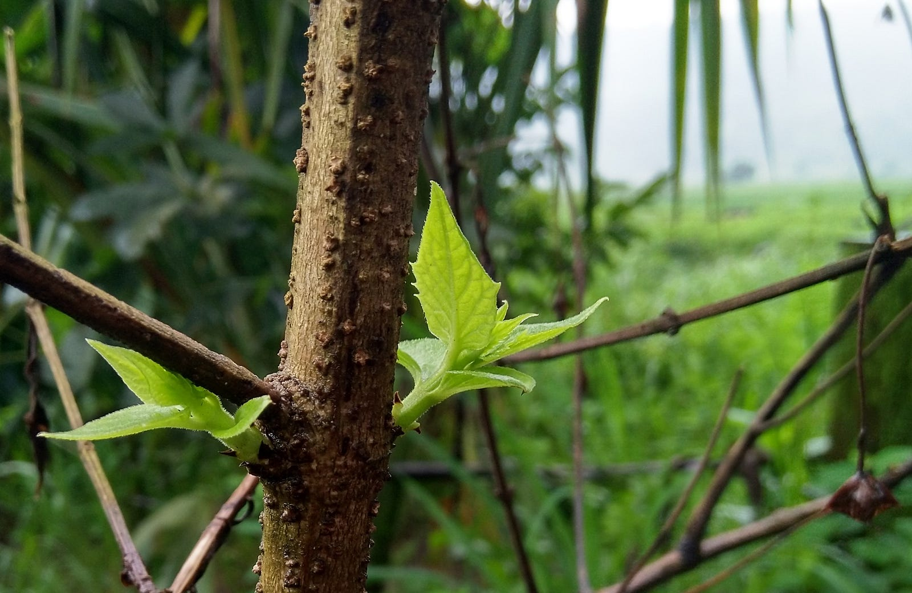

---

The beauty of every natural phenomenon is that it’s conceived in a gradual yet unsteady fashion. A butterfly emerging from a caterpillar, a sperm and egg turning first into an embryo, then an infant and then growing physically and emotionally as an individual, formation of solar systems from star dust left by stars which in turn gradually burnt out like Phoenix paving way to new life, the scent of rain sparking senses which we seem to have forgotten since an year, the warm feeling ignited by meeting family after a long seperation, the Terra formation that rains set in motion and the joy of watching it happen from a mountain top, the list is endless.

Our brain and it’s mechanisms are just an infinitesimal part of these and the ideas conceived in it are just another subset. But that need not undermine the uniqueness yet similarity of this process with everything else around us. And that’s what this article is about.

It's starts like an itch in your forehead. Triggered by something as trivial as a yellow flower dancing to the winds on a trekking trail, or a black butterfly near a pond, even a spider trying to rebuild it's web or a kid standing at the bus stop with his Father on crutches, the view from summit, man those are something else, like an omnipresent being the variety of thoughts they can trigger or silence are simply unfathomable.

And so the thought stays, somewhere in the back of your mind. Hidden, changing it's position due to the inherent chaos it carries, demanding for attention, knocking the doors of your consciousness while swimming in the deep dark depth of unknown that we call our unconscious. Stirring it with it's entropy, giving rise to huge waves, hitting the shores again only to knock the concious and demand for attention.

And still if you don't give it your piece of mind, the attention it desires, then it gets violent. Like small streams of rainwater coalescing into a rivulet and then a river. A river that's untamed, untapped, uncontrolled. Who doesn't need a way but makes it's own. Who doesn't ask for attention anymore. Rather, it carries such high level of command that it forces you stop in your track, leave whatever you're doing, be still and pay your undivided attention to it. You're not in a state to do anything but just be at its mercy. Because it waited enough and now it's furious, to be tended to.

And so you heed to it’s wishes, and the idea unravels, unfolding the vast universe it carried within it for so long, expanding to ends that your imagination can’t contain, defining new lengths of what you can perceive, adding new lenses to your perspective of life stitching more stories to your existence, turning you into a different person than what your were earlier, and through that new being it starts expressing itself outside your being, via your actions, words, presence or even absence of expressions, or just a deep exhalation that brings you peace.

Peace attained by conceiving a new idea to life.
