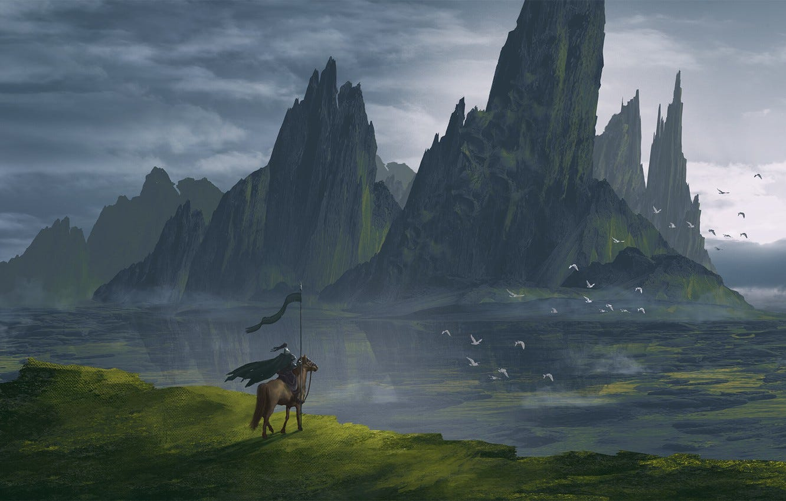
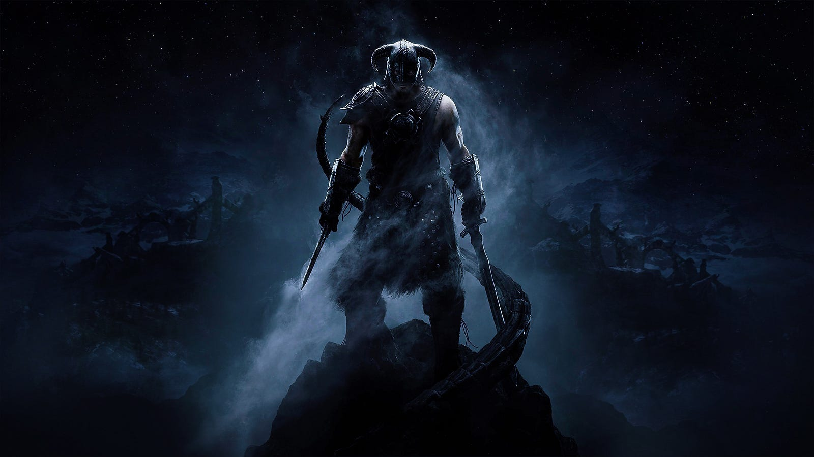

---

“In 20 years, all primates but humans will be extinct, poaching, habitat destruction, global warming”, the narrator was a Dodo bird, “Imagine if there were a tab on the activities humans did, imagine if there were no humans”, it was a gripping documentary, one summarizing the centuries long human footprint and it’s impact on Mother Earth, “This planet would have been a better place, humans just don’t fit in….”

“Hey, why do you always keep watching this stuff, it’ll get to your head. It’s 9pm, I want to watch Naruto Shippuden”, his sister snatched the remote and the Naruto track started ringing. It was dinner time and he usually listened to her. Mostly because he liked watching Naruto too, most teenagers his age did. He had to blend in…

### The dilemma

He went to the roof with his sister at bed time. The house had an open roof without any walls, the breeze from the Mountains made falling asleep relatively fluid. It was summer, no moon day to top that and with no clouds the entire village was lightened with starlight. The siblings loved the starry roof as their blankets, “Count the starts if you can’t sleep”, their parents would tell but the two would rather spend the night spotting the constellations.

“Hey Di, what do you think about the documentary today?”, “What about it?”, “They say humans are killing other species at a rate never seen by Mother Earth in ages”, “Go to sleep Norah, it was a tiring day.” Di was doing a double graduation and helping Norah with his studies do, he couldn’t ask more of her energy. But he couldn’t fall asleep either.

The starts kept twinkling. “One planet. No one owns it. A tiny blue dot wheezing through space at extreme speed and a funny path. Only bound by the gravity of the great Sun which in turn is rotating together with many others, mostly larger, star systems across Sagittarius A. Our galaxy itself is pretty but not as large as the giants like Andromeda whom we are set to collide with. What meaning and value does our existence have, what more are we than left over stardust from a far away stat who died eons earlier. We borrow, we use and we return. Every single part of ourselves is something we have inherited from stardust and yet we have the audacity to claim a price on everything we encounter? Land, Food, Water, Wood, Fossil fuels, Animals, even Humans themselves. What gives us the right to claim something which never belonged to us?” The stars were now twinkling and rotating, they were getting blurry. Or maybe it was just him imagining things. He extended his hands to stop their motion, to clear his vision. “Go to sleep Norah, you have Geometry exam tomorrow, don’t want to be…ah, idiot is snoring already!”

“Must have been a breeze for you, as always”, Kuro asked, “I am happy with the paper, if that’s what you are asking”. Geometry had been a breeze for both Norah and Kuro. They were respected by the class for their command and creativity in solving the problems. The teacher would keep testing them with out of book questions and either of them won’t keep the problem down without solving it. They were the Geometry prodigies of their school.

“You ever thought that we might have some higher purpose than solving geometry problems, getting good grades, job, mortgage, kids etc.” Norah asked. “Woah, easy tiger, where did that come from? Was yesterdays Naruto episode too strong?” “It’s just these documentaries I’ve been watching, always makes me feel we don’t really belong to this planet. That we don’t deserve Mother Earth”. “It’s not upto you to decide that right? We evolved naturally, just like all other species, we got a larger brain, found the importance of numbers and had a strong social quotient, we adapted”, “that doesn’t mean we abuse and go in a flow that’s detrimental to the one’s around us, there can be a food chain, a strength chain, alongwith harmony! Every other apex predator has a sustainable food chain, why not us?”.

Norah was talking more to himself than to Kuro. Kuro finally broke the silence, “Well, you have a point and I don’t have an answer. It’s just the way we evolved, we looked for paths that may or may not have factored in the environmental impact. We looked for solutions that just worked in that moment, for us, but what was good for us, may not be good to others”, “It’s a boomerang Kuro, all our actions will have detrimental impact on Mother Earth and then back on us”.

Kuro was tired of the discussion. “Hey, you met this new girl in the class, she’s great at Algebra they say, solves it in her head no pen and paper needed. Looks cute too, how about I introduce you to her?”, “I don’t have time for this dude. And there’s work at home. “Mortals, Norah thought, Kuro is also one of them, they keep changing the topic avoiding the gravity of the situation”. Need to go. Norah met up with his sister on way back home, they picked up some veggies along the way. “We need more protein Di”, “Would you be ok killing a hen/goat?” Di asked. Norah looked lost. His sister noticed and quietly got the chicken. “I’ll make a good meal for you, guess that Geometry preparation has choked your head, how about we call it a rest day today?”

### The pillar of vengeance

“Hey kid, don’t touch that stone, your soul will get cursed for eternity”, an old woman in her 90s was coming charging while Norah was checking our this stone he had discovered in the middle of the village. “There’s nothing called curses, it’s just a lie people tell to each other to hide their ill doings” Norah replied. At 8, he was hot headed, unorthodox and too direct for his own good. “I’ll prove it to you that this stone can’t do me anything”, and he progressed to urinate on that stone.

The old women stopped dead in her tracks. Her eyes were widened into a size of a golf ball, her skin became pale, she looked as if someone had sucked the life out of her. She sprinted towards Norah and held him by his shoulders. “Do you have any idea what you have done? This is not an ordinary stone. Beneath this stone a demon was buried, many years ago before the village was founded by your ancestors. This stone is a mark of respect to his presence and our tribute to him for not wrecking his anger on us. It’s holy. This act of yours will fire back. The village will burn to ashes, there will be rains unmatched before, the mountains will turn green and then burn after the rain passes to turn black. Nothing will survive the wrath of the demon.” “Shut it! If your demon is all so powerful I challenge him to put his all wrath on me, right here, right now, I’ll stay here until he does, let’s see what happens.”

And nothing happened. So Norah went ahead and broke a part of the pillar and still nothing happened. He got tired of waiting, so he went on a hike in nearby Mountains, overlooking the temple he liked visiting with his Grandfather. The hike was intense, about 2 hr long. By the time he started the descend the Sun had started to set. He passed though the demon stone. Again nothing happened. The old women was still there, sitting lifeless, shivering with fear of what she would be having to witness at her older age, what uncertainty this kids actions have put into the village’s destiny. “Nothing happened to me Grandma, you’re worrying for no reason, let me drop you home” and they headed back.

In the dark of the twilight, little did they notice, broken piece of the pillar was no longer visible and the pillar had moved just a few millimeters above the ground. Something was trying to surface.

### The training

“The demon will beat your scrawny ass in no time. His breath is enough to sweep you away like a kite. You won’t stand a single second against him”, the news having spread though every house in the village, Norah started receiving troll comments from every random person. “Look at this weakling, the only thing he could do to gain fame was urinate”, he’d had enough. He leaped forward to hit the person who said it and was knocked out by a blow which came out of seemingly nowhere.

He saw his sister by his bedside when he woke up. “You just have to ignore them, they will stop doing it in a few days. Those people don’t have any other better thing to do, it’s not right for you to feed their wrong behavior”.

“Sorry Di.” “Now have some food.”

What hurt him the most was not going against the blind belief of the village but being a weakling who still needed his sisters protection when he should be the one protecting her.

“I need more power, this world is cruel. They only understand the language of strength and supremacy. No one will venture ahead once they see a tank approaching them.”

And so he began, at the age of 8, to train like there was no tomorrow. He ran, he climbed hills, he lifted rocks, he pulled buckets of water from wells, he’d carry calves on his back, he’d plough the fields. He’d do anything and everything that made his body sore. And he needed a place of solace, to practice his punches, his kicks, his headbutts. “The Pillar! No one would even think of disturbing me there, they’d be scared shitless to even venture closer to their so called demon stone”. He used the pillar as a punching bag, put grass padding on all sides and hit it till his bones hurt.

And he kept repeating this, six days a week only to meditate on the seventh day. The only thing that kept him riveted to his older self, was star gazing with his sister before sleep.

### Leaving the village

Over the years, Norah turned his body into a machine. His muscles protruded like boulders from his frame. Yet, he looked light as if he could ride the wind. His eyes were sharp, always filled with distant thoughts. He made a name as a Geometry prodigy, his love for starts had a role to play.

He had given up on instilling fear in his fellow villagers. The thought of proving something to others felt inhibiting to him. “That can’t be something I can base as a central purpose of my life. It’s too shallow”, he’d concluded. And the village was intact btw, no demon wrath. The villagers soon had accepted that the demon pillar was just another prank by some old ancestor. Damn him/her!

“You’ve scored well in your exams, why not try applying for college in Pune/Mumbai? They’ll grant you a scholarship at this marks and you can do a side job to support your expenses”, Didi suggested one day. “But what about you?” She knew the question was coming. “Look, I have one more year for my masters to finish. Once done, I’ll join you too”, “I’ll wait for an year then”, “Look Norah”, her sound more stern now, “I can’t be with you always, you need to learn to fend for yourselves, there’s a different life out there in the cities. You need to acclimatize to it. I can take care of myself, learn to live by yourself too.” Norah was speechless on the thought of living away from his sister, but he knew he had to do that one day. If they have to improve their situation, he had to push the boundaries of comfort zone. “Consider it as a new life, a new beginning.”

“A new beginning? Maybe being closer to the city jerks who have a higher carbon footprint and have already turned the forests into concrete jungles” he thought. “Yeah, will do”, he replied to his sister, smiling.

He decided to pay a visit to the pillar which had helped him stay sane for the past 8 years. The one constant. The sign that he would question everything posted against him in a critical manner. The sign that he won’t blindly believe in anything. The sign of strength, of power, of protection. The pillar had been a companion to Norah, on his bad days he’d feel the pillar motivating him to reach out for more, like a guiding voice. Like a ray of hope. Like a good friend who always understood him and heard him out.

He didn’t workout today, rather only thought of meditating. He went ahead and trekked thought the Mountain ranges in the village. He had spotted places of rare flowers and decided to bring a few of their branches and plant them around the pillar, as a gesture of gratitude. The beautiful pillar had been neglected for long due to the demon myth. It deserved a kinder treatment.

“Thank you, for being there, we might not see each other for a while now but I’ll always remember you. I promise to continue my training too. Will be stronger and faster when I meet you next. Until then, stay strong and take care of these little flowers the way you took care of me.”

### The encounter

The sun had already set and Norah was bathing under the shades of twilight for one last time. He’d never noticed until now how beautiful the Mountains looked from the pillar. It was as if the Mountains were looking after the pillar or the pillar was longing to be with the Mountains, but there sure felt some connection. Over the years, Norah used to carry bits of the pillar with him on the Mountains and scatter them across to whichever place he’d venture into. It made him feel that the pillar was with him through all his journeys.

“I’ll need to head back, Di would have started getting worried by now”

All this time, he kept going back to the documentary of how humans have exploited the Mother Earth. His mind was having this turmoil of feelings that he wasn’t able to place his finger upon. He knew things weren’t right but he didn’t have any direction to focus the energy he felt building up inside.

It must have been fatigue, lack of water, the cold weather or something else, but as soon as we got up, he lost his balance, tripped over the pillar and to his surprise, the pillar who had never bulged while taking his increasingly powerful hits, crumbled under his head butt while rendering him almost unconscious.

“You have grown into a worthy vessel kid”, Norah froze. Standing in front of him was this towering frame of a beast. His muscles bulged through his armor which in turn was made of heavy metal and layers of leather. He wore a helmet the size of a bulls head with two protruding horns large than the bulls Norah had seen. He held two swords, a short one, with just a hilt and blade which seemed like a top of a spear more than a sword while the larger one glowed crimson red in the night as if burning deep from inside. His armor was almost entirely black with a dark blue cape hanging. He was mounted on a equally intimidating horse who seemed twice the size of usual horses. It was covered with an innate armor of steel and leather. The silky long hair waved across the wind flowing through the mountains. Norah was left paralyzed. He was both amazed by the beauty and strength of the two beasts in front of him and scared to death on where they appeared from.

That’s when he saw, the eyes, they gleamed red, like thirsty for blood. There was no other color in there. He knew his time was up, the Demon was real. It was in front of him, standing tall. He was going to wreck havoc on the village. “No, I need to protect Di”

“Calm down Norah!”, Norah stopped in his tracks, he was almost unable to move due to the information he was processing.

“I am here to help, to guide. I’ve been watching your growth since you were 8, you question the deepest rooted faiths, you ask what others fear to think about. People avoid talking to you because they don’t have answers. I am here to help you find your answers. Of the higher purpose you have always been seeking but neve being able to put your finger upon. Of Vasavi Shakti”

Norah was trying to calm his nerves and process what was happening. He didn’t have the guts to utter a single word to the giant in front of him. After what seemed like a humongous effort, he was able to utter what seemed like a faint cry, “Who….are…..you?”

The Knight laughed heartily. “You are still that scared little kid at your core, aren’t you?” His horse kneed to remind him that his frame was intimidating to most mortals, the Knight gathered himself.

“I’m Karna — The Knight of the Mountains but you can also call me what you always have”, the knight paused, “Kuro.”

TBC
