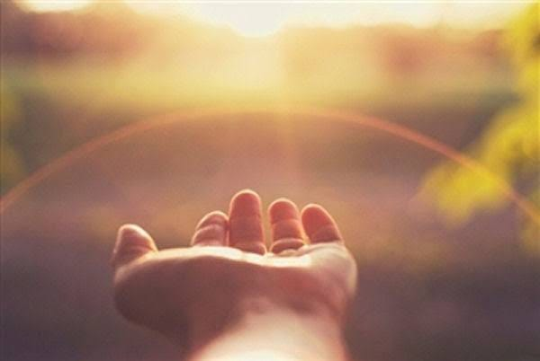

---

There are times in life when you lose the will. When moving a single muscle is a herculean task. When you question the point of doing every action. There’s nothing left to drive the next act, no motivation, no cause, no energy, no confidence, no belief, no purpose. Absolute apathy and loss of hope. What moves us then?

I’ve never been able to answer it, despite being in that situation multiple times. Sometimes I thought it was the view from summit, my drive to make a positive difference in someone’s life, the sunrise. Sometimes something as dark as the fear and pain of death, of being a nobody, of not using the gifts in any way or not discovering them at all.

But lately I’ve come to realise there are some questions we never find answers to. Like in a physics problem there’s always an unknown component that causes minor but significant change in the end result; we never really find what that component is, we uncover some part of it as we progress and learn but there’s always a portion that stays unanswered.

And that’s fine, maybe not everything needs to have an answer. **Maybe that small spark of energy that helps me get on with the day when everything seems to be falling apart need not have a label. Maybe my existence is enough for me to believe in it’s existence and significance**. I can’t have all answers and it’s fine, it’s really fine Rohan, you can still make peace with it. It’s me the spark of energy speaking, I’m here for you in your darkest times. And when you’d have nothing left around, no shield, no barriers, all your tools, beliefs, drive have fallen down and you’re sure you can’t fall down further, I’ll be there to hold you, you don’t have to know who I am.

I have a confession to make. My separation anxiety has made me drive away a lot of people from my life. I lost a good friend this year whom I’d started to think of as my sister. I drove her away despite her being absolutely patient and understanding with all my ill treatment. **Yes, I’ll never forgive myself for that but I can’t keep killing myself on my past sins. I need to let go.**

I lost another friend whom I’d started to think of a brother. He passed away doing what he loved. We shared the same belief system of doing something good for the society via the resources we have access to, however small or large they may be. And that made me realise something I keep forgetting.

> **Life’s too short and unpredictable to droll on the negatives of the past. I never know what will happen when. I can’t keep drowning myself in my insecurity and anxiety. I need to stop those thoughts and put them behind me.**

**I got to be at least as kind and forgiving to myself as I’m to others. I can’t keep searching happiness in people and things. I can’t move forward if I never forgive myself. And I know I won’t have all answers to forgive myself and that’s perfectly fine!**

Yes I’ve made mistakes, yes they’re not forgivable but I’m also human and it’s human to err. It’s human to learn and move forward. It’s human to latch on to any small ray of hope I have around and survive. Just for that instant if it be. Because life’s too precious to be drown and forgotten in past mistakes. There are people waiting to be helped. Starting with me.

I can make the world a better place only when I’m happy and able, when I forgive and move forward. It’s ok, I’m okay. It’ll all fall in place someday, if not then we will just start over. Just like we always have.
