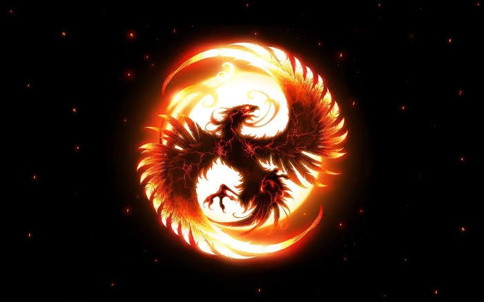

---

Phoenix, amazing birds they are, they can live, burn, die and be born again. The offspring carries forward the baton from it’s predecessors, yet, it’s independent, free, in thoughts and action. It’s a new start, yet, it’s tied to the same cycle, maybe even trapped?

I wonder if they retain the memories of their older selves. If they do, would they wear them, be them, or would they choose to discard and build something new? Or live in a middle ground?

Would they keep getting wiser with each cycle? Or just a bit more closer to peace. Would they want to continue to exit? Is there a choice? Or maybe, they’ll simply live in the moment, breathe, let things flow per their natural course and just observe and move along.

---

Martha Graham quotes “a dancer dies twice, once when they stop dancing and the first one hurts more.” When I struggle getting in the flow I can’t help but draw parallels of the quote to whatever I’m doing. “I’m not what I used to be", that thought is both scary and intriguing at the same time.

Scary because there’s a change happening. And if things are going well then changes are unwelcome. Especially when you don’t know the drivers of the change. Intriguing because it’s a chance to introspect and figure out what’s driving it. Is that quality dying? In this case it’s writing which brings the question -

**Can a writer die?**

---

I have an inherent bias against the thought of writer’s death. I believe things are mostly reversible. But I also know a set of things need to happen to reverse, which might not always be possible. What happens then?

---

Last few months have been difficult. I feel things haven’t been really flowing from writing standpoint, words seem to halt. But that’s ok, I knew I’d face this, everything has a start and end. It’s the learning, direction and legacy that we take forward. The idea is to keep moving until the flow is natural and not force the words out. The inner voice wants to be expressive. You can’t force expression, rather sit back, go silent and allow it to speak to you.

**The voice would be loud and clear when you’re ready to listen. Not fixed by anything external or material in nature. When you have a single goal in mind. Talking to yourself, for yourself as a means of expression, understanding, clarity, empathy and peace.**

---

We do change over time, we gain experiences that are unforgettable at times, that add new and lingering perspectives to our thoughts. Perspectives that at times might really help expand our extent of imagination. Also perspectives that might be unwelcome.

These will get reflected in things we think, write, say and do. In a way it’s like being reborn. Like a Phoenix offspring born from the ashes of the experiences and realisations. For better or worse, that’s not the question here. The point here rather is that there’s change happening irrespective of the what we do and don’t. And that’s perfectly natural.

This in itself should be something to look forward to every single moment. We humans have so much potential to change, not a single moment goes by when we aren’t exposed to stimuli that can spark something new. A beautiful quality to possess indeed!

---

Coming back to the title of the write up. When we write, we capture a state of mind. We capture our experiences, learnings, stimuli at that particular point in time. Going forward, we might not be the same person we were. I mean there may not be a huge change as such but if I were to write the same articles again, I might not do them the same way. I might not even get the idea to write the same ones, but maybe something else, like constellations for example! Haven’t written about those ☺

It’s ok to be afraid that at one point, I might lose out on the quality to express. It’s indeed something to be afraid of. But the larger point is there will always be the choice of being true to yourself. And that’s enough to get anything reignited. Be true to yourself for yourself and allow the voice to speak to you. It will, it always does, it would never abandon you, until you don’t abandon yourself.

A writer won’t die, there’s always rebirth, the core, the voice stays the same, the ways it expresses itself may change, it might stutter, need hand holding, some understanding, empathy, patience. But it will come back with a new perspective.

And that will be a new birth. A new form of expression. Now it’s upto you whether you embrace this new form of expression or try to revive the older form. There’s no right or wrong here. But there’s always something to learn and that happens when you walk uncharted territories with new feathers, new wings and new life.

And the older self will always stay alive long after you’re gone, in the words already written. You can always go back and meet them, consult them, learn from then, even be them.

---

Amazing birds they are indeed, Phoenix. Amazing enough to be grateful being one ☺
