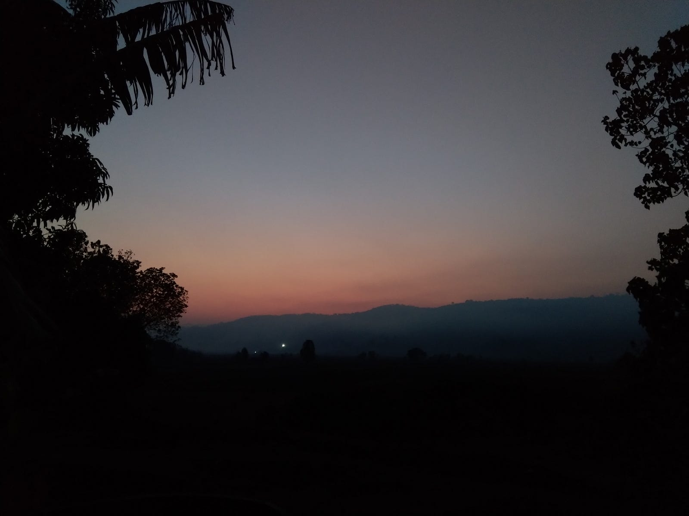

---

Twilight; it’s that time of the day which carries an air of immense mystical beauty. I’ve always been drawn to Twilight, be it dusk or dawn. And for the longest period of time, I haven’t been able to put a finger on what makes it so special.

The reason I write this is just to capture a part of what this brief moment means for me ☺

### A moment to connect

There’s a good chance that at the exact same moment while I’m watching the Sun rise or set, there’s someone on the other side of globe witnessing the opposite phenomenon. Having the same thoughts, feeling the same air and maybe even making the same notes to put them down in an article!

In that moment, two or more minds become one, all connected by the thought of witnessing and processing the precious beauty ahead of them. It shows people need not meet to have the same state of minds, they only need to watch and admire the same things. The thoughts will flow naturally.

Needless to say the connection between minds witnessing the Twilight can surpass both space and time. The air carried by the moment has the bulk of experience that everyone before and after, living across different parts of the Earth witness. In a way, it makes all the observers and admirers a single being. All that’s needed is to be open to the stimulus of the moment.

### The shift

The moment the day crosses Twilight, we witness noticable change in our perception. We have a natural inclination to close the task at hand and start a new one.

If at home, we spend time lighting lamp and praying. Or maybe looking out the window and watching the trees dance to the tune of wind while they’re either waking up or falling asleep.

Something drives us to shift gears, the day has passed and night has started or vice versa. And it’s not just us, it’s the cattle, the birds, the trees even the air!

### A moment to admire

Twilight is also when we witness the most fluid dance between the colours of red and blue. It’s almost as if Bob Ross is adding new layers of one colour on a canvas having the other colour as base, say shades of red being pained on blue canvas in increasing depth as the Sun moves. This dance is followed by either complete silence of the night or the bright energy of the day. All happening in front of us within a few minutes

### A moment of change

This time teaches us nothing is eternal. Irrespective of the position you are in, change will remain the only constant. The tides can always turn. The shades will always change. It’s upto us how we let the change impact us. We always have the choice to observe, admire and be grateful for the transition. It’s just a natural flow of things and we’re in control of how we let them affect us.

If we treat every change around us with admiration, gratitude and kindness, the same will come our way ☺

---

There’s a beautiful poem in Japanese which has Twilight as part of it’s subject, here are the translated lyrics. I’ll also link the music video. It’s a ending song in a series named “Attack on Titans(Season 3)” -

*The Earth and the Sky, why have they split so far apart…The World is cruel, yet it remains so beautiful. Those who cast stones, and those whom they strike,Between them lie fences difficult to overcome. If one of them changes stance…Justice will bear it’s fangs That which is howling within the cage. In the end, which side is it. I offered my heart to the unrestorable Twilight. At the end of a long night, where can Paradise be found. Requiem! Requiem! To the nameless flowers scattered in the night. Please rest in peace, as the dawn breaks.*

<https://youtu.be/cGBk7edLp_E>
