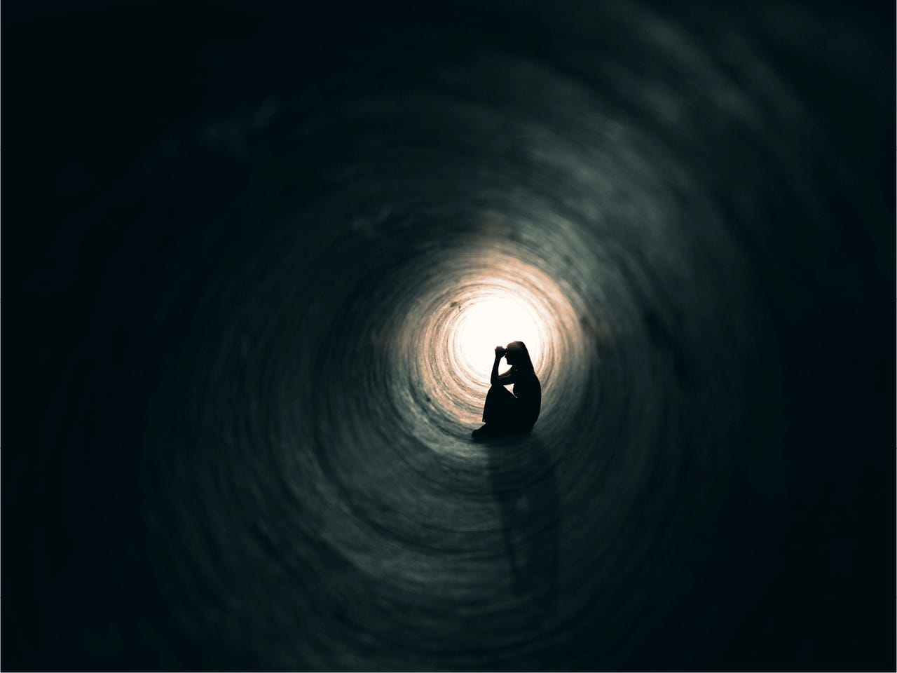

---

*Although not intentional, what I’m writing here may feel slightly saddening, reader discretion adviced.*

---

*For the longest time, the question of reason behind actions has been a brain burner. I’ll read like a man possessed, observe people, question situations, analyse instincts, write, rewrite. The moment I’d feel there are some leads, that the line is that much clear, some new piece of information will question all inferences I’ve collected.*

---

*We started as a leftover material of multiple stellar explosions. The materials of the explosion accumulating over billions of years to produce a network of biochemical reactions that define our entirety. All of it connected by a seemingly unmeasurable rules of reality, all but unknown, all but speculative, the more we question, the more our we fuel our pursuit in solving ignorance.*

*All our actions also seem dictated by our genomes, they guide our actions by rewarding or punishing us with harmones, all in accordance with how close our behaviour is to it’s programming. Mountains feel nice, maybe because they give a terrain view, a mean to find game, or evade predators. So the genome rewards the view from summit with a mixture of dopamine, serotonin or oxytocin. But is that the meaning of life? Acting as per the genome mandates us to, only to improve the propensity of propagation?*

*We’re also motivated by the want of proving our place in the society, of leaving a legacy behind. We’re social animals after all. Earning riches, buying properties, travelling places, owning precious items, religious devotion, creative expression, living as per societies expectation, growing and making a difference, getting a sense of belonging within our family, friends, people we are aquatinted with. Partially, it may be coming from our programming as social creatures. If not, all of the items above are conjured up meanings being assigned to give us a reason to exist. From a cosmic standpoint, no action we do would ever matter, our existence is all but an insignificant event is a seemingly insignificant and uneventful cornor of the universe.*

*Then what’s the meaning? How does one attain happiness, peace? What does being happy and being at peace mean anyway? Would gaining happiness not subject us to a loop of searching for more, when will the pursuit end? What does end mean anyway?*

*Maybe letting go of every pursuit ever is an answer. But how will one survive then. If you don’t conform to the society then you’ll only get crushed by it, eventually.*

*There’s no escape, or is there? What does escaping mean anyway and why would we want to escape? And why not?*

*Is the drive for survival the answer to everything? But survival is for living beings, what about the Sun? The Earth and everything else. What meaning do they have. What meaning did we have when we were part of them?*

*Why search for answers? How to search for them? What will we do after finding the answer, am I not being a slave to the pursuit of answers.*

*What’s wrong with that? What’s wrong with assigning any seemingly delusional meaning to life?*

*What is delusion and what is absolute reality?*
