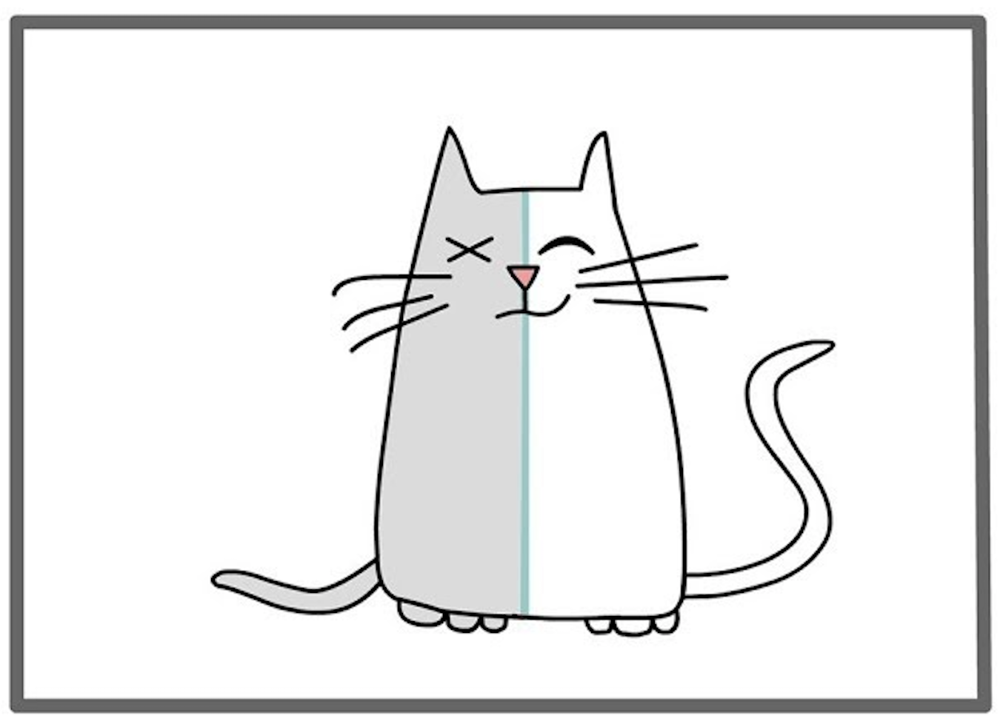

---

Do you crave order or uncertainty or both? And why?

*Sourced from Google*

The [2022 Nobel prize in Physics](https://www.nobelprize.org/prizes/physics/2022/press-release/) was an amazing leap in the field of Quantum Physics, it was awarded — “*for experiments with entangled photons, establishing the violation of Bell inequalities and pioneering quantum information science”.* I’m still finding it difficult to wrap my head around it, but to summarise — the winners solved an almost century old debate in quantum mechanics by experimentally proving that there are certain things which we just can’t explain or determine for sure, the Universe in itself is fundamentally probabilistic in nature and it might be pointless to keep digging for hidden variables to explain more physics. Try this [Sixty symbols video](https://youtu.be/tuyY2RlseBM) which has a great take on this by professionals or ref#3 which has 3Blue1Brown videos.

But why are we discussing this in the first place? What does the behaviour of quantum particles have anything to do with us? Well the day I watched this video something crossed me, the inclinations of nature to behave in a probabilistic/non-deterministic manner can actually be extrapolated in a lot more walks of life in general and for us as well. Let’s dive in!

## Earth’s story

The formation of our planet in itself has been a amalgamation of mostly probabilistic events — our nebula likely being disturbed by mostly a nearby supernova just enough to kickstart the formation of Sun which by chance also had the right mix of heavy elements like Silicon and Iron to start creating heavy planets with magnetic fields, the fact we shared orbit with Theia which later collided to create moon and enabled tides, the fact we have Jupiter and Neptune in just the right position to both prevent and enable asteroid and comet impacts, thus delivering both water and organic materials in just the right amount and frequency….well you get my point, all of this was not pre-determined but an output of chance outcomes with a sum total probability so low that we are starting to really incline on the [Rare Earth Hypothesis](https://en.wikipedia.org/wiki/Rare_Earth_hypothesis). Imagine even one outcome not working in our favour! Yet, we keep exploring for more Earth-like planets…why? Because we accept we are ignorant! There’s got to be another such event given the large sample size we have yet to unwind across the Universe!

You see, the laws of physics are indeed constraints on what may happen out there, but they give enough wiggle room for all sorts of combinations to occur! Planets around white dwarfs, moons like Titan, subsurface oceans, hell we may even have life evolving without Carbon at its centre! We can be sure of nothing unless we go out there and actually disprove any of these hypotheses, given they are not breaking the laws of Physics. And the fact that there’s so much more to uncover ends up driving more of our exploration!

> We want to be proven wrong!!

## Stoicism and uncertainty

Stoicism in itself has a deep connection to uncertainty imo, see fundamentally stoics have always proposed to focus on things we can control and not be swayed by things we can’t. Let’s take a mind walk, shall we!

When Zeno’s ship sank, what choices did he have? He lost everything and decided to invest in Stoicism rather than cursing his luck. In hindsight it seems an intuitive decision to us, but in that moment, the complex chemistry of emotions going through his mind is something we will never be able to fathom, yet, he chose to focus on the only thing he could control, his next constructive action…and Stoicism was born.

Everything we can’t fully control in life has some degree of uncertainty linked to it, our relationships, the future our kids, climate, our careers, quality of our health or even something as simple as how the dish we’re preparing will taste like! We can only influence things to so much extent!

Yet, humanity as a whole has been trying to make the world more deterministic, explaining the variance in the world, expensive services thriving on our insecurity of uncertainty — dieticians, relationship advisors, online tuitions, healthcare, vaccinations, electronics, jewellery, market advisors, election polls, media and news outlets, night clubs — each of these are designed to increase the certainty of achieving a particular outcome. I am not saying anything against these, in fact most of these have helped advance us as a species.

> All this is a classic example of exploration and exploitation, which again is fundamentally linked to our survival story

## To be or not to be

Modern humans have presence in almost every single piece of land on the Earth and it wouldn’t have been possible if not for the brave and curious bunch of explorers. Our species has always been curious, that’s what helped us be [versatile survivors](https://www.ncbi.nlm.nih.gov/pmc/articles/PMC4635443/), more so than others, powered by our relatively bigger brain to body mass ratio. For eg., around the 15th century, we see some of the most significant examples of the exploration mindset exhibited by us. In search of a route to India, the American continent was discovered, later followed by a route to India within a decade. Behind each of these successful voyages, there would have been countless losses. Yet we as a species pushed forward — why? Why did the inherent uncertainty not stop us? Well we can always blame capitalism. But I like to think of it as a select few folks motivated by their innate desire to explore and learn what lies beyond the horizon.

This exploration stage, a stage of massive uncertainty, where every single encounter was probable and voyagers could only be prepared enough for every failed voyage before them, is one of the greatest hallmarks that we humans deeply long for solving our ignorance! The failed voyages helped solve some uncertainty, but there was something new always lurking in the dark and someone new always pursuing to answer it.

And post exploration, comes exploitation, once you have the uncertain things out of the way, we as a species try reducing the variance by doing things exactly in the manner that benefits us. That act, in turn, damaging our surroundings at times, is an entirely different sad story.

## Probabilistic vs. Deterministic

There are instances in life where we need certainty to exist, this could be ensuring our families well being, health or financial, our career track, our relationships…but there’s only so much we can be deterministic about. There will always be unexplainable circumstances which are almost entirely out of our hands. And if things go south, it’s important to work on things we can control, not the ones we can think we determine. And most of the time, the only thing we can control is what and how we react in the current instant, which for all we know is enough.

I feel there’s peace in embracing a probabilistic outlook to certain things in life. That makes us more present, because every new instant is an opportunity to rediscover and challenge what we know, not discounting the fact that established facts which have a proven track record of working constructively need not be rediscovered (vaccines for example!). Else we as a species or as individuals won’t be able to move ahead.

It’s about identifying and finding the right balance on what aspects of life we want to keep probabilistic vs. deterministic. And the best part is, the answer is a multivariate sum total of all different experiences we have in life over time, it can keep evolving with us, growing us into what we are…

…like Carl Sagan says — just a way of Cosmos to understand itself!!

**References -**

1. [Press release: The Nobel Prize in Physics 2022](https://www.nobelprize.org/prizes/physics/2022/press-release/)
2. [Quantum Entanglement and the 2022 Nobel Prize in Physics — Sixty Symbols](https://youtu.be/tuyY2RlseBM)
3. [Bell’s Theorem: The Quantum Venn Diagram Paradox](https://youtu.be/zcqZHYo7ONs) and [Some light quantum mechanics (with minutephysics)](https://youtu.be/MzRCDLre1b4) — 3Blue1Brown
4. [The Birth of the Solar System](https://youtu.be/d-z0eQOEzkE)
5. [Rare Earth hypothesis](https://en.wikipedia.org/wiki/Rare_Earth_hypothesis)
6. [Stoicism — Aperture](https://youtu.be/EFkyxzJtiv4)
7. [The psychology and neuroscience of curiosity](https://www.ncbi.nlm.nih.gov/pmc/articles/PMC4635443/)
